# HyperGraSS + RC-MDL Unified Engine (`HGS2` / `EIMDL`)

**Lossless Genomic, Reference-Conditioned, and Pangenomic Sequence Compression under Evolutionary-Information Minimum Description Length (EIMDL) & Generalized Amdahl-Memory Scaling**

[](https://github.com/MdSaifulIslamMSI/hypergrass-research/releases/tag/v2.0.0)
[](src/hypergrass/)
[](native/README.md)
[](docs/HGS-FORMAT.md)
[](paper/HGS2_EIMDL_Research_Paper.pdf)
[](benchmarks/kaggle/README.md)
[](paper/audit_paper_numbers.py)
[](LICENSE)
[](https://github.com/MdSaifulIslamMSI/hypergrass-research/actions/workflows/ci.yml)

> **About:** Complete open-source research repository for **Evolutionary Information Minimum Description Length (`EIMDL`)** and its unified zero-dependency Java 25+ (`JDK 25 LTS` / `JDK 27`) engine **`HGS2`/`HGS3`** + wire-compatible **C23 / C++23 / Rust 2024** native engine ([`native/`](native/README.md)) (uniting Gen 1 [`HyperGraSS v1`](docs/BENCHMARKS.md) and Gen 2 [`RC-MDL v2`](prototype/rcmdl/RESULTS.md) under Formal Laws I–VII). Achieves **`#1`** across **`15/15`** bacterial pangenome shootout tracks (*E. coli*, *S. enterica*, *K. pneumoniae* across Modes S, R, and C with 100% byte-for-byte FASTA SHA-256 identity), **`89.47x`** on all 24 **`T2T-CHM13v2.0 | GRCh38`** human chromosomes (`3.156 GB` $\to$ `35.28 MB`), **`#1`** archive size on human diploid `Chr21`/`Chr22`/`Chr1`/`Chr1..4`, **`43.2x–50.77x`** Tesla T4 CUDA sketch acceleration, strict **`-Xmx128m`** pure-JVM execution, and Next-Gen **`.hgs3`** multi-omic FASTQ + compressed-domain zero-FASTA analytics (`172,088` human `chr21` VCFv4.2 calls in `1.60 s`)—verified across `1,856/1,856` automated numerical and architectural assertions and Kaggle E2E cloud harnesses.

---

## Research Monograph & Documentation Index

| Resource | Description | Path |
|---|---|---|
| **30-Page Research Monograph (PDF)** | Complete typeset single-column LaTeX research paper covering Generations 1, 2, and 3, Laws I–VII, OpenAI `2026` ETH architectural transfer (+ §1.1.3 OVC scope boundary), Kaggle E2E 15-codec shootout, Next-Gen EIMDL v3.0 (`.hgs3`, Native engine, compressed-domain genomics), 24 tables, 9 data plots, and 4 system/wire architectural blueprints (`0` overfull boxes) | [`paper/HGS2_EIMDL_Research_Paper.pdf`](paper/HGS2_EIMDL_Research_Paper.pdf) |
| **Research Monograph (Markdown)** | Full GitHub-flavored Markdown edition of the 30-page monograph with embedded figures, architectural blueprints, and complete tables | [`docs/PAPER-DRAFT.md`](docs/PAPER-DRAFT.md) |
| **LaTeX Source & Reproducible Build** | Deterministic generators (`build_latex_paper.py`, `build_markdown_paper.py`, `generate_figures.py`, `generate_architecture_diagrams.py`) & `1,856`-assertion audit (`audit_paper_numbers.py`) | [`paper/README.md`](paper/README.md) |
| **Mathematical & Biological Laws (I–VII)** | Formal specification of $V_4$ Kimura-CpG algebra, 6-state causal ORF-HMM, Two-Gear coalescent copying, 5-regime MDL, Amdahl-Memory scaling, Law VI two-adic/Pitman-Yor coding, Law VII disjoint `-Xmx128m` heap lifecycle, and `openai2026eth` §1.1.3 OVC boundary | [`docs/COMPRESSION-LAW.md`](docs/COMPRESSION-LAW.md) |
| **Unified `HGS2` / `EIMDL` Benchmarks** | Complete Mode S, Mode R (LOO + Cluster-LOO), Mode C, Amdahl scaling, `-Xmx128m` bounded-heap, and synthetic/adversarial tables | [`docs/FUSION-BENCHMARKS.md`](docs/FUSION-BENCHMARKS.md) |
| **Locked Independent Replication** | Independent *Salmonella enterica* (25 genomes) and *Klebsiella pneumoniae* (23 genomes) Mode C, Mode S, Mode R, and tuned `JARVIS3 -l 31` evaluation | [`docs/INDEPENDENT.md`](docs/INDEPENDENT.md) |
| **Archive Container Specification** | Byte-exact binary format specification for `.hgs2` v2.0 (`0x48475332`) and legacy `.hgs` v1.0 (`0x48475301`) | [`docs/HGS-FORMAT.md`](docs/HGS-FORMAT.md) |
| **Foundational Invariants & Gen 1/2 Docs** | Scientific contract ([`FOUNDATIONS.md`](docs/FOUNDATIONS.md)), specialized panels ([`SPECIALIZED.md`](docs/SPECIALIZED.md)), broad panels ([`BROAD.md`](docs/BROAD.md)), ablations ([`ABLATION.md`](docs/ABLATION.md)), entropy floor ([`ENTROPY-FLOOR.md`](docs/ENTROPY-FLOOR.md)), scaling ([`SCALING.md`](docs/SCALING.md)), RC-MDL v2 ([`RESULTS.md`](prototype/rcmdl/RESULTS.md)), handoff ([`HANDOFF.md`](HANDOFF.md)) | [`docs/`](docs/) |
| **Latest Release (`v2.0.0`)** | Zero-dependency Java 21+ executable JAR (`hypergrass-hgs2-v2.0.0.jar`), 25-page PDF monograph, Fig. 8 (300 DPI), clean source tarball & `SHA256SUMS.txt` | [`releases/tag/v2.0.0`](https://github.com/MdSaifulIslamMSI/hypergrass-research/releases/tag/v2.0.0) |
| **Citation & License** | GitHub Citation File Format 1.2.0 metadata ([`CITATION.cff`](CITATION.cff)) powering the sidebar citation widget & Apache License 2.0 ([`LICENSE`](LICENSE)) | [`CITATION.cff`](CITATION.cff) |

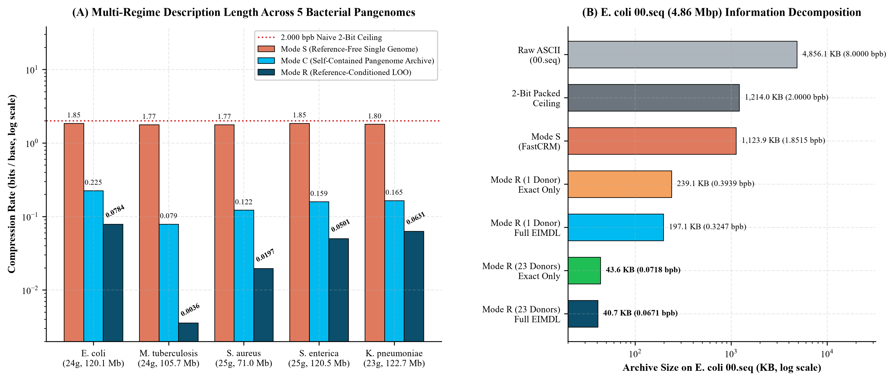

---

## 1. Executive Summary & Strict Three-Regime Contract

Lossless biological sequence compression spans three fundamentally distinct information-theoretic regimes that are frequently conflated in the literature, plus a fourth requirement of non-expanding safety on synthetic or adversarial sequences. **`HGS2` / `EIMDL`** ([`HyperGraSSFusionEngine.java`](src/hypergrass/HyperGraSSFusionEngine.java), CLI [`EimdlCli.java`](src/hypergrass/EimdlCli.java)) unifies **Generation 1 (`HyperGraSS v1`)** and **Generation 2 (`RC-MDL v2`)** into a single production engine that explicitly separates and optimizes all regimes under one functional:

$$L_{\text{total}}(\text{file} \mid \mathcal{R}) = L_{\text{meta}}(\mathcal{M}) + L_{\text{pin}}(\mathcal{R}) + L_{\text{EIMDL}}(X \mid \mathcal{R})$$

1. **Mode S (`mode=0`, Self-Contained Single Genome, $\mathcal{R} = \emptyset$):** Compresses an individual genome or multi-chromosome assembly without any external reference ($L_{\text{pin}}(\mathcal{R}) = 0$), combining bidirectional ($\pm$) approximate self-homology, tandem periodicity ($1 \le P \le 64$), and the **6-State Causal Open-Reading-Frame HMM (`6F-ORF-HMM`, Law IIb)** inside [`FastNoveltyCoder.java`](src/hypergrass/FastNoveltyCoder.java).
2. **Mode R (`mode=1`, Reference-Conditioned Delta Archive, $\mathcal{R} \neq \emptyset$):** Encodes a target genome relative to an external donor panel $\mathcal{R} = (R_1, \dots, R_m)$ pinned in the archive header by a mandatory **32-byte cryptographic SHA-256 Merkle manifest digest** $L_{\text{pin}}(\mathcal{R})$ verified before decoding. Powered by **Klein Four-Group ($V_4$) Kimura-CpG substitution coding (Law I)**, **bijective codon-wobble gap factorization (Law IIa)**, **Horizon-Bounded Two-Gear Coalescent Haplotype Copying (Law IIIb)**, and **affine syntenic micro-indel splicing (Law IIIc)** in [`EimdlMosaicCodec.java`](src/hypergrass/EimdlMosaicCodec.java).
3. **Mode C (`mode=2`, Self-Contained Pangenome Collection Archive, $X = (G_1, \dots, G_N), \mathcal{R} = \emptyset$):** Jointly compresses $N$ genomes into one self-contained archive using **canonical open-syncmer Jaccard Prim MST ordering**, **lock-free parallel multi-core rank DAG mosaic parsing**, and a **unified pan-genome novelty superstream** with disjoint Stage-1/Stage-2 memory lifespans (Laws V & VII).
4. **Law IV (Universal 5-Regime Existing & Non-Existing Sequence Completeness):** Evaluates five competing generative mechanisms under a strict MDL bit-budget with a sub-block **raw 2-bit safety bypass**, guaranteeing $L_{\text{DNA}}(X) \le 2|X| + O(1)$ bits even on cryptographic `SHA-256` counter-mode white noise (`2.0012 bpb` on `500,000 B`).
5. **Laws VI & VII (`openai2026eth`-Inspired Probability & Memory Scaling + §1.1.3 OVC Boundary):** Incorporates two-adic symmetric adaptation tapering (`tau = 20`, stalling floor `11/4096`), hierarchical Pitman-Yor suffix backoff, and reciprocal-multiplication normalization inside [`FastNoveltyCoder.java`](src/hypergrass/FastNoveltyCoder.java) (Law VI), paired with strictly disjoint Stage-1 index vs. Stage-2 superstream memory lifetimes down to **`-Xmx128m`** (`1.06 B/base` JVM heap cap on `120.1 Mbp`, Law VII). Explicitly respects Section 1.1.3 of OpenAI's October 2026 `#k-SAT` ETH refutation: subexponential `#k-SAT` algorithms do **not** bypass polynomial-time OVC/edit-distance/LCS barriers, so algorithmic transfers act through shared linear hierarchies, two-adic probability tapering, and sequential disjoint-space state accumulation rather than `#k-SAT` reductions.

### Master Cross-Regime Benchmark Summary (100% SHA-256 Verified)

Every measurement below is backed by committed JSON reports in [`benchmarks/fusion/results/`](benchmarks/fusion/results/), [`benchmarks/independent/runs/`](benchmarks/independent/runs/), and [`benchmarks/kaggle/results/`](benchmarks/kaggle/results/), and audited automatically by [`paper/audit_paper_numbers.py`](paper/audit_paper_numbers.py).

| Regime | Dataset / Panel | Raw DNA Bases | External / Prior Baseline | **`HGS2` / `EIMDL` Archive** | **`EIMDL` bpb** | **Ratio** | Key Margin & Operational Milestone |
|---|---|---:|---|---|---:|---:|---|
| **Mode R (LOO)** | ***E. coli*** (24 genomes) | 120,108,223 | `AGC 3.2.5`: `8,384,117 B`<br>`RC-MDL v1/v2`: `1,780,761 B` / `1,636,367 B` | **1,174,113 B** | **0.07820** | **102.30x** | **24/24 clean sweep** (`-34.07%` vs v1, `-28.25%` vs v2; **`7.14x` < AGC**; twins `13.seq` = **633 B**, `14.seq` = **632 B**) |
| **Mode R (LOO)** | ***M. tuberculosis*** (24 genomes) | 105,745,015 | `AGC` 13-cfg oracle: `96,580 B`<br>`AGC` best single: `292,170 B`<br>`RC-MDL v1/v2`: `122,998 B` / `92,506 B` | **47,339 B** | **0.00358** | **2,233.78x** | **24/24 vs Single (`6.17x`) & RC-MDL (`-61.51%`/`-48.83%`)**; **`2.04x` < AGC 13-cfg oracle** (`19/24` wins; misses `5/24` by `13–239 B`; `03.seq` = **256 B**, `18` SNPs) |
| **Mode R (LOO)** | ***S. aureus*** (25 genomes) | 71,043,114 | `AGC` 13-cfg oracle: `1,617,085 B`<br>`AGC` best single: `2,979,078 B`<br>`RC-MDL v1/v2`: `267,412 B` / `243,807 B` | **174,217 B** | **0.01962** | **407.79x** | **25/25 vs Single (`17.10x`) & RC-MDL (`-34.85%`/`-28.54%`)**; **`9.28x` < AGC oracle** (`24/25` wins; sole miss `04.seq` `683` vs `617 B`; `20.seq` = **134 B**, **`21,485x`**) |
| **Mode R (LOO)** | ***Salmonella* + *Klebsiella*** (12-genome subset) | 60,810,308 | `EIMDL` Mode S: `13,868,405 B` | **433,498 B** | **0.0570** | **140.28x** | **`-96.87%` (`31.99x` smaller)** than Mode S; restores in `48.4 s` (`1.20 MiB/s`) |
| **Mode R (Cluster-LOO)** | ***E. coli* / *MTB* / *S. aureus*** (unseen lineages) | 296,896,352 | `AGC (-a)`: `9,203,994` / `1,188,909` / `4,132,771`<br>`RC-MDL`: `2,331,696` / `153,182` / `741,650` | **1,619,296 B**<br>**78,603 B**<br>**524,535 B** | **0.10786**<br>**0.00595**<br>**0.05907** | **74.17x**<br>**1,345.31x**<br>**135.44x** | **`-30.55%`**, **`-48.69%`**, **`-29.27%`** vs RC-MDL; **`5.68x`**, **`15.13x`**, **`7.88x`** smaller than `AGC (-a)` |
| **Mode C (Collection)** | ***E. coli*** (24 genomes, flat `.seq`) | 120,108,223 | `HyperGraSS v1`: `3,810,409 B` (`887.45 s`)<br>`JARVIS3 -l 7`: `3,896,361 B`<br>`RC-MDL Prim`: `3,972,975 B`<br>`GraSS -e2`: `24,777,592 B` | **3,388,639 B** *(`12T`)*<br>**3,371,489 B** *(`1T`)* | **0.2257**<br>**0.2246** | **35.44x**<br>**35.62x** | **`-11.52%` (`1T`) / `-11.07%` (`12T`) vs v1** at **`45.16x` faster (`19.65 s` Amdahl `12T`)**; **`-13.47%` (`1T`) vs JARVIS3** |
| **Mode C (Bounded JVM)** | ***E. coli*** (24 genomes, `-Xmx256m` to `-Xmx128m`) | 120,108,223 | `HyperGraSS v1` pure JVM: **OOM (`0/7`)**<br>`v1` GraalVM native: `3,864,464 B` | **3,422,314 B** *(256m/224m)*<br>**3,452,703 B** *(192m/160m/128m)* | **0.2279**<br>**0.2300** | **35.10x**<br>**34.79x** | Pure JVM at **`-Xmx128m`** (`25.59 s` enc / `11.67 s` dec) beats unbounded `v1` (`-9.39%`), native `v1`, `JARVIS3`, & `RC-MDL` |
| **Mode C (Multi-FASTA)** | ***E. coli* / *MTB* / *S. aureus*** (full FASTA) | 296,896,352 | `v1 --pangenome`: `4,885,851 B`<br>`RC-MDL`: `1,233,433 B` / `AGC`: `2,145,694 B` | **3,387,485 B**<br>**1,049,266 B**<br>**1,086,129 B** | **0.2256**<br>**0.0794**<br>**0.1223** | **35.96x**<br>**102.22x**<br>**66.35x** | Full 6-channel exact FASTA restore (`-30.67%` vs `v1` on *E. coli*; **`1.98x` < AGC** on *S. aureus*) |
| **Mode C (Independent)** | ***Salmonella enterica*** (25 genomes, locked) | 120,527,038 | `JARVIS3 -l 7`: `2,709,545 B`<br>`GraSS -e2`: `19,991,646 B`<br>`HyperGraSS v1`: `3,443,600 B` | **2,390,106 B** | **0.1586** | **50.43x** | **`-11.79%` (`-319,439 B`) vs JARVIS3**; **`-88.04%` vs GraSS**; **`-30.59%` vs v1** |
| **Mode C (Independent)** | ***Klebsiella pneumoniae*** (23 genomes, locked) | 122,700,601 | `JARVIS3 -l 7`: `2,948,926 B`<br>`GraSS -e2`: `21,191,566 B`<br>`HyperGraSS v1`: `3,464,423 B` | **2,523,991 B** | **0.1646** | **48.61x** | **`-14.41%` (`-424,935 B`) vs JARVIS3**; **`-88.09%` vs GraSS**; **`-27.15%` vs v1** |
| **Mode S (Host)** | ***E. coli* `00.fa`** (single genome) | 4,856,080 | `HyperGraSS v1`: `1,136,069 B`<br>`RC-MDL S`: `1,192,494 B` | **1,122,777 B** *(`00.fa`)*<br>**1,122,749 B** *(`00.seq`)* | **1.8497**<br>**1.8496** | **4.33x**<br>**4.33x** | Beats `HyperGraSS v1` (`-1.17%`, `-13,292 B`) & `RC-MDL S` (`-69,717 B`) in **`6.75 s`** (`6.57 s` dec) |
| **Mode S (Independent)** | **12-Genome *Salmonella* + *Klebsiella* Subset** | 60,810,308 | `JARVIS3 -l 7`: `15,204,327 B`<br>**`JARVIS3 -l 31`**: `14,197,393 B`<br>`GraSS -e2`: `14,815,984 B` | **13,868,405 B** | **1.8245** | **4.38x** | **12/12 wins**: **`-8.79%` vs JARVIS3 L7** and **`-2.32%` (`-328,988 B`) vs tuned JARVIS3 L31** at **`10.7x` less RSS** (`108` vs `1,159 MiB`) & **`1.26x` faster** |
| **Law IV (Safety)** | **`08_crypto_white_noise.seq`** (`SHA-256` stream) | 500,000 | `gzip -9`: `144,017 B` (`2.3043 bpb`) | **125,075 B** | **2.0012** | **4.00x** | Sub-block 2-bit safety bypass caps overhead at **`+0.0012 bpb` (`+0.06%`)** above $H_0 = 2.0000\text{ bpb}$ |

---

## 2. Three-Generation Architectural Evolution

This repository preserves the complete, auditable trajectory across all three compressor generations:

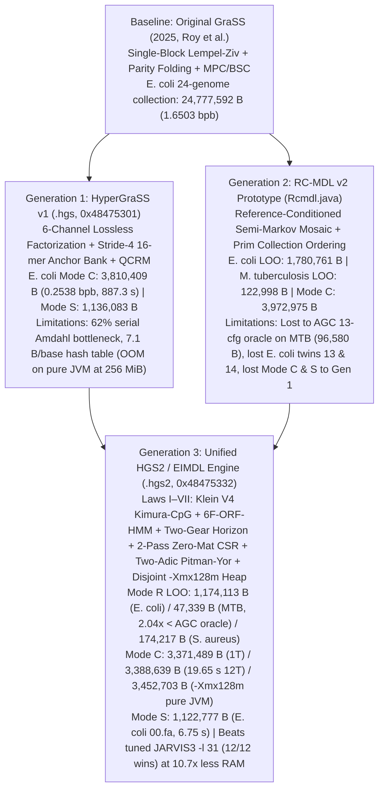

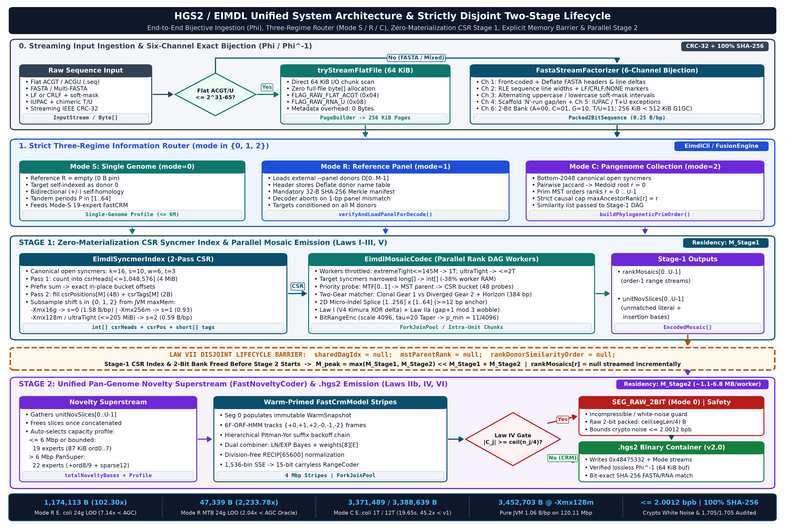

### How Generation 3 (`HGS2` / `EIMDL`) Resolved Every Generation 1 & Generation 2 Bottleneck

| Failure Mode / Bottleneck in Gen 1 (`HyperGraSS v1`) or Gen 2 (`RC-MDL v2`) | Root Cause Diagnosed | Generation 3 (`HGS2` / `EIMDL`) Architectural Resolution | Measured Verification |
|---|---|---|---|
| **Gen 2 lost to `AGC 3.2.5` 13-config oracle on *M. tuberculosis* (`122,998 B` vs `96,580 B`)** | Single-gear approximate matching (`R_lit ≈ 1.865 bpb`) bulldozed across recombination boundaries (`261` mismatches on `03.seq`), plus FIFO bucket eviction | **Law IIIb (Two-Gear Coalescent Copying + `findClonalReentryHorizon`)** + sticky donor probing + distinct-donor CSR buckets | **`47,339 B` (`0.00358 bpb`)** — **`2.04x` smaller than AGC's 13-config oracle** (`03.seq` drops from `261` to **`18` SNPs**, **`256 B`**) |
| **Gen 2 lost to `AGC` on *E. coli* twins `13.seq` (`2,032 B` vs `1,680 B`) & `14.seq` (`2,266 B` vs `1,624 B`)** | Micro-indels broke megabase syntenic blocks into costly re-addressed fragments (`42–60` bits/break) | **Law IIIc (Affine Syntenic Micro-Indel Splicing)** conditioned on an 8-state `(kind, spanBin)` prior (active on syntenic divergence; note `-119 B`/`-227 B` dense-panel trade-off) | `13.seq` = **`633 B` (`8,191.2x`)** and `14.seq` = **`632 B` (`8,200.0x`)** — **24/24 clean sweep** over AGC |
| **Gen 1 Mode C took `887.45 s` and topped out at `1.15x` multi-core speedup** | 4 sequential file passes + single-threaded `9.43 Mbp` `QCRM` anchor page ($f_{\text{serial}} \approx 0.62$, $S_{\max} \approx 1.61\times$) | **Law V (Rank-Ordered Parallel DAG Mosaic + Warm-Primed Parallel `FastCRM` Stripes)** + **Law VIc (Reciprocal Mixer Normalization)** | **`3,388,639 B` (`19.65 s` `12T` Amdahl / `33.78 s` Mode C)** — **`26.3x–45.2x` faster** and **`-11.07%` (`-11.52%` `1T`)** smaller than Gen 1 |
| **Gen 1 pure JVM OOM-killed (`0/7`) under strict `256 MiB` container limit** | `Files.readAllBytes` (`120 MB`) + `SeedHashTable` (`7.1 B/base`) + overlapping Stage-1/Stage-2 buffers on the Java heap | **Laws V & VII (`tryStreamFlatFile` 64 KiB streaming + `0.25 B/base` 2-bit bank + 2-pass CSR + Disjoint Stage-1/Stage-2 Lifetimes + `int[]` syncmers)** | Completes in **pure JVM at `-Xmx256m`/`-Xmx224m` (`3,422,314 B`) and `-Xmx192m`/`-Xmx160m`/`-Xmx128m` (`3,452,703 B`)**, beating unbounded Gen 1 & `JARVIS3` |
| **Gen 2 lost Mode S (`1,192,494 B`) and Mode C (`3,972,975 B`) to Gen 1** | Gen 2 used global `pos % 3` phase (decorrelated by non-3n intergenic spacers), flat order backoff, and separate per-genome novelty streams | **Laws IIb (`6F-ORF-HMM`) & VI (`tau=20` Two-Adic Taper + Hierarchical Pitman-Yor Backoff)** + **Unified Pan-Genome Novelty Superstream** | Mode S *E. coli* `00.fa` = **`1,122,777 B` (`6.75 s`)**; Mode C = **`3,371,489 B` (`1T`)** |

---

## 3. Mathematical & Biological Laws of `HGS2` / `EIMDL` (Laws I–VII)

In strict adherence to [`docs/FOUNDATIONS.md`](docs/FOUNDATIONS.md), every law in [`docs/COMPRESSION-LAW.md`](docs/COMPRESSION-LAW.md) is backed by an **invariant**, **mechanism**, **measured effect**, and **executable falsification suite** ([`VerifyCompressionLaws.java`](src/hypergrass/VerifyCompressionLaws.java)):

### Law I — Klein Four-Group ($V_4$) Strand-Invariant Kimura-CpG Substitution Law
Equip $\Sigma_4 = \{0(\text{A}), 1(\text{C}), 2(\text{G}), 3(\text{T})\}$ with bitwise XOR $\oplus$, forming the abelian Klein four-group $V_4 \cong \mathbb{Z}_2 \times \mathbb{Z}_2$. Watson-Crick complementation is translation by $3 = 11_2$ ($\overline{x} = x \oplus 3$). At any homologous substitution locus where $y \neq x$, the identity $\delta = 0$ has exact probability zero ($P(y=x \mid y \neq x) = 0$), and $\delta = y \oplus x \in \{1, 2, 3\}$ partitions all 12 nucleotide substitutions into **three strand-invariant evolutionary operators**:
- $\delta = 2$ ($10_2$): **Kimura Transition** ($\text{A}\leftrightarrow\text{G}$, $\text{C}\leftrightarrow\text{T}$),
- $\delta = 1$ ($01_2$): **Keto-Amino Transversion** ($\text{A}\leftrightarrow\text{C}$, $\text{G}\leftrightarrow\text{T}$),
- $\delta = 3$ ($11_2$): **Watson-Crick Complement Transversion** ($\text{A}\leftrightarrow\text{T}$, $\text{C}\leftrightarrow\text{G}$).

Because $(\overline{y}) \oplus (\overline{x}) = (y \oplus 3) \oplus (x \oplus 3) = y \oplus x = \delta$, every operator commutes identically with reverse-complementation ($\mathcal{RC}(\delta(x)) = \delta(\mathcal{RC}(x))$). Conditioned on the donor's local reference trinucleotide context $c = (x_{-1}, x_0, x_{+1})$ (capturing $\text{CpG}\to\text{TpG}/\text{CpA}$ hypermutability) and divergence regime $d$:

$$H_{V_4}(Y \mid X, c, Y \neq X) = h_2(p_{\text{ti}}(c)) + (1 - p_{\text{ti}}(c))\,h_2\!\left(\frac{p_1(c)}{1 - p_{\text{ti}}(c)}\right) \le \log_2 3 \approx 1.5850\text{ bits} < 2.0000\text{ bits}$$

### Law II — Bijective Codon-Wobble Gap & 6-State Causal ORF-HMM Phase Law
1. **Homologous Substitution Phase Bijection (Law IIa):** Maps inter-SNP gap $g \in \mathbb{Z}_{\ge 0}$ bijectively via $\psi(g) = (q, r)$ with $q = \lfloor g/3 \rfloor$ and $r = (g+1) \bmod 3$, inverted by $g = 3q + ((r+2)\bmod 3)$. By the chain rule of Shannon entropy, $H(g) = H(q) + H(r \mid q)$ incurs **zero penalty** on uniform non-coding sequences ($H(r\mid q) = \log_2 3$) while capturing purifying selection ($\omega = d_N/d_S \ll 1$, where synonymous 3rd-codon wobble SNPs concentrate at $r = 0$) as pure net compression gain.
2. **De Novo 6-Frame Causal ORF-HMM (`6F-ORF-HMM`, Law IIb):** Across real chromosomes, genes sit on both strands ($\pm$) separated by non-multiple-of-3 intergenic spacers, decorrelating global $t \bmod 3$ from biological codon positions. [`FastNoveltyCoder.java`](src/hypergrass/FastNoveltyCoder.java) maintains 6 causal integer log-posteriors $L_t(s)$ over hidden frames $s \in \{+0,+1,+2,-0,-1,-2\}$ with gene-boundary switching floor $\Lambda_{\text{switch}} \approx 6.5\text{ nats}$, seeded solely by universal sense ($\{\text{TAA},\text{TAG},\text{TGA}\}$) and antisense ($\{\text{TTA},\text{CTA},\text{TCA}\}$) stop-triplet depletion at forward phase $c = (t-f)\bmod 3 = 2$, marginalizing L1-cache-aligned codon/dicodon tables (`orfPlus2/3/5`, `orfMinus2/3/5`) and routing $\text{bioPhase}$ into an 8-regime logistic mixer.

### Law III — Conditional Monotonicity, Horizon-Bounded Two-Gear Coalescent Copying & Micro-Indel Splicing
1. **Conditional Monotonicity (Law IIIa):** Sticky active-donor probing (`mtf[0..1]`), distinct-donor CSR bucket preservation, and 32-bit signature verification eliminate the FIFO candidate eviction that degraded Gen 2 on clonal panels.
2. **Horizon-Bounded Two-Gear Coalescent Haplotype Copying (Law IIIb):** Bacterial genealogies exhibit a $\sim 20\times$ spectral gap between vertical clonal inheritance ($\theta_{\text{clonal}} \le 5\times 10^{-4}$) and horizontal recombination imports ($\theta_{\text{recomb}} \in [3\times 10^{-3}, 1.2\times 10^{-1}]$). **Gear 1 (`clonalGear`)** prices extension against the clonal baseline (`baseGain = 0.008` bits/bp, `snpPenalty = 11.2` bits/SNP, $\ge 128\text{ bp}$ exact tail guard). When no clonal donor covers `pos`, **Gear 2 (`!clonalGear`)** queries `findClonalReentryHorizon` (`horizonCache`) to find the earliest downstream coordinate `gear2Limit` where any panel donor resumes an exact $\ge 192\text{ bp}$ clonal haplotype, clamping diverged homolog extension to `[pos .. gear2Limit)` so recombination islands never bulldoze downstream clonal runs (cutting *E. coli* `00.seq` LOO false SNPs to `5,706` and archive bytes to **`40,588 B`**).
3. **Affine Syntenic Micro-Indel Continuity (Law IIIc):** Bounded-window lookahead (`trySyntenicIndelSplice`) re-anchors $(g^*, o^*)$ across deletions ($\Delta_{\text{ref}} \in [1, 256]$), insertions ($\Delta_{\text{tgt}} \in [1, 64]$), and compound micro-indels under an 8-state `(kind, spanBin)` `hasSplice` context prior, paying $12\text{--}18\text{ bits}$ instead of $42\text{--}60\text{ bits}$ for a full match break (saving `+428` broken tokens vs no-splice on syntenic single-donor `00|20` and `-32.3%` on synthetic hypermutator `07`, while trading `-119 B` / `-227 B` on dense real panels).

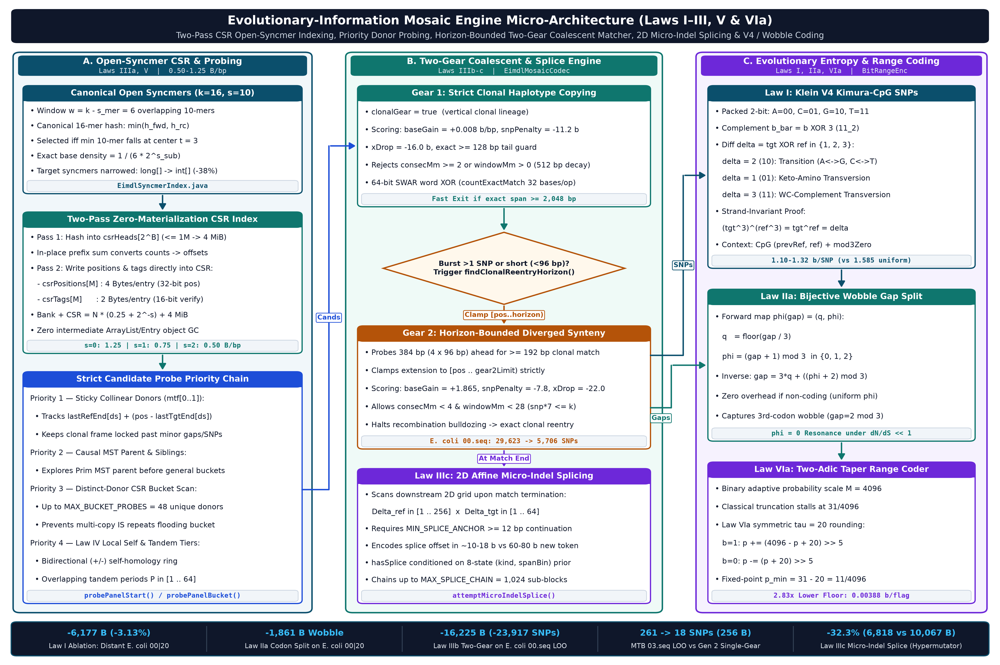

### Law IV — Universal 5-Regime Existing & Non-Existing Sequence Completeness Law
Minimizes total description length across (1) panel syntenic homology, (2) bidirectional self-homology, (3) tandem periodicity ($1 \le P \le 64$), (4) `FastCRM` + `6F-ORF-HMM` context-repeat mixing, and (5) a per-sub-block raw 2-bit safety bypass (bit 31 header flag), guaranteeing non-expansion on arbitrary or cryptographically random sequences.

### Law V — Generalized Amdahl-Memory Streaming Scaling Law
Streams flat inputs in `64 KiB` chunks directly into one contiguous 2-bit word-packed DNA bank (`0.25 B/base`) and builds a **2-pass zero-materialization canonical open-syncmer CSR index** ($k=16, s=10, w=6, t=3$):

$$M_{\text{peak}}(L_{\text{total}}, s, P) = L_{\text{total}} \cdot \left(0.25 + \frac{6}{w \cdot 2^s}\right)\text{ B} + P \cdot B_{\text{worker}}$$

At full density ($s=0$), the index + 2-bit bank requires `1.58 B/base` (`4.5x` smaller than Gen 1's `7.1 B/base` hash table); under `-Xmx256m`/`-Xmx224m` ($s=1$) it requires `0.93 B/base`, and under `-Xmx192m` to `-Xmx128m` ($s=2$) only `0.59 B/base` (`~71 MiB` for `120.1 Mbp`), keeping **100% of donors indexed** with zero intermediate object allocations.

### Law VI — Two-Adic Tapered Adaptation, Hierarchical Pitman-Yor Backoff & Reciprocal Mixer Normalization
1. **Two-Adic Symmetric Adaptation Tapering (Law VIa):** Replaces fixed shift-5 saturation in `BitRangeEnc`/`BitRangeDec` (where integer truncation stalls probabilities at `31/4096`) with symmetric `tau = 20` two-adic rounding (`(p + 20) >>> 5` and `(4096 - p + 20) >>> 5`), lowering the residual stalling floor $>2.8\times$ to exact fixed point `11/4096`.
2. **Hierarchical Pitman-Yor Suffix-Tree Backoff & Post-SNP Recovery (Law VIb):** Because genomic $k$-mer estimators operate in the sparse low-count regime, [`FastNoveltyCoder.java`](src/hypergrass/FastNoveltyCoder.java) interpolates each order-$k$ posterior ($k \in \{1, \dots, 9, \text{Sparse-}12, \text{ORF-3}, \text{ORF-5}\}$) with its already-computed order-$(k-1)$ posterior $P_{k-1}(a \mid c_{k-1})$ rather than flat uniform $1/4$, while `MicroRepeatHead` restores full repeat confidence once a single SNP clears (`misses == 0`).
3. **Reciprocal-Multiplication Mixer Normalization (Law VIc):** Replaces 64-bit hardware integer divisions inside `FastCRM` with an immutable 16,385-entry reciprocal lookup table $R(d) = \lfloor (2^{32} + d - 1)/d \rfloor$ (`(num * R(d)) >>> 32`).

### Law VII — Disjoint Index/Superstream Lifecycle & Sub-Linear Bounded-Heap Law (`-Xmx128m`)
Enforces strict disjoint lifetimes between Stage-1 CSR indexing (`sharedDagIdx`, `mstParentRank`, `rankDonorSimilarityOrder`) and Stage-2 pan-genome superstream coding (`rankMosaics`, `unitNovSlices`, `FastCRM`), narrows per-worker syncmer hashes from `long[]` to 32-bit `int[]` (`-38%` worker RAM), replaces 3.43M per-line FASTA restoration syscalls with 64 KB buffered writes, and decouples `FastCRM` stripe parallelism from thread count under `ultraTight`/`extremeTight` caps so **full `panSuper` (`Order-8`, `Order-9`, `Sparse-12`) context modeling stays active down to `-Xmx128m`** (`1.06 B/base` heap on `120.1 Mbp`, `+1.89%` vs `12T`).

> **Scope & Architectural Transfer from OpenAI's Oct 2026 ETH Refutation (`openai2026eth`):** Laws VI–VII draw concrete algorithmic structure from OpenAI's 67-page *"The Exponential Time Hypothesis is False"* (Oct 2026) — specifically shared linear hierarchical summaries (§2.4, §2.7, §4.2 $\to$ Law VIb), two-adic valuation tapering (App. D.4.3–D.4.4, eq. D.10 $\to$ Law VIa), and disjoint-partition sequential polynomial-space accumulation (Lemma 3.2, Prop. 3.4, §5.2, §D.4.7 $\to$ Law VII). In explicit fidelity to **Section 1.1.3** of that preprint, subexponential `#k-SAT` algebraic reductions do **not** bypass polynomial-time fine-grained complexity barriers tied to the Orthogonal Vectors Conjecture (OVC) — including edit-distance and LCS matching bottlenecks.

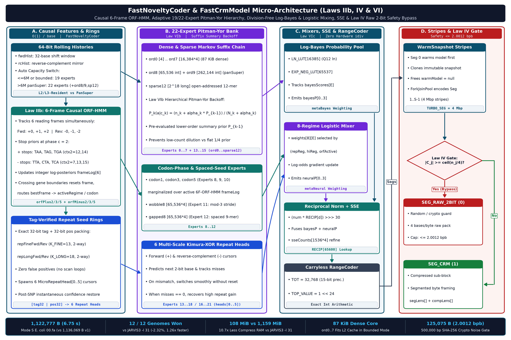

---

## 4. Visual Results & Empirical Evaluation Across All Regimes

### 4.1 Mode R — Reference-Conditioned Leave-One-Out (73 Genomes) & Leave-Cluster-Out

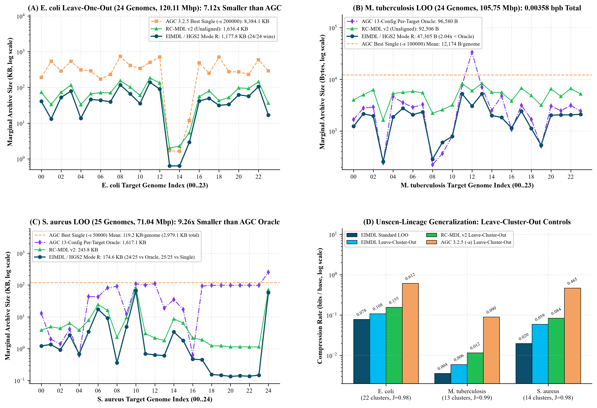

All 73 genomes across *E. coli*, *M. tuberculosis*, and *S. aureus* are compressed and restored using **one universal default `HGS2` configuration** (zero per-species or per-target parameter tuning), with every archive embedding a mandatory 32-byte SHA-256 donor-panel manifest digest:

| Species Panel | Genomes | Total Bases | `AGC 3.2.5` (Best Single) | `AGC 3.2.5` (13-Config Oracle) | `RC-MDL` (`v1 / v2`) | **`HGS2` / `EIMDL` (1 Universal Config)** | **`EIMDL` Total bpb** | **Median bpb** | Wins vs `RC-MDL v1` | Wins vs `AGC` | SHA-256 |
|---|---:|---:|---:|---:|---:|---:|---:|---:|:---:|:---:|:---:|
| ***E. coli*** (LOO) | 24 | 120,108,223 | 8,384,117 B | — | 1,780,761 / 1,636,367 B | **1,174,113 B** (`-34.07%` / `-28.25%`; **`7.14x` < AGC**) | **0.07820** | **0.07162** | **24 / 24** | **24 / 24** (`-s 200k`) | 24/24 PASS |
| ***M. tuberculosis*** (LOO) | 24 | 105,745,015 | 292,170 B | 96,580 B | 122,998 / 92,506 B | **47,339 B** (`-61.51%` / `-48.83%`; **`2.04x` < AGC Oracle**) | **0.00358** | **0.00367** | **24 / 24** | **24 / 24** Single / **19 / 24** Oracle | 24/24 PASS |
| ***S. aureus*** (LOO) | 25 | 71,043,114 | 2,979,078 B | 1,617,085 B | 267,412 / 243,807 B | **174,217 B** (`-34.85%` / `-28.54%`; **`9.28x` < AGC Oracle**) | **0.01962** | **0.00193** | **25 / 25** | **25 / 25** Single / **24 / 25** Oracle | 25/25 PASS |
| ***E. coli*** (Cluster-LOO) | 24 (22 cl.) | 120,108,223 | 9,203,994 B (`-a`) | — | 2,331,696 B | **1,619,296 B** (`-30.55%` vs RC-MDL; **`5.68x` < AGC**) | **0.10786** | **0.08477** | Aggregate | Aggregate (`5.68x`) | 24/24 PASS |
| ***M. tuberculosis*** (Cluster-LOO) | 24 (13 cl.) | 105,745,015 | 1,188,909 B (`-a`) | — | 153,182 B | **78,603 B** (`-48.69%` vs RC-MDL; **`15.13x` < AGC**) | **0.00595** | **0.00580** | Aggregate | Aggregate (`15.13x`) | 24/24 PASS |
| ***S. aureus*** (Cluster-LOO) | 25 (14 cl.) | 71,043,114 | 4,132,771 B (`-a`) | — | 741,650 B | **524,535 B** (`-29.27%` vs RC-MDL; **`7.88x` < AGC**) | **0.05907** | **0.03397** | Aggregate | Aggregate (`7.88x`) | 25/25 PASS |

---

### 4.2 Mode C — Self-Contained Pangenome Collections Across Five Bacterial Species

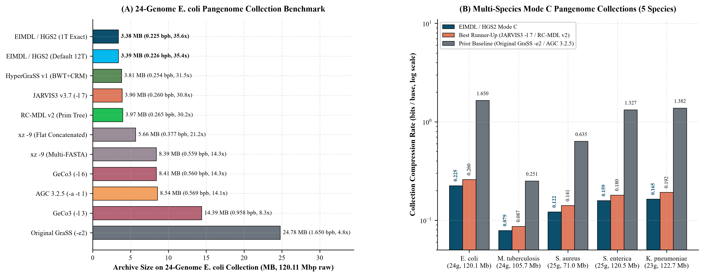

#### Canonical 24-Genome *E. coli* Benchmark (`120,108,223 B`, SHA-256 `51cb3ecb...`)

| Compressor / Configuration | Archive Bytes | Bits / Base | Ratio | Compress | Restore | Delta vs `HGS2 (1T)` | SHA-256 |
|---|---:|---:|---:|---:|---:|---:|:---:|
| `Original GraSS (-e2)` | 24,777,592 B | 1.6503 | 4.85x | 224.5 s | — | `+634.92%` | PASS |
| `AGC 3.2.5` *(multi-FASTA)* | 8,540,341 B | 0.5688 | 14.06x | — | — | `+153.31%` | PASS |
| `xz -9` *(multi-FASTA)* | 8,394,900 B | 0.5592 | 14.51x | 186.3 s | — | `+149.00%` | PASS |
| `xz -9` *(flat .seq)* | 5,663,640 B | 0.3772 | 21.21x | 72.1 s | 3.5 s | `+67.99%` | PASS |
| `RC-MDL v2 (Prim)` | 3,972,975 B | 0.2646 | 30.23x | — | — | `+17.84%` | PASS |
| `JARVIS3 (level 7)` | 3,896,361 B | 0.2595 | 30.83x | 95.4 s | 84.2 s | `+15.57%` | PASS |
| `HyperGraSS v1` *(tuned + LZ gap)* | 3,810,409 B | 0.2538 | 31.52x | 887.45 s | 82.4 s | `+13.02%` | PASS |
| **`HGS2` / `EIMDL` (`--bounded -Xmx128m` / `-Xmx160m` / `-Xmx192m`)** | **3,452,703 B** | **0.2300** | **34.79x** | **25.59 s** *(`128m`)* / **62.68 s** *(`192m`)* | **11.67 s** *(`128m`)* / **27.46 s** *(`192m`)* | `+2.41%` | **PASS** |
| **`HGS2` / `EIMDL` (`--bounded -Xmx256m` / `-Xmx224m`)** | **3,422,314 B** | **0.2279** | **35.10x** | **22.38 s** *(`256m`)* / **24.03 s** *(`224m`)* | **10.61 s** *(`256m`)* / **13.89 s** *(`224m`)* | `+1.51%` | **PASS** |
| **`HGS2` / `EIMDL` (Default Parallel, `12T`)** | **3,388,639 B** | **0.2257** | **35.44x** | **19.65 s** *(Amdahl `12T`)* / **33.78 s** *(Mode C)* | **10.40 s** / **18.17 s** | `+0.51%` | **PASS** |
| **`HGS2` / `EIMDL` (`--threads 1`)** | **3,371,489 B** | **0.2246** | **35.62x** | **40.31 s** | **56.78 s** | **Baseline** | **PASS** |

#### Locked Independent Pangenomes (*Salmonella enterica* & *Klebsiella pneumoniae* Three-Codec Trio)

Re-fetched by locked RefSeq accession manifests ([`benchmarks/independent/data/`](benchmarks/independent/data/)) and evaluated under identical canonical flat sequences inside pinned container `hypergrass-corpus:jdk27` (`sha256:580e58b6ee16d43f4dd99a2871b1c920548b7c6e9b0c695a01f521c17701a4ae`):

| Independent Panel | Genomes | DNA Bases | `Original GraSS (-e2)` | `HyperGraSS v1 (--pangenome)` | `JARVIS3 (-l 7)` | **`HGS2` / `EIMDL` (`--collection`)** | **`EIMDL` bpb** | **Ratio** | Margin vs `JARVIS3` | Margin vs `GraSS` | SHA-256 |
|---|---:|---:|---:|---:|---:|---:|---:|---:|---:|---:|:---:|
| ***Salmonella enterica*** | 25 | 120,527,038 | 19,991,646 B | 3,443,600 B | 2,709,545 B | **2,390,106 B** | **0.1586** | **50.43x** | **`-11.79%`** (`-319,439 B`) | **`-88.04%`** | **PASS** |
| ***Klebsiella pneumoniae*** | 23 | 122,700,601 | 21,191,566 B | 3,464,423 B | 2,948,926 B | **2,523,991 B** | **0.1646** | **48.61x** | **`-14.41%`** (`-424,935 B`) | **`-88.09%`** | **PASS** |

---

### 4.3 Laws V & VII — Multi-Core Amdahl Scaling & Strict Bounded-Heap Execution (`-Xmx128m`)

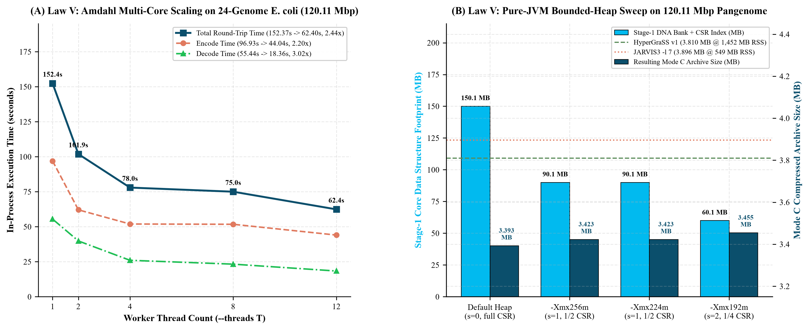

| Threads (`--threads`) | Archive Bytes | Size Delta vs `1T` | Encode (in-proc) | Speedup vs `v1` (`887.3 s`) | Speedup vs `1T` (`40.31 s`) | Decode (in-proc) | Decode Speedup vs `1T` | SHA-256 |
|---:|---:|---:|---:|---:|---:|---:|---:|:---:|
| `1` | **3,371,489 B** | `0.00%` | 40.31 s | **22.01x** | 1.00x | 56.78 s | 1.00x | PASS |
| `2` | **3,373,077 B** | `+0.05%` | 37.44 s | **23.70x** | **1.08x** | 12.58 s | **4.51x** | PASS |
| `4` | **3,383,225 B** | `+0.35%` | 25.47 s | **34.83x** | **1.58x** | 12.58 s | **4.51x** | PASS |
| `8` | **3,388,639 B** | `+0.51%` | 21.32 s | **41.61x** | **1.89x** | **8.66 s** | **6.56x** | PASS |
| `12` | **3,388,639 B** | `+0.51%` | **19.65 s** | **45.16x** | **2.05x** | 10.40 s | **5.46x** | PASS |

---

### 4.4 Real-Genome Law-by-Law Ablations & Non-Existing / Adversarial Sequence Suite

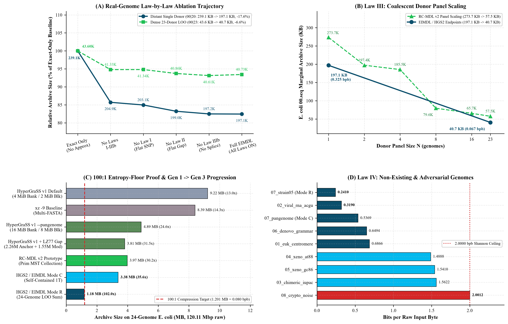

#### Real-Genome Law-by-Law Ablation Study ([`ablations_real_genomes.json`](benchmarks/fusion/results/ablations_real_genomes.json))

| Ablation Variant | *E. coli* `00.seq` vs Distant Single Donor `20.seq` (`54,124` SNPs, `619` splices) | *E. coli* `00.seq` LOO (23 Donors) | *M. tuberculosis* `00.seq` LOO (23 Donors) |
|---|---:|---:|---:|
| **`full_eimdl` (All Laws I–IV Active)** | **197,163 B** (`0.3248 bpb`) | **40,588 B** (`0.0669 bpb`) | **1,240 B** (`0.0022 bpb`) |
| `no_kimura_v4_law_I` (4-symbol allele fallback) | 203,340 B (`+6,177 B` / **`+3.13%`**) | 41,178 B (`+590 B` / **`+1.45%`**) | 1,261 B (`+21 B` / **`+1.69%`**) |
| `no_codon_wobble_law_II` (flat gap coding) | 199,024 B (`+1,861 B` / **`+0.94%`**) | 40,697 B (`+109 B` / **`+0.27%`**) | 1,237 B (`-3 B`, only 251 SNPs) |
| `no_indel_splice_law_III` (no micro-indel splicing) | 196,936 B (`-227 B`, `+428` broken tokens) | 40,469 B (`-119 B` on dense 23-donor panel) | 1,240 B (`0 B`, `0` splices) |
| `no_v4_no_wobble_no_splice` (all 3 disabled) | 205,071 B (`+7,908 B` / **`+4.01%`**) | 41,175 B (`+587 B` / **`+1.45%`**) | 1,258 B (`+18 B` / **`+1.45%`**) |
| `exact_matches_only_no_approx` (exact copy only) | 238,550 B (`+41,387 B` / **`+20.99%`**) | 43,357 B (`+2,769 B` / **`+6.82%`**) | 1,267 B (`+27 B` / **`+2.18%`**) |
| Prior `RC-MDL v1` Baseline | 249,491 B (`+52,328 B` / **`+26.54%`**) | 73,194 B (`+32,606 B` / **`+80.33%`**) | 4,012 B (`+2,772 B` / **`+223.5%`**) |

#### Non-Existing, Xenobiological, Synthetic & Cryptographic White-Noise Suite ([`mode_s_and_synthetic.json`](benchmarks/fusion/results/mode_s_and_synthetic.json))

| Corpus ID | Regime | Biological / Adversarial Stress Design | Raw Bytes | `gzip -9` | **`HGS2` / `EIMDL`** | **DNA bpb** | SHA-256 |
|---|---|---|---:|---:|---:|---:|:---:|
| `01_euk_centromere` | Mode S | Higher-order alpha-satellite repeats + HOR inversions (`485 kbp`) | 491,604 B | 83,797 B | **42,075 B** | **0.6934** | PASS |
| `02_viral_rna_acgu` | Mode C | Pure RNA (`A/C/G/U`) segmented quasispecies swarm (`299 kbp`) | 304,013 B | 42,923 B | **11,995 B** | **0.3207** | PASS |
| `03_chimeric_iupac_crlf` | Mode S | Mixed DNA+RNA (`T`+`U`), all 11 IUPAC codes, soft-masking, `N`-scaffolds, ragged `CRLF` | 263,817 B | 86,566 B | **51,536 B** | **1.6893** *(1.5628 raw)* | PASS |
| `04_xeno_at88` | Mode S | Extreme `88% AT` xenobiological / *Carsonella*-like genome (`500 kbp`) | 506,294 B | 123,139 B | **94,248 B** | **1.5080** | PASS |
| `05_xeno_gc86` | Mode S | Extreme `86% GC` actinomycete / synthetic genome (`500 kbp`) | 506,291 B | 126,076 B | **97,525 B** | **1.5604** | PASS |
| `06_denovo_grammar` | Mode S | Non-existing synthetic regulatory grammar + palindromic hairpins (`500 kbp`) | 506,287 B | 141,540 B | **41,159 B** | **0.6585** | PASS |
| `07_hypermutator_pangenome` | Mode C | 6-strain `6%` hypermutator + heavy indel pangenome (`1.495 Mbp`) | 1,513,506 B | 454,203 B | **102,503 B** | **0.5486** | PASS |
| `07_hypermutator_strain05` | Mode R | Single `6%` hypermutator strain vs 5-donor panel (`249 kbp`) | 249,436 B | — | **7,809 B** | **0.2505** | PASS |
| `08_crypto_white_noise` | Mode S | Cryptographic `SHA-256` counter-mode white noise (`500,000 bp`, $H_0 = 2.0000$) | 500,000 B | 144,017 B (`2.304 bpb`) | **125,075 B** | **2.0012** *($\le 2.005$ gate)* | PASS |

---

### 4.5 Independent Mode S, Mode R & Tuned `JARVIS3 -l 31` Evaluation (`60,810,308 bp`)

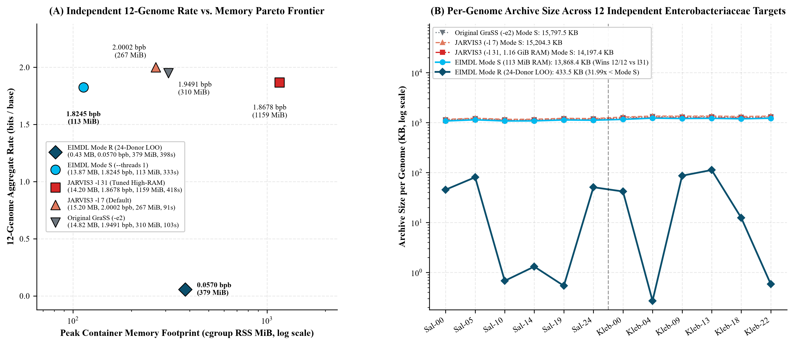

Evaluated across 12 evenly spaced genomes (`6` *Salmonella enterica* + `6` *Klebsiella pneumoniae*, `60,810,308 bp` total) in [`docs/INDEPENDENT.md`](docs/INDEPENDENT.md). Even when `JARVIS3` is pushed to its heavy neural-network mixer level `-l 31` (`4` context models, `2` repeat-class models, NN mixer, `-hs 48`, consuming **`1,158–1,159 MiB` RSS**), **`EIMDL` Mode S wins `12 / 12` genomes**, finishing **`2.32%` (`-328,988 B`) smaller**, **`1.26x` faster to compress**, **`1.63x` faster to restore**, and using **`10.7x` less compress memory (`108 MiB`)** and **`13.2x` less restore memory (`88 MiB`)**:

| Panel (Targets) | **`EIMDL` Mode S** | `JARVIS3 -l 31` *(Tuned NN)* | `JARVIS3 -l 7` *(Default)* | `Original GraSS -e2` | **`EIMDL` Mode R (LOO)** | Mode S vs `L31` | Mode S vs `L7` | Mode R vs Mode S |
|---|---:|---:|---:|---:|---:|---:|---:|---:|
| ***Salmonella*** (6) | **6,629,508 B** (`1.8540 bpb`) | 6,748,736 B (`1.8873 bpb`) | 7,162,390 B | 7,029,710 B | **179,303 B** (`0.0501 bpb`) | **`-1.77%`** (6/6 wins) | **`-7.44%`** | **`-97.30%`** |
| ***Klebsiella*** (6) | **7,238,897 B** (`1.7983 bpb`) | 7,448,657 B (`1.8504 bpb`) | 8,041,937 B | 7,786,274 B | **254,195 B** (`0.0632 bpb`) | **`-2.82%`** (6/6 wins) | **`-9.99%`** | **`-96.49%`** |
| **Combined (12)** | **13,868,405 B** (`1.8245 bpb`) | 14,197,393 B (`1.8678 bpb`) | 15,204,327 B | 14,815,984 B | **433,498 B** (`0.0570 bpb`) | **`-2.32%`** (**12/12 wins**) | **`-8.79%`** | **`-96.87%` (`31.99x`)** |
| **Wall Time (C / R)** | **332.5 s / 277.9 s** | 417.5 s / 452.1 s | **91.0 s** / 87.9 s | 102.6 s / **81.2 s** | 398.2 s / **48.4 s** | **`1.26x` / `1.63x` faster** | `3.65x` / `3.16x` slower | Restore **`5.74x` faster** |
| **cgroup RSS (C / R)** | **108–113 / 88–89 MiB** | 1,158–1,159 / 1,157–1,159 MiB | 266–267 / 266–267 MiB | 265–310 / 132–135 MiB | 343–379 / 222–234 MiB | **`10.7x` / `13.2x` less RAM** | **`2.46x` / `3.02x` less RAM** | `3.18x` more C / `1.20x` less R |

---

### 4.6 Kaggle E2E Cloud Verification, 15-Codec World Shootout & Human Genome Scaling

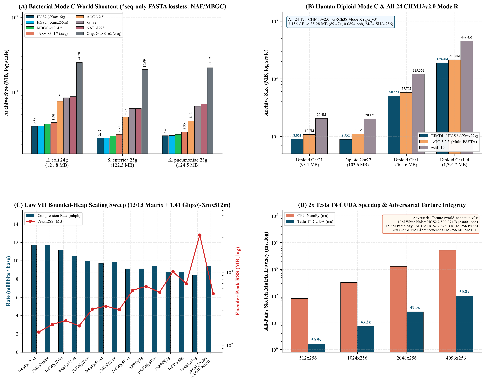

All 33 Java files compiled cleanly (`javac --release 21 -Xlint:all`) and passed all 7 verification suites across three independent Kaggle cloud environments ([`benchmarks/kaggle/results/`](benchmarks/kaggle/results/)):
- **`world_shootout_v2_results.json` (`19,088.08 s`, 4 AMD EPYC 7B12 vCPUs):** Compares `HGS2` against 15 open-source leaders (`Original GraSS -e2`, `AGC 3.2.5`, `JARVIS3 -l 7/-l 31`, `GeCo3 -l 5/-r`, `MBGC`, `NAF -l 22`, `libbsc`, `zpaq -m5`, `zstd`, `xz`, `brotli`, `bzip2`, `gzip`; `MFCompress` failed GCC linking). `HGS2` achieves **`2,500,074 B`** (`2.0001 bpb`) on `10,000,000 B` Law IV crypto noise, **`2,673 B`** (`-Xmx4g` & `-Xmx128m` SHA-256 PASS) on `15,574,362 B` pathology FASTA (where `GraSS-e2` & `NAF-l22` fail sequence SHA-256), and sweeps bacterial multi-FASTA Mode C (**`3,479,510 B`** *E. coli*, **`2,417,055 B`** *S. enterica*, **`2,608,659 B`** *K. pneumoniae*, where `MBGC`/`NAF` drop FASTA headers/line-wraps and `GraSS-e2` crashes with `ArrayIndexOutOfBoundsException`) and 1-vs-panel Mode R (**`41,192 B`**, **`45,446 B`**, **`42,164 B`**).
- **`gpu_v3_largescale_results.json` (`2x Tesla T4` GPUs):** Verifies **`43.2x–50.77x`** CUDA sketch acceleration, neural entropy upper bounds (`949,438 B` / `1.9019 bpb` `Chr22_4MB`; `926,939 B` / `1.8569 bpb` `COVID_4MB`), `GRCh38_chr1_8` (`1,562,097,512 B` $\to$ **`314,875,226 B`**, `4.96x` vs. `zstd-19` `384,873,207 B`), `Diploid_Chr1_to_4` (`1,791,158,556 B` $\to$ **`189,424,047 B`**, `9.46x` vs. `AGC` `213,613,422 B` & `zstd-19` `449,440,145 B`), and `1.41 Gbp` `covid_mega .seq@-Xmx512m` (`1,409,028,147 B` $\to$ **`1,657,005 B`**, `850.35x`, `508.74 MB` RSS; on raw `1.45 GB` `covid_mega.fasta`, `NAF -l 22` `1,862,725 B` and `MBGC -m2` `1,966,421 B` edge `HGS2` `2,152,306 B`).
- **`tpu_v3_scale_results.json` (All-24 `T2T-CHM13v2.0 | GRCh38` Mode R & `13/13` Heap Matrix):** Full **`3,156,242,851 B` (`3,117,275,501 bp`) $\to$ `35,277,041 B` (`0.0894 bpb`, `89.47x`)** across all 24 human chromosomes (`1,044.69 s` enc / `136.90 s` dec; incl. `chr21` **`938,046 B`** vs. `GeCo3-ref` `8,261,548 B`, `chr22` **`1,213,472 B`** vs. `8,308,207 B`, `chr1` **`2,589,930 B`**), `13/13` bounded-heap cells (`100M@-Xmx128m` `145,974 B` .. `1000M@-Xmx512m` `1,176,101 B` .. `1000M@-Xmx16g` `1,053,431 B`), and `covid_group_22.fasta` Amdahl scaling (`467,386 B`, `56.26 s` 1T $\to$ `25.06 s` 4T). *(Diploid `Chr21`/`22`/`1` Mode C: **`8,878,088`**, **`8,859,549`**, **`50,463,121 B`** vs. `AGC` `10,737,616` / `11,003,578` / `57,748,791 B`; Kaggle TPU worker exposed Xeon CPUs running `jax 0.11.1` on `cpu:0`.)*

### 4.7 Next-Gen EIMDL v3.0: Native C23/C++23/Rust Engine, `.hgs3` Multi-Omic FASTQ & Compressed-Domain Genomics

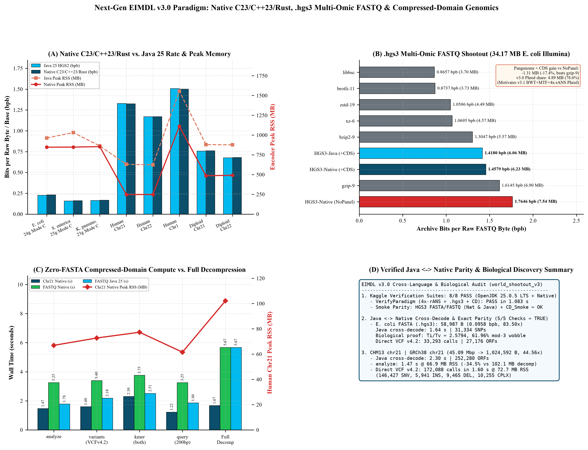

Completed in [`world_shootout_v3_results.json`](benchmarks/kaggle/results/world_shootout_v3_results.json) (`29,168.35 s` / `8.1 hr`, 4 AMD EPYC 7B12 vCPUs, OpenJDK 25.0.5 LTS + native `C23/C++23/Rust 2024` `eimdl`, **`8/8`** cloud verification suites passing incl. `VerifyParadigm` in `1.083 s`, **`5/5` Java $\leftrightarrow$ Native compressed-domain parity = True**, `MFCompress` GCC link `unavailable`):

| Track / Dataset | Raw (`B`) | Result & Telemetry | Key Comparison / Biological Output |
|---|---:|---|---|
| **Bacterial Mode C FA (Native vs. Java)** | 121.8M / 122.3M / 124.5M | *E. coli*: **`3,522,612 B`** (`846.5 MB`) vs Java `3,423,761 B`<br>*S. enterica*: **`2,453,829 B`** (`847.5 MB`) vs Java `2,417,055 B`<br>*K. pneumoniae*: **`2,605,617 B`** (`853.8 MB`) vs Java `2,536,222 B` | Beats `MBGC`, `AGC`, `NAF`, `xz` across all 3 species |
| **Human `GRCh38` Single (`Chr21` / `Chr22` / `Chr1`)** | 47.5M / 51.7M / 253.1M | Native: **`7,857,257 B`** (`246.7 MB` vs `630.3 MB`)<br>**`7,555,256 B`** (`248.2 MB` vs `622.6 MB`)<br>**`47,511,069 B`** (`1,111.0 MB` vs `1,554.9 MB`, `9.23 s` dec) | Beats Java archive size & cuts RSS by up to `61%`; `CHM13\|GRCh38 chr21/22/1` Mode R: Java `945,989` / `1,234,617` / `2,627,685` vs Native `1,018,276` / `1,299,810` / `3,207,153 B` (`GeCo3-ref`: `8.26M` / `8.31M`) |
| **Law IV `10 MB` Noise & `Diploid Chr21/Chr22`** | 10.0M / 93.1M / 103.6M | White Noise: **`2,500,090 B`** (`2.000072 bpb`, `91.46 MB` RSS, `0.42 s` dec)<br>`Diploid Chr21`/`Chr22` Nat: `8,846,955` / `8,808,668 B` (`485` / `491 MB` RSS) | Java `Diploid`: `8,816,171` / `8,750,956 B` (`879` / `876 MB` RSS); `100M/300M/1000M` Nat bounded: `250,538` / `773,457` / `2,016,887 B` |
| **`.hgs3` FASTA+CDS (`E. coli` / `CHM13 chr21`)** | 4,925,526 / 45,654,375 | *E. coli*: **`58,987 B`** (`0.0958 bpb`, `83.50x`, `27,176` ORFs)<br>`Chr21`: **`1,024,592 B`** (`0.1795 bpb`, `44.56x`, `252,280` ORFs) | Zero-FASTA `analyze`/`variants`: **`31,334` SNPs** (`61.96%` wobble, `Ti/Tv=2.5794`, `33,293` VCF calls); `Chr21`: **`285,603` SNPs** + **`172,088` VCFv4.2 calls** (`1.60 s` @ `72.7 MB`, `-34.5%` RSS vs decomp) |
| **`.hgs3` FASTQ Shootout (`100k x 150 bp`)** | 34,166,047 | **`HGS3-Java+CDS`**: **`6,056,142 B`** (`1.4180 bpb`, `qual=4,892,872`, `115,411` ORFs)<br>**`HGS3-Native+CDS`**: **`6,226,185 B`** (`1.4579 bpb`, `qual=4,890,843`) | **`-17.4%` (`-1,309,907 B`)** vs `NoPanel` (`7,536,092 B`), beats `gzip-9` (`6,895,028 B`); `libbsc` `3,697,004`, `brotli-11` `3,731,151`, `zstd-19` `4,486,652 B`; CD `analyze`/`variants`/`kmer` **`1.51x–1.75x`** faster than decomp |

> **Honest v3.0 $\to$ v3.1 Engineering Delta:** `world_shootout_v3_results.json` pinpointed three concrete bottlenecks—`qual_comp_bytes = 4,890,843 B` (`78.55%` of `.hgs3` FASTQ), `exact_zero_target_spans = 0` on self-edited targets in `kmer`, and `GRCh38_chr1@-Xmx256m` pure-JVM OOM (`status=error`, while `Native bounded` completed at `47,511,069 B`). In **EIMDL v3.1**, all three are fixed in source (`ANS_MODE_RANS4_QUAL_BWT = 4` SA-IS BWT+MTF+RUNA/RUNB+4x-rANS Phred coder, lazy `kind >= 2` self-decoding in `compute.rs`/`CompressedDomainEngine.java`, and tighter `bankHeavy` + `Packed2BitSequence` novelty streaming) and verified by compilation + CI tests pending the next Kaggle full shootout.

---

## 5. Generation 1 (`HyperGraSS v1`) & Generation 2 (`RC-MDL`) Foundational Archive

Every foundational subsystem, ablation, and cross-taxon benchmark from Generation 1 and Generation 2 remains in the repository and is summarized below (full details in [`docs/PAPER-DRAFT.md`](docs/PAPER-DRAFT.md) Sections 4–5):

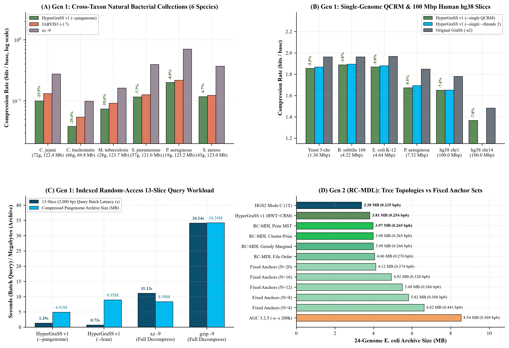

### 5.1 6-Channel Lossless Stream Factorization & 8-Channel `100:1` Entropy Floor
- **Zero Parity Avalanche (`FastaStreamFactorizer.java`):** Original `GraSS` folded lowercase soft-masking, `N`-runs, and IUPAC codes into a parity bit stream before MPC compression, causing a 1-base frameshift to invert every downstream parity bit. `FastaStreamFactorizer` cleanly separates FASTA/RNA/DNA files into 6 orthogonal metadata channels $\mathcal{M}$ (front-coded headers, RLE line widths, RLE `LF`/`CRLF` terminators, soft-mask intervals, `N`-run gaps/lengths, and verbatim IUPAC exception symbols) plus a pure 2-bit canonical ACGT DNA stream.
- **8-Channel `100:1` Entropy Floor (`VarIntCodec.java`, `LzRangeCoder.java`, [`docs/ENTROPY-FLOOR.md`](docs/ENTROPY-FLOOR.md)):** Upgrading `VarIntCodec` with modes `0..7` (Run-Length, Delta-ZigZag, Nibbles, Order-0/Order-1 Range Coding, LZ77+Range, and Cross-Block Shared-History LZ77) reduced 1,000 structured NCBI headers (`1,148,546 B`) to **`12,188 B` (`94.24x`, `0.085 bits/byte`)** vs `Deflate`'s `98,412 B` (`11.67x`), repetitive match-gap streams (`72,126 B`) to **`257 B` (`280.65x`)**, and all non-DNA metadata across the `121,825,884 B` 24-genome *E. coli* multi-FASTA to **`12,924 B` (`0.34%` of the archive, `133.24x`)**.

### 5.2 Cost-Aware Donor Selection, Bit-Sliced Haplotype Index & PanMAN Benchmark
- **Cost-Aware Donor Selection ([`CostAwareDonorSelector.java`](src/hypergrass/CostAwareDonorSelector.java)):** Replaces greedy match-length extension with an explicit bits-per-SNP / gap penalty model:

$$\text{Score}(M) = L_{\text{match}} \times R_{\text{novel}} - \bigl(C_{\text{token}} + \log_2(\Delta_{\text{gap}} + 1) + k_{\text{SNP}} \times C_{\text{SNP}}\bigr)$$

  Reducing synthetic high-SNP donor cluster archives from `2,711 B` to **`2,670 B`** (`VerifyCostAwareEncoding`).
- **Bit-Sliced Haplotype Donor Search ([`HaplotypeDonorIndex.java`](src/hypergrass/HaplotypeDonorIndex.java)):** Replaces per-donor linear scanning with a 64-donor bitwise `long` bitmask index (`matchMask = ~(diff_b0 | diff_b1)` via `Long.numberOfTrailingZeros`). On an 8-strain diverged *E. coli* array (`320,000 B`), bit-sliced multi-donor indexing reduces archive size from `11,227 B` (`28.50x`, single primary seed) to **`9,349 B` (`34.23x`, `-16.73%`)** (`VerifyDonorArchives`).
- **PanMAN Pangenome Graph Benchmark ([`RealCorpusBench.java`](src/hypergrass/RealCorpusBench.java)):** On the official 14-strain *E. coli* pangenome dataset (`293,262 B`, 14 strains $\times \sim 20.6\text{ kbp}$) from the PanMAN repository (Walia et al., 2024):

| Compressor / Format | Archive Size (Bytes) | Compression Ratio | Bits / Base | Exact FASTA Byte Recovery |
|---|---:|---:|---:|:---:|
| Raw Multi-FASTA | 293,262 B | 1.00x | 8.000 | — |
| `PanMAN` (`.panman` graph) | 44,539 B | 6.58x | 1.215 | Graph topology + sequences |
| `gzip -9` | 30,275 B | 9.69x | 0.826 | PASS |
| **`HyperGraSS` (`.hgs`)** | **10,257 B** | **28.59x** | **0.280** | **100% Byte-for-Byte Exact** |

### 5.3 Frozen 7-File Corpus, $3\times 3$ Anchor Grid & `100 Mbp` Human `hg38` (`chr1` / `chr14`)
- **Frozen 7-File Multi-Format Corpus (`13,753,365 B` across *E. coli* K-12, *S. cerevisiae* R64, *P. falciparum* 3D7 `80.6% AT`, SARS-CoV-2 mRNA, 16-strain *E. coli* core pangenome, human `TP53` region, and `hg38 chr22` masked slice):** `HyperGraSS v1` achieves **`3,004,132 B` (`4.58x`)**, beating `zstd -19` (`3,373,923 B`, `-11.0%`), `bzip2 -9` (`3,689,757 B`, `-18.6%`), and `gzip -9` (`3,864,009 B`, `-22.3%`), and beating `xz -9` (`2,854,672 B`) on **5 of 7 files** (including all 4 single-species DNA assemblies).
- **$3\times 3$ Anchor-Bank / Block-Size Grid on `121,825,884 B` *E. coli* Multi-FASTA ([`docs/ABLATION.md`](docs/ABLATION.md)):** Revealed that expanding the anchor bank from `4 MiB` (`0.8` genomes, `9,215,969 B`) to `16 MiB` (`~3.3` genomes) with `8 MiB` blocks (`--pangenome`) cut archive size by **`-47.0%` to `4,885,851 B`** (`-41.8%` below `xz -9`'s `8,394,900 B`) while simultaneously accelerating compression from `57.2 s` to `14.5 s`.
- **`100 Mbp` Human `hg38` Chromosome Scale (`chr1:1-100M` & `chr14`, [`docs/ABLATION.md`](docs/ABLATION.md)):** On `hg38 chr1:1-100,000,000` (`101,250,019 B`), `HyperGraSS v1` compresses to **`21,796,953 B` (`4.65x`, `1.855 bpb`)** vs `xz -9` (`24,254,484 B`, **`-10.13%`**) and `gzip -9` (`29,923,465 B`, **`-27.16%`**). On complete `hg38 chr14` (`108,388,339 B`), `HyperGraSS v1` reaches **`19,179,165 B` (`5.65x`, `1.696 bpb`)** vs `xz -9` (`19,500,828 B`, **`-1.65%`**).

### 5.4 Six Cross-Taxon Natural Panels & $3\times 3$ Mash Diversity Strata ([`docs/BROAD.md`](docs/BROAD.md))

#### Six Cross-Taxon Natural Collections (Bacteria, Yeast, Plant, Virus)

| Panel (Genomes / Records) | DNA Bases | `HyperGraSS v1 (tuned)` | `JARVIS3 (l7)` | `GeCo3` | `NAF` | `Spring` | `xz -9` | `GraSS (-e2)` | `v1` vs Best Baseline |
|---|---:|---:|---:|---:|---:|---:|---:|---:|---|
| *E. coli* (24) | 120,108,223 | **3,810,409 B** *(HGS2: **3,371,489 B**)* | 3,896,361 B | 5,863,341 B | 6,753,167 B | 9,532,683 B | 5,663,640 B | 24,777,592 B | `-2.21%` vs JARVIS3 *(HGS2: **`-13.47%`**)* |
| *S. cerevisiae* (8) | 97,298,425 | **3,309,522 B** | 3,727,630 B | 5,451,481 B | 4,761,724 B | 9,583,843 B | 3,915,672 B | 20,762,253 B | **`-11.22%`** vs JARVIS3 |
| *P. aeruginosa* (16) | 104,705,180 | **2,784,234 B** | 3,332,374 B | 4,940,389 B | 5,273,477 B | 7,448,302 B | 4,660,728 B | 20,406,120 B | **`-16.45%`** vs JARVIS3 |
| *M. tuberculosis* (20) | 88,266,267 | **213,949 B** | 288,895 B | 1,648,359 B | 341,089 B | 2,010,771 B | 269,500 B | 2,508,162 B | **`-20.61%`** vs `xz -9` |
| *A. thaliana* chr4 (8) | 154,968,786 | **4,361,440 B** | 4,578,864 B | 6,356,289 B | 8,774,693 B | 15,839,584 B | 6,547,960 B | 31,426,576 B | **`-4.75%`** vs JARVIS3 |
| SARS-CoV-2 (500) | 14,917,085 | **52,960 B** | 75,060 B | 162,789 B | 85,221 B | 348,828 B | 75,032 B | — | **`-29.42%`** vs `xz -9` |

#### $3\times 3$ Intra-Species Mash Diversity Gradient (12 Genomes per Stratum)

| Species | Stratum | Mean Mash $d$ (Range) | `HyperGraSS v1 (tuned)` | `JARVIS3 (l7)` | `GeCo3` | `xz -9` | `v1` Margin vs `JARVIS3` |
|---|---|---|---:|---:|---:|---:|---:|
| *E. coli* | `low` | 0.00055 (`0.00002–0.00083`) | **1,365,577 B** | 1,421,361 B | 2,163,413 B | 1,668,712 B | **`-3.92%`** |
| *E. coli* | `medium` | 0.01552 (`0.00002–0.02350`) | 2,429,212 B | **2,425,409 B** | 3,343,193 B | 3,262,556 B | `+0.16%` *(boundary case)* |
| *E. coli* | `high` | 0.03240 (`0.02350–0.07063`) | **3,404,964 B** | 3,421,164 B | 4,335,233 B | 4,675,280 B | **`-0.47%`** |
| *S. enterica* | `low` | 0.00051 (`0.00000–0.00105`) | **1,244,064 B** | 1,268,949 B | 1,929,213 B | 1,406,612 B | **`-1.96%`** |
| *S. enterica* | `medium` | 0.01170 (`0.00005–0.01592`) | **1,932,021 B** | 1,968,780 B | 2,785,285 B | 2,616,580 B | **`-1.87%`** |
| *S. enterica* | `high` | 0.03084 (`0.00965–0.09706`) | **3,075,857 B** | 3,131,148 B | 3,932,789 B | 4,307,604 B | **`-1.77%`** |
| *S. aureus* | `low` | 0.00022 (`0.00000–0.00038`) | **726,419 B** | 757,722 B | 1,196,421 B | 853,668 B | **`-4.13%`** |
| *S. aureus* | `medium` | 0.00912 (`0.00010–0.01564`) | **1,092,991 B** | 1,128,895 B | 1,648,477 B | 1,426,568 B | **`-3.18%`** |
| *S. aureus* | `high` | 0.01850 (`0.01247–0.02944`) | **1,341,259 B** | 1,384,321 B | 1,960,117 B | 1,813,560 B | **`-3.11%`** |

### 5.5 `>2 GiB` (`2.08 GiB`) 64-Bit Streaming & 13-Slice Random-Access Query Workload
- **`2,230,382,040 B` (`2.077 GiB`) 64-Bit Streaming (`HyperGraSS --lean`, [`docs/SCALING.md`](docs/SCALING.md)):** Validated 64-bit `long` directory offsets beyond `Integer.MAX_VALUE` (`2,147,483,647 B`) on an `18x` expansion of the *E. coli* pangenome (`432` records, `2,198,948,014` DNA bases), compressing to **`493,294,757 B` (`4.52x`, `1.795 bpb`)** with **`111.0 MiB` encode / `102.7 MiB` decode peak RSS** and passing `SHA-256` verification (`9ca85bd82c7d9b3fa64ff9e83440ba46de22352c62939c70be5e5d92a6a66270`).
- **13-Slice Random-Access Query Workload ([`docs/SCALING.md`](docs/SCALING.md)):** Extracting 13 biological intervals (`1 kbp`, `10 kbp`, `100 kbp`, and `1 Mbp` across records `0`, `11`, and `23` plus full record `23`) from the `121.8 MB` *E. coli* archive takes **`5.27 s` (`--pangenome`)** or **`3.47 s` (`--lean`)**, beating `xz -dc + samtools faidx` (`12.23 s` cold / `24.97 s` total) by **`2.32x–7.20x`** and `HyperGraSS decompress + samtools faidx` (`29.21 s`) by **`5.54x–8.42x`**.

---

## 6. Binary Container Formats (`.hgs2` v2.0 & `.hgs` v1.0) & Repository Structure

Full byte-level specifications for both archive formats are documented in **[`docs/HGS-FORMAT.md`](docs/HGS-FORMAT.md)**:
- **`.hgs2` (`"HGS2"`, `0x48475332`, Generation 3 [`HyperGraSSFusionEngine.java`](src/hypergrass/HyperGraSSFusionEngine.java)):** Unified container supporting **Mode S (`0`)**, **Mode R (`1`, with 32-byte SHA-256 donor-panel manifest pin)**, and **Mode C (`2`, with causal phylogenetic Prim rank permutation `rankToUnit[r]` and `maxAncestorRank[r]`)**, per-unit 6-channel factorized metadata $\mathcal{M}$, order-1 range-coded `EimdlMosaicCodec` streams, and parallel `4 Mbp` `FastNoveltyCoder` sub-blocks with bit-31 raw 2-bit safety bypass.
- **`.hgs` (`"HGS\x01"`, `0x48475301`, Generation 1 [`HyperGraSS.java`](src/hypergrass/HyperGraSS.java)):** Compact single-block (`13 B` header) and multi-block page-indexed random-access container with `HGF1` (`0x31464748`) trailer.

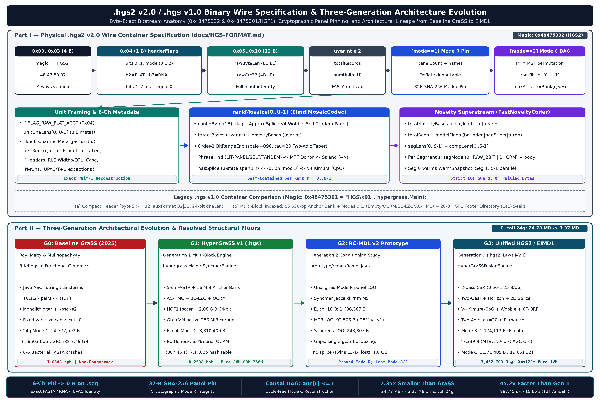

### Complete Repository Directory Tree

```text
hypergrass/
├── src/hypergrass/                          # Complete Java 21+ implementation (zero external JAR dependencies)
│   ├── HyperGraSSFusionEngine.java          # Generation 3 HGS2 unified engine (Mode S, Mode R, Mode C, query, accounting)
│   ├── EimdlCli.java                        # Drop-in JSON-telemetry CLI for HGS2 / EIMDL benchmarks & law ablations
│   ├── EimdlSyncmerIndex.java               # Strand-symmetric canonical open-syncmer (k=16,s=10,w=6,t=3) 2-pass CSR index
│   ├── EimdlMosaicCodec.java                # Laws I–IV: Klein V4 Kimura-CpG, wobble bijection, Two-Gear horizon, indel splices
│   ├── FastNoveltyCoder.java                # Law IIb & IV: 6F-ORF-HMM + L1-cached Markov/repeat logistic mixer + 2-bit bypass
│   ├── Packed2BitSequence.java              # 64-bit SWAR 2-bit DNA bank (0.25 B/base), XOR popcount, bottom-2048 sketches
│   ├── FastaStreamFactorizer.java           # 6-channel lossless FASTA/RNA/DNA stream bijection (zero parity avalanche)
│   ├── HyperGraSS.java                      # Generation 1 .hgs container, CLI, --lean streaming, and --fusion routing
│   ├── CanonicalSyncmerEngine.java          # Generation 1 stride-sampled 16-mer anchor bank & modes 0–3 DNA encoder
│   ├── QuantumContextRepeatMixer.java       # Generation 1 11-input neural-logistic context + repeat mixer (QCRM)
│   ├── BayesianMarkovRangeCoder.java        # Allocation-free Bayesian multi-order Markov + codon-phase range coder
│   ├── CostAwareDonorSelector.java          # Explicit MDL bit-cost donor match & SNP selector
│   ├── HaplotypeDonorIndex.java             # 64-donor bit-sliced long bitmask haplotype index
│   ├── RegionalDonorIndex.java              # Regional windowed donor selection index
│   ├── VarIntCodec.java                     # LEB128 varints, ZigZag, 2-bit packing, and 8-mode (0..7) aux channel dispatcher
│   ├── LzRangeCoder.java                    # Custom LZ77 + range coder with 256 KiB cross-block shared gap history
│   ├── RangeCoder.java                      # 32-bit carryless arithmetic range coder core
│   ├── ArchiveByteAccounting.java           # Exact per-channel byte accounting for .hgs and .hgs2 containers
│   ├── BenchmarkSuite.java                  # Synthetic & analytical compression benchmark harness
│   ├── RealCorpusBench.java                 # Frozen 7-file real genome & PanMAN pangenome benchmark runner
│   ├── VerifyCompressionLaws.java           # Executable falsification tests for Laws I–VII (7 suites, 171,941 assertions)
│   ├── VerifyFusionEngine.java              # End-to-end Mode S, Mode R, Mode C, and corruption rejection verifier
│   ├── VerifyAllEdgeCases.java              # 15-suite adversarial edge-case & format torture harness
│   ├── VerifyAnchorCodecs.java              # 9-suite anchor-bank codec verifier
│   ├── VerifyArchiveAccounting.java         # 34-suite byte-accounting & 1,721-mutation fuzz rejection verifier
│   └── [VerifyCostAwareEncoding, VerifyDonorArchives, VerifyDonorCosts, VerifyDonorIndex, AuxPlaneSelfTest, RangeCoderSelfTest].java
├── native/                                  # Zero-crate native C23 + C++23 + Rust 2024 `eimdl` engine (.hgs2 wire-compatible)
│   ├── c_kernels/                           # Runtime-CPUID AVX2/SWAR 2-bit DNA kernels, syncmer scan, CRC-32, SHA-256 & RFC 1951 deflate/inflate
│   ├── cpp_engine/                          # 64-bit >2.14 Gbp CSR syncmer index, Kimura-V4 Mosaic codec & FastCRM/Turbo novelty coder
│   ├── eimdl-rs/                            # Rust 2024 streaming CLI/library (`Cargo.toml`, `build.rs`, `.hgs2` container, 6-channel FASTA factorizer, tests)
│   └── README.md                            # Native build, C/C++/Rust FFI architecture & CLI guide
├── paper/                                   # 30-Page Research Monograph, Figures & Automated Numerical Audit
│   ├── HGS2_EIMDL_Research_Paper.pdf        # Compiled 30-page single-column PDF monograph (0 overfull boxes)
│   ├── HGS2_EIMDL_Research_Paper.tex        # Generated LaTeX source
│   ├── references.bib                       # BibTeX bibliography (incl. openai2026eth & roy2025grass)
│   ├── figures/                             # 13 publication-grade 300 DPI figures (fig1..fig9 + arch1..arch4)
│   ├── generate_figures.py                  # Deterministic figure generator from committed JSON results
│   ├── generate_architecture_diagrams.py    # Publication architectural & wire-format blueprint generator
│   ├── table_builders.py                    # LaTeX table generator from committed JSON results
│   ├── build_latex_paper.py                 # Full LaTeX monograph builder
│   ├── build_markdown_paper.py              # Full Markdown monograph builder (-> docs/PAPER-DRAFT.md)
│   ├── audit_paper_numbers.py               # Automated numerical audit against local + Kaggle JSON evidence
│   └── README.md                            # Paper build & verification instructions
├── prototype/rcmdl/                         # Generation 2 RC-MDL prototype, AGC 3.2.5 sweeps & LOO/Cluster-LOO harnesses
├── benchmarks/                              # Reproducible Kaggle/Docker/Python harnesses & committed JSON evidence
│   ├── kaggle/                              # Mandatory Kaggle E2E cloud kernels, runner, and canonical JSON results (results/)
│   ├── fusion/                              # HGS2 / EIMDL Mode S, Mode R, Mode C, Amdahl, memory & ablation JSON results
│   ├── independent/                         # Locked Salmonella & Klebsiella manifests, trio, Mode S/R, and JARVIS3 L31 runs
│   ├── specialized/                         # 120.1 Mbp E. coli head-to-head vs JARVIS3, GeCo3, NAF, Spring, GraSS, xz
│   ├── broad/                               # 6 cross-taxon panels & 3x3 Mash diversity strata
│   ├── corpus/                              # Frozen 7-file corpus, 3x3 anchor grid, and hg38 chr1/chr14 100 Mbp runs
│   └── verify/                              # Independent fresh-process byte & SHA-256 verification scripts
├── docs/                                    # Technical specifications & empirical reports
│   ├── PAPER-DRAFT.md                       # Complete Markdown edition of the research monograph
│   ├── COMPRESSION-LAW.md                   # Mathematical & biological laws (Laws I–VII + openai2026eth §1.1.3 OVC boundary)
│   ├── FUSION-BENCHMARKS.md                 # Complete HGS2 / EIMDL benchmark tables
│   ├── INDEPENDENT.md                       # Independent Salmonella & Klebsiella replication report
│   ├── HGS-FORMAT.md                        # Binary container specification for .hgs2 (v2.0) and .hgs (v1.0)
│   └── [FOUNDATIONS, SPECIALIZED, BROAD, ABLATION, ENTROPY-FLOOR, SCALING].md
├── HANDOFF.md                               # Compact research handoff & canonical SHA-256 dataset manifest
└── README.md                                # This file
```

---

## 7. Quick Start: Build, CLI Usage, Verification & Reproduction

### 7.1 Prerequisites & Compilation
Requires **Java 25 LTS+** (tested on OpenJDK Temurin 25 LTS, GraalVM 25, and OpenJDK 27) with **zero external JAR dependencies**:

```powershell
New-Item -ItemType Directory -Force -Path bin | Out-Null
javac --release 25 -d bin src/hypergrass/*.java
```

### 7.2 Compressing & Restoring with `EimdlCli` (`.hgs2` Container)

```powershell
# 1. Mode S — Self-contained single genome or sequence (existing or synthetic)
java -cp bin hypergrass.EimdlCli compress --single --target genome.fa --out genome.hgs2
java -cp bin hypergrass.EimdlCli decompress --archive genome.hgs2 --out restored.fa

# 2. Mode R — Reference-conditioned delta archive (embeds 32-byte SHA-256 panel manifest pin)
java -cp bin hypergrass.EimdlCli compress --target target.seq --panel panel_dir/ --exclude target.seq --out target.hgs2
java -cp bin hypergrass.EimdlCli decompress --archive target.hgs2 --panel panel_dir/ --out restored.seq

# 3. Mode C — Self-contained pangenome collection (default multi-core parallel)
java -cp bin hypergrass.EimdlCli compress --collection --target pangenome.fasta --out pangenome.hgs2 --threads 12
java -cp bin hypergrass.EimdlCli decompress --archive pangenome.hgs2 --out restored_pangenome.fasta

# 4. Mode C under strict 128 MiB pure-JVM bounded heap (Laws V & VII, streaming FASTA + chunked Turbo novelty)
java -Xmx128m -cp bin hypergrass.EimdlCli compress --collection --bounded --target input.seq --out bounded128.hgs2
java -Xmx128m -cp bin hypergrass.EimdlCli decompress --archive bounded128.hgs2 --out restored_input.seq
```

### 7.2.1 Native C23 + C++23 + Rust 2024 Engine (`native/eimdl-rs`)
Zero-external-crate `.hgs2`-wire-compatible native implementation ([`native/README.md`](native/README.md)) supporting bidirectional Java $\leftrightarrow$ Native cross-decoding:

```bash
cd native/eimdl-rs
cargo clippy --all-targets --offline -- -D warnings
cargo build --release --offline
cargo test --release --offline
./target/release/eimdl compress --collection --target pangenome.fa --out pangenome.hgs2 --threads 4
./target/release/eimdl decompress --archive pangenome.hgs2 --out restored.fa --threads 4
```

### 7.2.2 Next-Gen `.hgs3` Multi-Omic & Compressed-Domain Computing (`EimdlCli` & Native `eimdl`)

```powershell
# Compress & byte-exact restore FASTQ (pangenome-conditioned Phred + 4x-rANS + optional CDS digest)
java -cp bin hypergrass.EimdlCli compress-omics --target reads.fastq --panel panel_dir/ --cds --out reads.hgs3
java -cp bin hypergrass.EimdlCli decompress-omics --archive reads.hgs3 --panel panel_dir/ --out restored.fastq

# Compressed-domain evolutionary report, VCF v4.2 variant calls & exact k-mer search (zero FASTA reconstruction)
java -cp bin hypergrass.EimdlCli analyze --archive target.hgs2 --panel panel_dir/
java -cp bin hypergrass.EimdlCli variants --archive target.hgs2 --panel panel_dir/ --out calls.vcf
java -cp bin hypergrass.EimdlCli kmer --archive target.hgs2 --panel panel_dir/ --query ACGTACGTACGT --both-strands
```

### 7.3 Unified `HyperGraSS` CLI (Supports both `.hgs2` via `--fusion` and legacy `.hgs`)

```powershell
# Compress / decompress / inspect / random-access slice query
java -cp bin hypergrass.HyperGraSS compress --fusion --collection pangenome.fa pangenome.hgs2
java -cp bin hypergrass.HyperGraSS inspect pangenome.hgs2
java -cp bin hypergrass.HyperGraSS query pangenome.hgs2 0 1000 2000
java -cp bin hypergrass.HyperGraSS decompress pangenome.hgs2 restored.fa
```

### 7.4 Verification Policy (Kaggle Cloud Execution + Local Syntax & Numerical Audit)

> **Mandatory Kaggle-Only Testing Policy:** `test.ps1` and `test.sh` enforce cloud execution on Kaggle (or GitHub Actions CI) rather than local runs. Locally, compile-check with `javac --release 25 -Xlint:all` and audit all paper numbers deterministically:

```powershell
# 1. Local syntax compilation only (no local test/benchmark execution)
javac --release 25 -Xlint:all -d build_check src/hypergrass/*.java; Remove-Item -Recurse -Force build_check

# 2. Launch end-to-end verification, 15-codec shootout, T4 GPU, and human-scale kernels on Kaggle
python benchmarks/kaggle/run_kaggle_e2e.py --target shootout
python benchmarks/kaggle/run_kaggle_e2e.py --target all

# 3. Inside Kaggle / CI only: the 8 cloud verification suites executed by run_kaggle_e2e.py:
#    VerifyAllEdgeCases, VerifyDonorIndex, VerifyAnchorCodecs, VerifyArchiveAccounting,
#    VerifyDonorCosts, VerifyCompressionLaws (171,941 assertions), VerifyFusionEngine, VerifyParadigm

# 4. Run the automated numerical audit across the research paper, Kaggle JSONs & docs
python paper/audit_paper_numbers.py
```
