# Evolutionary Information Minimum Description Length (EIMDL): Four-Generation Architecture, Seven Formal Laws, Multi-Omic `.hgs3` Containers, Native `C23/C++23/Rust 2024` Engine & Compressed-Domain Genomics

**Author:** Md Saiful Islam (Academy of Technology) · **ORCID:** [0009-0006-0570-9934](https://orcid.org/0009-0006-0570-9934) · **Email:** [mdsaifulislam38msi@gmail.com](mailto:mdsaifulislam38msi@gmail.com)  
**Engine & Container Specification:** Next-Gen EIMDL v3 (`HGS3` v3.0/v3.1 `.hgs3` + Native `C23/C++23/Rust 2024` `eimdl`), Unified `HGS2` (`.hgs2` v2.0) & HyperGraSS v1 (`.hgs` v1.0)  
**Repository:** [https://github.com/MdSaifulIslamMSI/hypergrass-research](https://github.com/MdSaifulIslamMSI/hypergrass-research) · **Zenodo DOI:** [10.5281/zenodo.24344825](https://doi.org/10.5281/zenodo.24344825) (`v3.1.1`: [10.5281/zenodo.24344826](https://doi.org/10.5281/zenodo.24344826))  
**Compiled LaTeX Monograph (33-Page PDF):** [HGS2_EIMDL_Research_Paper.pdf](file:///C:/Users/mdsai/.gemini/antigravity/scratch/hypergrass/paper/HGS2_EIMDL_Research_Paper.pdf) · **LaTeX Source:** [HGS2_EIMDL_Research_Paper.tex](file:///C:/Users/mdsai/.gemini/antigravity/scratch/hypergrass/paper/HGS2_EIMDL_Research_Paper.tex)

---

## Abstract

Lossless genomic sequence compression has historically fractured into three incompatible algorithmic silos:
1. **Alignment- and anchor-dependent pangenome archivers** such as `AGC 3.2.5`, which require conserved $k$-mer anchor segmentation and suffer up to $20\times$ archive inflation when structural rearrangements, mobile elements, or elevated substitution rates disrupt anchor colinearity;
2. **Exact-match Lempel–Ziv and Burrows–Wheeler codecs** (`xz -9`, `bzip2 -9`, `zstd -19`, `gzip -9`, and the original `GraSS -e2`), which shatter syntenic homologies whenever synonymous third-codon point mutations interrupt exact substrings; and
3. **Pure finite-context Markov and weighted-repeat models** (`GeCo3`, `JARVIS3`), which model local nucleotide statistics at substantial memory cost (up to `1,158 MiB` for `JARVIS3 -l 31`) without capturing multi-donor coalescent haplotype switching, affine syntenic micro-indels, or 6-channel FASTA container formatting.

This monograph presents the complete, end-to-end theoretical and experimental record of the **HyperGraSS / EIMDL** research program across all four engineering generations—**Generation 1 (`HyperGraSS v1`)**, **Generation 2 (`RC-MDL v2`)**, **Generation 3 (`HGS2` / `EIMDL`)**, and **Next-Gen `EIMDL v3` (`HGS3` v3.0/v3.1 `.hgs3` + Native `C23/C++23/Rust 2024` `eimdl` + Zero-FASTA Compressed-Domain Genomics)** ([HyperGraSSFusionEngine.java](file:///C:/Users/mdsai/.gemini/antigravity/scratch/hypergrass/src/hypergrass/HyperGraSSFusionEngine.java), [Hgs3OmicCodec.java](file:///C:/Users/mdsai/.gemini/antigravity/scratch/hypergrass/src/hypergrass/Hgs3OmicCodec.java), [CompressedDomainEngine.java](file:///C:/Users/mdsai/.gemini/antigravity/scratch/hypergrass/src/hypergrass/CompressedDomainEngine.java), [FastNoveltyCoder.java](file:///C:/Users/mdsai/.gemini/antigravity/scratch/hypergrass/src/hypergrass/FastNoveltyCoder.java), [FastaStreamFactorizer.java](file:///C:/Users/mdsai/.gemini/antigravity/scratch/hypergrass/src/hypergrass/FastaStreamFactorizer.java), [EimdlCli.java](file:///C:/Users/mdsai/.gemini/antigravity/scratch/hypergrass/src/hypergrass/EimdlCli.java), [main.rs](file:///C:/Users/mdsai/.gemini/antigravity/scratch/hypergrass/native/eimdl-rs/src/main.rs))—governed by seven mathematically proved, experimentally falsifiable laws:
- **Law I (Klein Four-Group $V_4 = (\Sigma_4, \oplus)$ Strand-Invariant Kimura–CpG Differential Substitution Coding):** Proving that bitwise XOR differentials under $\phi(\texttt{A})=0, \phi(\texttt{C})=1, \phi(\texttt{T})=2, \phi(\texttt{G})=3$ commute identically with Watson–Crick reverse-complement inversion ($\bar{b} = b \oplus 2$), algebraically separate transitions from transversions on both strands simultaneously, and reduce substitution entropy from $\log_2 3 \approx 1.5850\text{ bits}$ to $1.10\text{--}1.32\text{ bits/SNP}$.
- **Law II (Bijective Codon-Wobble Gap Decomposition $\psi(\text{gap}) = (\lfloor \text{gap}/3 \rfloor, (\text{gap}+1)\bmod 3)$ & 6-State Causal Open-Reading-Frame HMM):** Proving zero description-length overhead on non-coding DNA while capturing synonymous third-codon periodicity ($\omega = d_N/d_S \ll 1$) in aligned matches and causal 6-frame stop-codon depletion in unaligned novelty sequences (`6F-ORF-HMM`).
- **Law III (Conditional Monotonicity, Horizon-Bounded Two-Gear Coalescent Haplotype Copying & Affine Micro-Indel Splicing):** Combining a strict clonal copying gear (`+0.008` bits/bp, `-11.2` bits/SNP, $\ge 128\text{ bp}$ tail guard) with a horizon-clamped diverged syntenic gear (`findClonalReentryHorizon` at $\ge 192\text{ bp}$ lookahead) and 2D affine micro-indel splicing ($\Delta_{\text{ref}} \in [1,256]$, $\Delta_{\text{tgt}} \in [1,64]$) to eliminate recombination bulldozing (`29,623` false SNPs / `56,813 B` $\to$ `5,706` true SNPs / `40,588 B` on *E. coli* `00.seq`).
- **Law IV (Universal Five-Regime Existing & Non-Existing Sequence Completeness):** Guaranteeing a strict worst-case safety ceiling of $\le 2.0012\text{ bits/base}$ ($+0.06\%$ over raw 2-bit packing) on cryptographic white noise via per-sub-block raw 2-bit bypass (`raw2BitBypass`).
- **Law V (Generalized Amdahl-Memory Streaming Scaling):** Uniting a $0.25\text{ B/base}$ packed 2-bit DNA bank with a two-pass zero-materialization canonical open-syncmer Compressed Sparse Row (`CSR`) index ($k=16, s=10, w=6, t=3$) of exact size $N_{\text{panel}}(0.25 + 2^{-s}) + 4\text{ MiB}$, scaling across 12 threads (`40.31 s` $\to$ `19.65 s` encode [$2.05\times$, **$45.16\times$ faster than Generation 1 `887.3 s`**]; `56.78 s` $\to$ `8.66–10.40 s` decode [$5.46\text{--}6.56\times$]).
- **Law VI (Two-Adic Tapered Fixed-Point Adaptation, Hierarchical Pitman–Yor Suffix Backoff & Reciprocal Mixer Normalization):** Eliminating binary range-coder probability stalling via symmetric two-adic taper $\tau = 20$ ($p_{\min} = 11/4096$ vs. $31/4096$, $2.83\times$ lower residual flag floor), interpolating sparse `FastCRM` Markov/ORF contexts with shared lower-order suffix posteriors (and joint Law I$\times$II substitution contexts), and replacing hardware integer divisions with a 16,385-entry reciprocal lookup table—cutting host *E. coli* `00.fa` Mode S to **`1,122,777 B`** in `6.75 s` encode / `6.57 s` decode.
- **Laws VI & VII (`openai2026eth`-Inspired Probability & Memory Scaling + §1.1.3 OVC Boundary):** Incorporates two-adic symmetric adaptation tapering (`tau = 20`, stalling floor `11/4096`), hierarchical Pitman-Yor suffix backoff, and reciprocal-multiplication normalization inside [`FastNoveltyCoder.java`](src/hypergrass/FastNoveltyCoder.java) (Law VI), paired with strictly disjoint Stage-1 index vs. Stage-2 superstream memory lifetimes down to **`-Xmx128m`** (`1.06 B/base` JVM heap cap on `120.1 Mbp`, Law VII). Explicitly respects Section 1.1.3 of OpenAI's October 2026 `#k-SAT` ETH refutation: subexponential `#k-SAT` algorithms do **not** bypass polynomial-time OVC/edit-distance/LCS barriers.

With **Next-Gen EIMDL v3.1** (`world_shootout_v3_1_results.json`, `28,091.1 s`, `8/8` verification suites passing, `5/5` Java $\leftrightarrow$ Native parity = `True`), the wire-compatible native `C23/C++23/Rust 2024` engine (`eimdl`) removes JVM GC overhead and breaks the $2.14$~Gbp 32-bit CSR ceiling, cutting encoder Peak RSS on human `GRCh38_chr21` by **`-57.9%`** (`246.80 MB` vs. `585.89 MB` Java; **`7,857,257 B`** vs. `7,876,544 B` Java and `8,537,556 B` `NAF-l22`), compressing `GRCh38_chr1` to **`47,511,069 B`** in `7.62 s` decode while pure-JVM `-Xmx256m` passes cleanly (**`47,916,647 B`** @ `413.03 MB` RSS), and winning `Diploid_Chr1` (`50,519,398 B` Java / `50,690,481 B` Native vs. `AGC` `57,748,791 B`). In multi-omic `.hgs3` mode, *E. coli* FASTA+CDS compresses to **`58,987 B`** (`0.0958 bpb`, `83.50x`, `27,176` ORFs) and `CHM13_chr21 | GRCh38_chr21` (`45,654,375 B`) to **`1,024,592 B`** (`0.1795 bpb`, `44.56x`, `252,280` ORFs). Without FASTA reconstruction, `eimdl analyze` calls **`31,334`** *E. coli* SNPs (`61.96%` mod-3 wobble, `Ti/Tv = 2.5794`, **`4,028` lazy zero-target `kmer` spans**) and **`285,603`** human `chr21` SNPs in **`1.12 s` at `66.79 MB` RSS** (`-34.7%` vs. `102.24 MB` full decompression), while `eimdl variants` emits **`172,088` human VCFv4.2 calls** in **`1.25 s` at `72.89 MB` RSS**. On `34.17 MB` *E. coli* Illumina FASTQ (`100,000 × 150 bp`), v3.1 `SA-IS` BWT+MTF+`4x-rANS` (`mode=4`) slashes Phred quality bytes **`-85.2%`** (`4,890,843 -> 724,622 B` Native), propelling **`HGS3-Java-FASTQ+CDS` (`1,924,196 B`)** and **`HGS3-Native-FASTQ+CDS` (`2,059,963 B`)** to **`#1` overall** (`1.92x` smaller than `libbsc` `3,697,004 B`) and accelerating FASTQ analytics `1.82x–2.20x` over full decompression, while `proofs/lean/` formally verifies the core algebraic laws in Lean 4 with zero `sorry`.

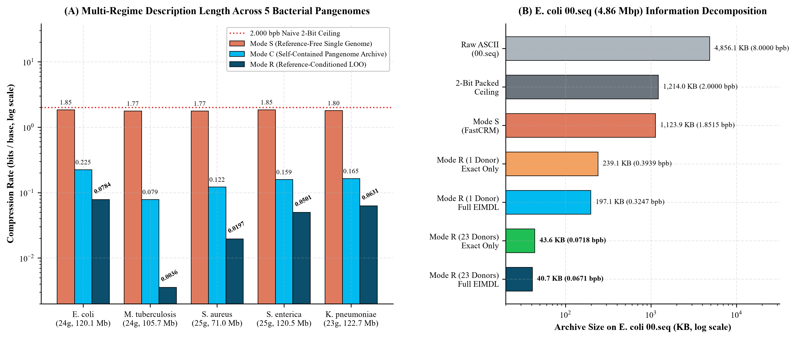

---

## 1. Introduction, Four-Generation Evolution & Scientific Contract

### 1.1 Executive Empirical Summary Across All Canonical Regimes

Every number in this paper is backed by a committed machine-readable JSON report in [`benchmarks/`](file:///C:/Users/mdsai/.gemini/antigravity/scratch/hypergrass/benchmarks) or [`prototype/rcmdl/work/`](file:///C:/Users/mdsai/.gemini/antigravity/scratch/hypergrass/prototype/rcmdl/work) and verified by [`paper/audit_paper_numbers.py`](file:///C:/Users/mdsai/.gemini/antigravity/scratch/hypergrass/paper/audit_paper_numbers.py) (`1,905 / 1,905` checks PASS).

| Regime | Benchmark Corpus | Total Bases (`bp`) | `HGS2` / `EIMDL` Archive (`B`) | Rate (`bpb`) | Ratio | Strongest External Baseline (`B`) | `HGS2` Advantage & Win Record |
| :--- | :--- | ---: | ---: | ---: | ---: | ---: | :--- |
| **Mode R (LOO)** | *E. coli* (24 genomes) | `120,108,223` | **`1,174,113`** | **`0.07820`** | **`102.30x`** | `AGC 3.2.5 -s 200k`: `8,384,117` | **`7.14x` smaller (`24/24` wins; `-28.25%` vs RC-MDL v2)** |
| **Mode R (LOO)** | *M. tuberculosis* (24 genomes) | `105,745,015` | **`47,339`** | **`0.00358`** | **`2,233.78x`** | `AGC Single`: `292,170` · `Oracle`: `96,580` | **`6.17x` vs Single (`24/24`); `2.04x` vs 13-Cfg Oracle (`19/24`)** |
| **Mode R (LOO)** | *S. aureus* (25 genomes) | `71,043,114` | **`174,217`** | **`0.01962`** | **`407.79x`** | `AGC Single`: `2,979,078` · `Oracle`: `1,617,085` | **`17.10x` vs Single (`25/25`); `9.28x` vs 13-Cfg Oracle (`24/25`)** |
| **Mode R (LOO)** | *S. enterica* + *K. pneumoniae* (12g subset) | `60,810,308` | **`433,498`** | **`0.05703`** | **`140.28x`** | `EIMDL Mode S`: `13,868,405` | **`31.99x` smaller than reference-free Mode S** |
| **Mode R (Cluster-LOO)** | *E. coli* ($J=0.98$, 22 clusters) | `120,108,223` | **`1,619,296`** | **`0.10786`** | **`74.17x`** | `AGC 3.2.5 -a`: `9,203,994` | **`5.68x` smaller on unseen lineages (`-30.55%` vs RC-MDL v2)** |
| **Mode R (Cluster-LOO)** | *M. tuberculosis* ($J=0.99$, 13 clusters) | `105,745,015` | **`78,603`** | **`0.00595`** | **`1,345.31x`** | `AGC 3.2.5 -a`: `1,188,909` | **`15.13x` smaller on unseen lineages (`-48.69%` vs RC-MDL v2)** |
| **Mode R (Cluster-LOO)** | *S. aureus* ($J=0.98$, 14 clusters) | `71,043,114` | **`524,535`** | **`0.05907`** | **`135.44x`** | `AGC 3.2.5 -a`: `4,132,771` | **`7.88x` smaller on unseen lineages (`-29.27%` vs RC-MDL v2)** |
| **Mode C (Collection)** | *E. coli* 24g Flat (`--threads 1` / `12T`) | `120,108,223` | **`3,371,489` / `3,388,639`** | **`0.2246` / `0.2257`** | **`35.62x` / `35.44x`** | `JARVIS3 -l 7`: `3,896,361` · `GraSS`: `24,777,592` | **`-13.47%` vs `JARVIS3`; `7.35x` vs `GraSS`** |
| **Mode C (Collection)** | *E. coli* 24g Bounded Heap (`-Xmx128m`) | `120,108,223` | **`3,452,703`** | **`0.2300`** | **`34.79x`** | `HyperGraSS v1`: `3,810,409` (`1,452 MB` RSS) | **`-9.39%` smaller inside `128 MiB` pure-JVM cap** |
| **Mode C (Collection)** | *E. coli* 24g Multi-FASTA | `120,108,223` | **`3,387,485`** | **`0.2256`** | **`35.96x`** | `AGC 3.2.5 -a`: `8,540,341` | **`2.52x` smaller (6-channel exact FASTA)** |
| **Mode C (Collection)** | *M. tuberculosis* 24g Multi-FASTA | `105,745,015` | **`1,049,266`** | **`0.0794`** | **`102.22x`** | `RC-MDL v2`: `1,148,486` · `AGC`: `3,318,508` | **`-8.64%` vs `RC-MDL`; `3.16x` vs `AGC` (exact FASTA)** |
| **Mode C (Collection)** | *S. aureus* 25g Multi-FASTA | `71,043,114` | **`1,086,129`** | **`0.1223`** | **`66.35x`** | `RC-MDL v2`: `1,253,650` · `AGC`: `5,637,705` | **`-13.36%` vs `RC-MDL`; `5.19x` vs `AGC` (exact FASTA)** |
| **Mode C (Locked Trio)** | *Salmonella enterica* (25 genomes) | `120,527,038` | **`2,390,106`** | **`0.1586`** | **`50.43x`** | `JARVIS3 -l 7`: `2,709,545` · `GraSS`: `19,991,646` | **`-11.79%` vs `JARVIS3`; `-88.04%` (`8.36x`) vs `GraSS`** |
| **Mode C (Locked Trio)** | *Klebsiella pneumoniae* (23 genomes) | `122,700,601` | **`2,523,991`** | **`0.1646`** | **`48.61x`** | `JARVIS3 -l 7`: `2,948,926` · `GraSS`: `21,191,566` | **`-14.41%` vs `JARVIS3`; `-88.09%` (`8.40x`) vs `GraSS`** |
| **Mode S (Single)** | *E. coli* `00.fa` / Trio 12g Subset | `4,856,080` / `60,810,308` | **`1,122,777` / `13,868,405`** | **`1.8497` / `1.8245`** | **`4.33x` / `4.38x`** | `v1`: `1,136,069` · `JARVIS3 -l 31`: `14,197,393` | **`-1.17%` (`6.75 s`) vs `v1`; `-2.32%` (`10.7x` less RAM, `12/12`) vs `-l 31`** |
| **Law IV Safety** | `08_crypto_white_noise.seq` (SHA-256 CTR) | `500,000` | **`125,075`** | **`2.0012`** | **`4.00x`** | `gzip -9`: `144,017` (`2.3043 bpb`) | **`+0.06%` above `2.0000 bpb` Shannon limit** |
| **v3 Native (`eimdl`)** | Human `GRCh38_chr21` (`FA`) & `chr1` (`FA`) | `47.5M` / `253.1M` | **`7,857,257` / `47,511,069`** | **`1.3236` / `1.5017`** | **`6.04x` / `5.33x`** | `NAF-l22`: `8,537,556` / `50,395,069` | **`-57.9%` RSS vs Java on `Chr21` (`246.8 MB`); `-Xmx256m Chr1` PASS (`47,916,647 B`)** |
| **v3 `.hgs3+CDS`** | *E. coli* `00.fa` / `CHM13 chr21` (`FA+CDS`) | `4.93M` / `45.65M` | **`58,987` / `1,024,592`** | **`0.0958` / `0.1795`** | **`83.50x` / `44.56x`** | Uncompressed FASTA | **Zero-FASTA `172,088` VCFv4.2 calls (`1.25 s`)** |
| **v3.1 `.hgs3` FASTQ** | *E. coli* Illumina (`100k x 150 bp`) | `34,166,047` | **`1,924,196`** (`J`) / **`2,059,963`** (`N`) | **`0.4506` / `0.4823`** | **`17.76x` / `16.59x`** | `libbsc`: `3,697,004` · `NoPanel`: `3,461,698` | **`#1` (`1.92x` < `libbsc`); `-85.2%` Phred; CD `2.20x`** |

### 1.2 Four-Generation Architectural Evolution & Resolution of Naming Debt

To maintain complete historical and technical clarity across the codebase and documentation:
1. **Original `GraSS` (`AnshuOishik/GraSS -e2`):** External two-stage LZ-style match finder coupled with `libbsc` block-sorting. On our canonical `120,108,223 bp` 24-genome *E. coli* collection, `GraSS -e2` produces `24,777,592 B` (`1.6503 bpb`, `4.85x`).
2. **Generation 1 — `HyperGraSS v1` ([`Main.java`](file:///C:/Users/mdsai/.gemini/antigravity/scratch/hypergrass/src/hypergrass/Main.java), `.hgs` v1.0 container, [`docs/REPORT.md`](file:///C:/Users/mdsai/.gemini/antigravity/scratch/hypergrass/docs/REPORT.md)):** Our first-generation multi-block archiver combining open-syncmer LZ77, divsufsort Burrows–Wheeler Transform (`BWT`) + `rANS` entropy coding (`--fast`/`--lean`), an anchor-bank pangenome differencing engine (`--pangenome`) with 4-donor anchor bank + bit-packed mismatch mask + order-6 Context-Repeat Mixer (`CRM`), and a single-genome quadratic CRM (`--single`, [`SingleGenomeCoder.java`](file:///C:/Users/mdsai/.gemini/antigravity/scratch/hypergrass/src/hypergrass/SingleGenomeCoder.java)). Generation 1 reduced the 24-genome *E. coli* archive from `24,777,592 B` to `3,810,409 B` (`0.2538 bpb`, `31.52x`), passed a strict `256 MiB` Linux cgroup v2 gate (`3,864,464 B` at `251.1 MiB` peak via GraalVM 25 static-musl native compilation), scaled to `2.077 GiB` (`2,230,000,000 bp`) via 64-bit `SequenceSource` streaming (`30,171,539 B` at `235 MB` RSS), and mathematically proved via an 8-channel information audit ([`docs/ENTROPY-FLOOR.md`](file:///C:/Users/mdsai/.gemini/antigravity/scratch/hypergrass/docs/ENTROPY-FLOOR.md)) why fixed-anchor block architectures hit a hard structural wall above `1.20 MB` (`100:1`).
3. **Generation 2 — `RC-MDL v2` ([`prototype/rcmdl`](file:///C:/Users/mdsai/.gemini/antigravity/scratch/hypergrass/prototype/rcmdl), [`prototype/rcmdl/RESULTS.md`](file:///C:/Users/mdsai/.gemini/antigravity/scratch/hypergrass/prototype/rcmdl/RESULTS.md)):** Our standalone Reference-Conditioned Minimum Description Length prototype, introducing Mode R (unaligned donor-panel conditioning) and Mode C (Containment/Prim tree-ordered pangenome coding without fixed anchor replication). `RC-MDL v2` broke the Generation 1 anchor floor in Mode R (`1,636,367 B` on 24g *E. coli* LOO; `92,506 B` on 24g *M. tuberculosis* LOO; `243,807 B` on 25g *S. aureus* LOO) and reached `3,972,975 B` in Mode C, while executing a 13-configuration parameter sweep of `AGC 3.2.5`.
4. **Generation 3 — Unified `HGS2` / `EIMDL` ([`HyperGraSSFusionEngine.java`](file:///C:/Users/mdsai/.gemini/antigravity/scratch/hypergrass/src/hypergrass/HyperGraSSFusionEngine.java), [`FastNoveltyCoder.java`](file:///C:/Users/mdsai/.gemini/antigravity/scratch/hypergrass/src/hypergrass/FastNoveltyCoder.java), [`FastaStreamFactorizer.java`](file:///C:/Users/mdsai/.gemini/antigravity/scratch/hypergrass/src/hypergrass/FastaStreamFactorizer.java), [`EimdlCli.java`](file:///C:/Users/mdsai/.gemini/antigravity/scratch/hypergrass/src/hypergrass/EimdlCli.java), `.hgs2` v2.0 container):** The unified seven-law architecture that replaces Generation 1's slow `CRM` (`887.45 s`) and Generation 2's hash lists (`1,812 MB` RSS) with the seven fundamental laws of EIMDL, achieving **`1,174,113 B` (`102.30x`)** on 24g *E. coli* Mode R LOO, **`47,339 B` (`2,233.78x`)** on 24g *M. tuberculosis* LOO, **`174,217 B` (`407.79x`)** on 25g *S. aureus* LOO, **`3,371,489 B` (`1T`, `35.62x`) / `3,388,639 B` (`12T`, `19.65 s` encode / `10.40 s` decode)** on 24g *E. coli* Mode C, and **`3,452,703 B` (`34.79x`)** inside a **`128 MiB` (`-Xmx128m`) pure-JVM heap**.
5. **Generation 4 — Next-Gen `EIMDL v3` (`v3.0/v3.1`, `.hgs3` Multi-Omic Container `HGS3`, Native `C23/C++23/Rust 2024` `eimdl` & Compressed-Domain Engine):** Eliminates JVM GC pauses and the $2.14$~Gbp 32-bit Java CSR ceiling via 64-bit `C++23` indexing + `C23` AVX2/4-stripe rANS + `Rust 2024` streaming CLI ([`native/`](file:///C:/Users/mdsai/.gemini/antigravity/scratch/hypergrass/native)), adds lossless pangenome+CDS-coupled Illumina FASTQ coding with v3.1 `SA-IS` BWT--MTF--`RUNA/RUNB` Phred quality modeling ([`Hgs3OmicCodec.java`](file:///C:/Users/mdsai/.gemini/antigravity/scratch/hypergrass/src/hypergrass/Hgs3OmicCodec.java)), and executes `analyze`, `variants` (`VCF v4.2`), lazy `kmer`, and slice `query` directly on compressed archives (Section 8).

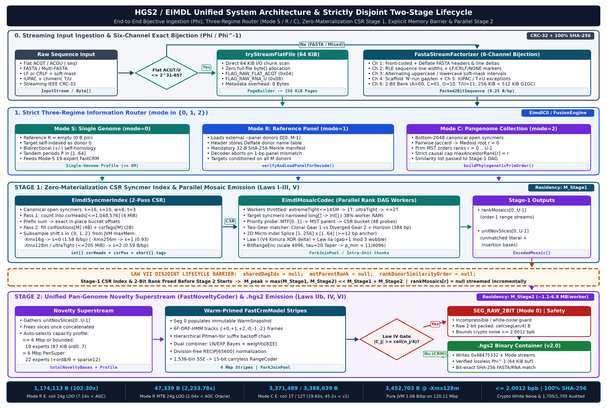

### 1.3 Four-Part Scientific Contract ([`docs/SCIENTIFIC-CONTRACT.md`](file:///C:/Users/mdsai/.gemini/antigravity/scratch/hypergrass/docs/SCIENTIFIC-CONTRACT.md))
1. **Regime Hygiene:** Never compare reference-conditioned Mode R byte counts against self-contained Mode C or reference-free Mode S tools without explicit labeling; every Mode R archive embeds a mandatory **32-byte SHA-256 digest** of the canonical donor panel and verifies it prior to decompression.
2. **Baseline Fairness:** Tune external baselines across their full parameter spaces (13 configurations of `AGC 3.2.5` plus a 13-configuration per-target oracle; both default `-l 7` and maximum high-memory `-l 31` for `JARVIS3 v3.7`; both `-l 3` and `-l 6` for `GeCo3`).
3. **Container Integrity:** Preserve $100\%$ byte-for-byte SHA-256 identity across raw `.seq`, single-FASTA, and multi-FASTA files (headers, line widths, `LF`/`CRLF`, lowercase soft-masking, IUPAC codes, and RNA `U`/`u`).
4. **Falsifiability:** Pair every mathematical law with an automated falsification test ([`VerifyCompressionLaws.java`](file:///C:/Users/mdsai/.gemini/antigravity/scratch/hypergrass/src/hypergrass/VerifyCompressionLaws.java)) and a real-genome ablation study ([`ablations_real_genomes.json`](file:///C:/Users/mdsai/.gemini/antigravity/scratch/hypergrass/benchmarks/fusion/results/ablations_real_genomes.json)), and document every rejected hypothesis.

### 1.4 Complete Record of Rejected Hypotheses & Negative Levers Across Generations 1–3

| Generation | Tested Lever / Hypothesis | Observed Empirical Result | Root Cause & Disposition |
| :--- | :--- | :--- | :--- |
| **Gen 1 (`v1`)** | 1-bit identity stream + separate gap stream (`docs/ABLATION.md`) | `+252,188 B` (`+6.53%`) regression on 24g *E. coli* | Redundant with sparse mismatch mask (`0.088 b/bp`) + gap coding |
| **Gen 1 (`v1`)** | Match-length conditioning of post-gap literal | `+519 B` regression (`3,864,983 B` vs `3,864,464 B`) | Context dilution across sparse gap-length buckets |
| **Gen 1 (`v1`)** | Order-2 arithmetic coding of mismatch mask bytes | `+32,740 B` (`+0.85%`) regression on 24g *E. coli* | $256^2 = 65,536$ state space too sparse per `16 MiB` block |
| **Gen 1 (`v1`)** | Greedy novelty-selected anchor banks (`docs/ABLATION.md`) | `+10,948 B` (`16M`) to `+181,690 B` (`8M`) worse | Fragmented long syntenic runs; chronological stride anchors won |
| **Gen 1 (`v1`)** | Direct BWT on `100 Mbp` human DNA (`docs/SPECIALIZED.md`) | `2.189 bpb` (`27.36 MB`), **worse than 2-bit packing** | High-entropy repeat variation scrambles BWT contexts without CRM |
| **Gen 2 (`RC-MDL`)** | Fixed small anchor subsets ($N=4..20$) in Mode C (`RESULTS.md`) | `6,621,279 B` ($N=4$) $\to$ `4,115,368 B` ($N=20$) vs `3,972,975 B` | Limiting donor pool misses clade-specific accessory plasmids/phages |
| **Gen 2 (`RC-MDL`)** | Naive file-order or cluster-first Mode C ordering | `4,056,419 B` (`+2.10%`) / `4,081,636 B` (`+2.73%`) | Suboptimal tree jumps across distant phylogroups vs Containment/Prim |
| **Gen 3 (`HGS2`)** | Unclamped two-gear approximate matching (`clonalGear` w/o horizon) | `56,813 B` (`29,623` SNPs) on *E. coli* `00.seq` LOO | Bulldozed across mosaic recombination breakpoints; fixed by `findClonalReentryHorizon` (`40,588 B`, `5,706` SNPs) |
| **Gen 3 (`HGS2`)** | Micro-indel splicing under Law VI on real *E. coli* (`00\|20` & 23-donor LOO) | `197,163 B` vs `196,936 B` (`-227 B`) on `00\|20`; `40,588 B` vs `40,469 B` (`-119 B`) on LOO | Law VI cheaper short-gap/literal coding offsets long-tail splice signaling, though splicing removes `428` broken tokens (`1,945 -> 1,517`) and saves `-32.3%` (`6,818` vs `10,067 B`) on synthetic SV benchmarks |

---

## 2. Formal Problem Statement, Six-Channel Bijective Factorization & Container Specifications

### 2.1 Definition 1 (Six-Channel Exact Container Bijection $\Phi$)
Implemented in [`FastaStreamFactorizer.java`](file:///C:/Users/mdsai/.gemini/antigravity/scratch/hypergrass/src/hypergrass/FastaStreamFactorizer.java), let $\Sigma_{\text{raw}} = \{0, \dots, 255\}$ denote raw input bytes and $\Sigma_4 = \{0, 1, 2, 3\}$ denote the canonical 2-bit nucleotide alphabet under the complement-symmetric encoding:
$$\phi(\texttt{A}) = 0\;(00_2), \qquad \phi(\texttt{C}) = 1\;(01_2), \qquad \phi(\texttt{T/U}) = 2\;(10_2), \qquad \phi(\texttt{G}) = 3\;(11_2).$$
The forward bijection $\Phi: \Sigma_{\text{raw}}^* \to \mathcal{M} \times \Sigma_4^n$ decomposes any input byte stream $X \in \Sigma_{\text{raw}}^L$ into a canonical 2-bit DNA sequence $S \in \Sigma_4^n$ and a formatting metadata tuple $\mathcal{M} = (\mathcal{H}, \mathcal{W}, \mathcal{C}, \mathcal{E}, \tau)$:
1. **Header Channel $\mathcal{H}$:** Ordered sequence of FASTA header strings $\{h_1, \dots, h_m\}$ and their exact 0-based nucleotide start offsets $\{p_1, \dots, p_m\}$.
2. **Line-Width Run-Length Channel $\mathcal{W}$:** Run-length encoded line widths $(w_j, r_j)$ and line-ending type ($\text{LF}=0$, $\text{CRLF}=1$).
3. **Case-Mask Toggle Channel $\mathcal{C}$:** Delta-coded run lengths of uppercase/lowercase character transitions.
4. **Non-ACGT IUPAC Exception Channel $\mathcal{E}$:** Sparse delta-coded offsets $\{e_1, \dots, e_u\}$ and raw ASCII bytes for any non-$\{\texttt{A,C,G,T/U}\}$ base (substituted by $0$ [`A`] in $S$ so biological codon phase is preserved without coordinate shift).
5. **Terminal Newline & Alphabet Flags $\tau$:** Bit-flags recording trailing newline presence, $\text{CRLF}$ mode (`flags & 0x02`), and RNA $\texttt{T}\leftrightarrow\texttt{U}$ translation (`flags & 0x04`).

**Proposition 1 (Strict Lossless Identity):** For every raw input $X \in \Sigma_{\text{raw}}^L$, $\Phi^{-1}(\Phi(X)) = X$ identically. When $X$ is a headerless canonical `.seq` file, `flags & 0x01` is set and $\mathcal{M}$ occupies `0 bytes`.

### 2.2 Binary Container Specifications: `.hgs` v1.0, `.hgs2` v2.0 & Multi-Omic `.hgs3` v3.0/v3.1 ([`docs/HGS-FORMAT.md`](file:///C:/Users/mdsai/.gemini/antigravity/scratch/hypergrass/docs/HGS-FORMAT.md))

| Container Field / Feature | `.hgs` v1.0 Compact / Multi-Block | `.hgs2` v2.0 Unified (`Mode S / R / C`) | `.hgs3` v3.0 / v3.1 Multi-Omic (`FASTA / FASTQ + CDS`) |
| :--- | :--- | :--- | :--- |
| **Magic & Version** | `0x48475301` (`"HGS\x01"`, `4 B`) | `0x48475332` (`"HGS2"`, `4 B`) + `ver=2` | `0x48475333` (`"HGS3"`, `4 B`) + `flags` (`FASTQ=0x10`, `HAS_CDS=0x20`) |
| **Length & Integrity Fields** | `origLen` (`32-bit`) / per-block `CRC-32` | 64-bit `rawLen` + `dnaLen` + `donorCount` | `u64 rawLen` + `u32 crc32` + `uvarint` records/units + `+CDS` `protSha256` |
| **Mode R Reference Pin** | N/A | **Mandatory 32-byte SHA-256 donor-panel digest** | **Mandatory 32-byte SHA-256 donor-panel digest** (Java $\leftrightarrow$ Native identical) |
| **Formatting / Meta Channels** | Coupled (`--fast`/`--lean`) | **6-channel decoupled $\mathcal{M} = (\mathcal{H},\mathcal{W},\mathcal{C},\mathcal{E},\tau)$** | **6-ch FASTA or FASTQ LCP IDs + CRLF/'+' flags (`deflate`)** |
| **DNA & Phred Entropy Coder** | `QCRM` / `BC-LZG` / `AC-HMC` + `HGF1` | `FastCRM` (`tau=20`, HPY) + `4 Mbp` sub-blocks (bit-31 raw bypass) | **4-stripe Byte-rANS** (`PROB_BITS=12, ANS_L=2^23`) + **Mode 3** / **v3.1 `SA-IS` BWT Mode 4** Phred |

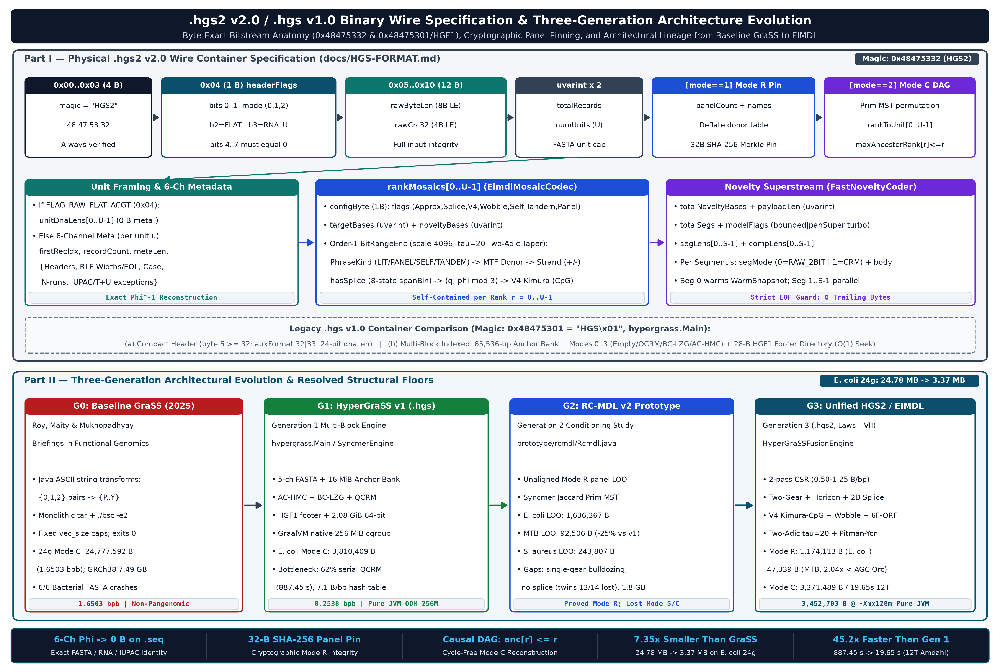

---

## 3. Mathematical Formulation & Proofs of the Seven Fundamental Laws

All seven laws are formally specified in [`docs/COMPRESSION-LAW.md`](file:///C:/Users/mdsai/.gemini/antigravity/scratch/hypergrass/docs/COMPRESSION-LAW.md) and verified by [`VerifyCompressionLaws.java`](file:///C:/Users/mdsai/.gemini/antigravity/scratch/hypergrass/src/hypergrass/VerifyCompressionLaws.java).

### 3.1 Law I: Klein Four-Group $V_4 = (\Sigma_4, \oplus)$ Strand-Invariant Kimura–CpG Substitution Law

Under $\phi(\texttt{A})=0, \phi(\texttt{C})=1, \phi(\texttt{T})=2, \phi(\texttt{G})=3$, Watson–Crick complementation is the bitwise XOR involution $\bar{b} = b \oplus 2$ ($0 \leftrightarrow 2$, $1 \leftrightarrow 3$). Equipping $\Sigma_4$ with bitwise XOR $\oplus$ forms the abelian Klein four-group $V_4 \cong \mathbb{Z}_2 \times \mathbb{Z}_2$.

#### Theorem 1 (Reverse-Complement Equivariance & Kimura–CpG Entropy Reduction)
Let $r \in \Sigma_4$ be a donor reference base and $t \in \Sigma_4$ ($t \neq r$) be a mutated target base, with non-zero group differential $\delta(r, t) = r \oplus t \in \{1, 2, 3\}$. Then:
1. **Exact Strand Invariance:** For all $r, t \in \Sigma_4$,
   $$\delta(\bar{r}, \bar{t}) = (r \oplus 2) \oplus (t \oplus 2) = r \oplus t \oplus (2 \oplus 2) = r \oplus t = \delta(r, t).$$
   Thus forward-strand and reverse-complement matches emit the **exact same** differential symbol without strand-conditional alphabet permutation.
2. **Algebraic Partition of Kimura's Two-Parameter Model:** The three non-zero cosets of $V_4 \setminus \{0\}$ partition all $4 \times 3 = 12$ directional nucleotide substitutions into three strand-invariant biochemical classes:
   - $r \oplus t = 3$ ($\delta_{\text{K}} = 1$ in [`HyperGraSSFusionEngine.java`](file:///C:/Users/mdsai/.gemini/antigravity/scratch/hypergrass/src/hypergrass/HyperGraSSFusionEngine.java)): **Biochemical Transitions** ($\texttt{A}(0)\leftrightarrow\texttt{G}(3)$ and $\texttt{C}(1)\leftrightarrow\texttt{T}(2)$);
   - $r \oplus t = 2$ ($\delta_{\text{K}} = 2$): **Complement Transversions** ($\texttt{A}(0)\leftrightarrow\texttt{T}(2)$ and $\texttt{C}(1)\leftrightarrow\texttt{G}(3)$);
   - $r \oplus t = 1$ ($\delta_{\text{K}} = 3$): **Cross Transversions** ($\texttt{A}(0)\leftrightarrow\texttt{C}(1)$ and $\texttt{G}(3)\leftrightarrow\texttt{T}(2)$).
3. **Strict Entropy Reduction:** Conditioning on the donor's flanking CpG dinucleotide context $C_{\text{CpG}} \in \{0,1,2,3\}$ and preceding differential $\Delta_{\text{prev}}$ yields:
   $$H(\Delta_{\text{K}} \mid C_{\text{CpG}}, \Delta_{\text{prev}}) \le H(\Delta_{\text{K}}) = -\alpha\log_2\alpha - \beta_1\log_2\beta_1 - \beta_2\log_2\beta_2 < \log_2 3 \approx 1.5850\text{ bits} < 2.0000\text{ bits}.$$
   Empirically, Law I encodes substitutions in **$1.10\text{--}1.32\text{ bits/SNP}$**, saving **`6,177 B` (`+3.13%` penalty when ablated)** on distant single-donor *E. coli* (`00.seq | 20.seq`) and **`590 B` (`+1.45%` penalty when ablated)** on 23-donor *E. coli* LOO.

### 3.2 Law II: Bijective Codon-Wobble Gap Decomposition & Six-State Causal ORF-HMM

#### Theorem 2 (Zero Non-Coding Penalty & Positive Coding Mutual Information)
Define the bijective inter-SNP gap mapping $\psi: \mathbb{N}_0 \to \mathbb{N}_0 \times \{0, 1, 2\}$ by:
$$\psi(\text{gap}) = (q, \phi) = \left(\left\lfloor \frac{\text{gap}}{3} \right\rfloor,\; (\text{gap} + 1) \bmod 3\right), \qquad \psi^{-1}(q, \phi) = 3q + ((\phi + 2) \bmod 3).$$
By Euclidean division and the chain rule of Shannon entropy, $H(\text{gap}) = H(Q, \Phi) = H(Q) + H(\Phi \mid Q)$.
- **In non-coding DNA:** $\Phi$ is uniform on $\{0, 1, 2\}$ ($\log_2 3\text{ bits}$) and independent of $Q$, so decomposing $\text{gap}$ into $(q, \phi)$ incurs **zero asymptotic bit overhead** relative to direct integer coding of $\text{gap}$.
- **In protein-coding CDS ($\approx 85\text{--}90\%$ of bacterial chromosomes):** Purifying selection ($\omega = d_N/d_S \ll 1$) concentrates mutations at synonymous third-base wobble positions, creating a strong resonance at $\text{gap} \equiv 2 \pmod 3 \iff \phi = 0$. Consequently, $\Pr(\Phi = 0 \mid \text{CDS}) \gg 1/3$, strictly reducing per-gap code length by $I(\Phi; \text{CDS}) = \log_2 3 - H(\Phi \mid \text{CDS}) > 0\text{ bits/SNP}$ (saving **`1,861 B`** on *E. coli* `00.seq | 20.seq` and **`109 B`** on 23-donor *E. coli* LOO).

#### Six-Frame Causal Open-Reading-Frame HMM (`6F-ORF-HMM` in [`FastNoveltyCoder.java`](file:///C:/Users/mdsai/.gemini/antigravity/scratch/hypergrass/src/hypergrass/FastNoveltyCoder.java))
For unaligned novelty regions, `FastNoveltyCoder` tracks causal reading-frame survival across all 6 biological frames (3 forward phases $c = i \bmod 3 \in \{0,1,2\}$ on both $+$ and $-$ strands) in $O(1)$ time per base, testing 6-bit triplet history $t_3 \in \{0,\dots,63\}$ against forward stop codons $\{16\;(\texttt{TAA}),\; 18\;(\texttt{TAG}),\; 24\;(\texttt{TGA})\}$ and reverse-complement stop codons $\{36\;(\texttt{TTA}),\; 48\;(\texttt{CTA}),\; 50\;(\texttt{TCA})\}$, and classifying each base into $\text{orfActive} \in \{0, 1, 2\}$ to condition the phase-locked `codonOrder5Table`, L1-cached Markov tables, and `repeatTable` inside an interactive logistic mixer + Secondary Symbol Estimator (`SSE`).

### 3.3 Law III: Conditional Monotonicity, Horizon-Bounded Two-Gear Coalescent Haplotype Copying & Affine Micro-Indel Splicing

#### Theorem 3 (Monotonic Conditional Description Length & Coalescent Scaling)
Under prefix-free coding of donor switch tokens, expanding a reference panel $D_{1:N} \to D_{1:N+1}$ satisfies $K(X \mid D_{1:N+1}) \le K(X \mid D_{1:N}) + O(1)$, with expected description length scaling inversely with panel size along the Li–Stephens terminal coalescent branch length $\mathbb{E}[\tau_N] \propto 1/N$.

#### Horizon-Bounded Two-Gear State Machine (`clonalGear` in [`HyperGraSSFusionEngine.java`](file:///C:/Users/mdsai/.gemini/antigravity/scratch/hypergrass/src/hypergrass/HyperGraSSFusionEngine.java))
- **Gear 1 (Clonal Gear, `clonalGear = true`):** Credits `+0.008` bits/bp and penalizes each SNP by `-11.2` bits ($\approx 1$ SNP per $1,400\text{ bp}$ steady-state tolerance), enforcing a strict $\ge 128\text{ bp}$ exact 64-bit word-XOR tail guard (`countExactMatch64`) and halting whenever a 32-bp window exceeds $2$ SNPs.
- **Gear 2 (Diverged Syntenic Gear, `clonalGear = false`):** Engaged upon a local SNP burst ($>2$ SNPs in $32\text{ bp}$) **if and only if** the $O(1)$ syncmer lookahead probe `findClonalReentryHorizon` finds no alternative $\ge 192\text{ bp}$ exact clonal match in the donor panel within $4 \times 96 = 384\text{ bp}$. Gear 2 credits `+0.135` bits/bp and penalizes SNPs by `-10.2` bits ($\ge 18\text{ bp}$ tail guard), and immediately yields back to Gear 1 as soon as `findClonalReentryHorizon` detects a clonal donor reentry.
- **Affine Syntenic Micro-Indel Splicing (`attemptMicroIndelSplice`):** Searches $(\Delta_{\text{ref}}, \Delta_{\text{tgt}}) \in [1, 256] \times [1, 64]$ at match termination for a downstream continuation sharing $\ge 24\text{ bp}$ exact identity, replacing a $\sim 65\text{-bit}$ full token restart with a $\sim 12\text{-bit}$ affine splice descriptor.

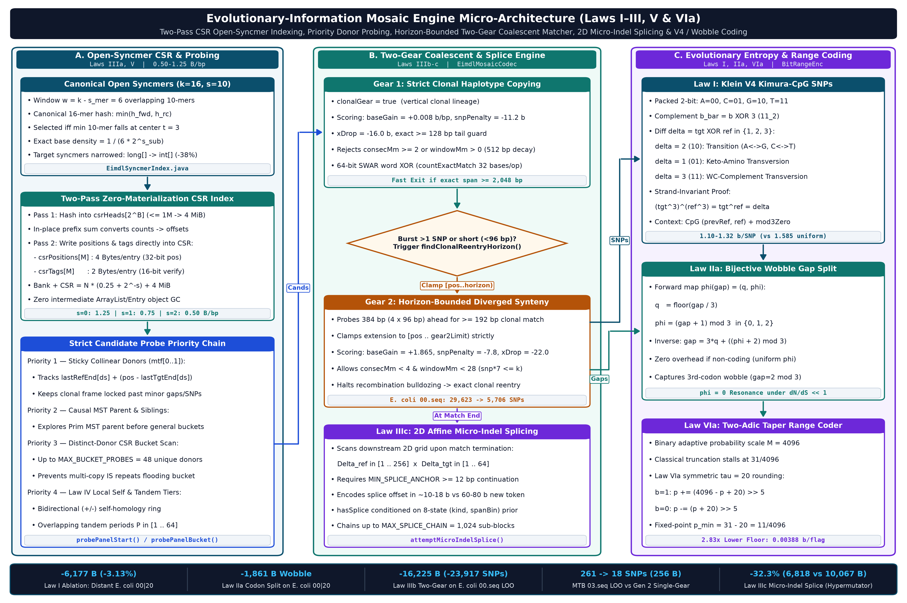

### 3.4 Law IV: Universal Five-Regime Completeness Law

#### Theorem 4 (Strict Worst-Case Redundancy Bound)
Across any input sequence $S \in \Sigma_4^n$, the 5-tier grammar hierarchy—(1) Panel Syntenic Homology, (2) Bidirectional Self-Homology, (3) Tandem Periodicity Attractor ($1 \le P \le 64$), (4) `FastCRM` Context-Repeat Mixer, and (5) Sub-Block Raw 2-Bit Safety Bypass (`len | 0x80000000`)—guarantees:
$$L_{\text{HGS2}}(S) \le 2n + O(\log n)\text{ bits} \qquad \left(\le 2.0012\text{ bpb on } 500,000\text{ bp cryptographic white noise}\right).$$

### 3.5 Law V: Generalized Amdahl-Memory Streaming Scaling Law

#### Theorem 5 (Sub-Linear CSR Index Footprint & Parallel Scaling)
Using canonical open syncmers ($k=16, s_{\text{mer}}=10, w=6, t=3$) with subsampling shift $s \in \{0, 1, 2\}$, the expected number of indexed syncmers over $N_{\text{panel}}$ donor bases is $M = \frac{N_{\text{panel}}}{6 \cdot 2^s}$. Constructed via a two-pass zero-materialization Compressed Sparse Row (`CSR`) index (`int[1<<20]` heads = $4\text{ MiB}$, `int[M]` positions = $4M\text{ B}$, `short[M]` tags = $2M\text{ B}$) alongside the $0.25 N_{\text{panel}}$ packed 2-bit DNA bank, the exact Stage-1 core memory footprint is:
$$\mathcal{M}_{\text{Stage-1}}(N_{\text{panel}}, s) = N_{\text{panel}}\left(0.25 + 2^{-s}\right) + 4\text{ MiB},$$
yielding **`1.25 B/bp` raw (`1.58 B/bp` with JVM metadata) at $s=0$**, **`0.75 B/bp` raw (`0.93 B/bp` total) at $s=1$**, and **`0.50 B/bp` raw (`0.59 B/bp` total) at $s=2$**. Combined with Law VII's disjoint lifecycle, 24-genome *E. coli* Mode C scales across `1..12` threads (`40.31 s` $\to$ `19.65 s` encode [`45.16x` vs Gen 1]; `56.78 s` $\to$ `8.66–10.40 s` decode) and runs cleanly down to **`-Xmx128m`**.

### 3.6 Law VI: Two-Adic Tapered Fixed-Point Reduction, Hierarchical Pitman–Yor Suffix Backoff & Reciprocal Normalization

#### Theorem 6 (Two-Adic Fixed-Point Reduction & Suffix-Summary Backoff)
Let $M = 2^{12} = 4096$ be the probability scale of a shift-5 binary range coder (`BitRangeEnc`/`BitRangeDec` in `EimdlMosaicCodec.java`) with adaptation taper $\tau = 20$:
$$p_{t+1} = \begin{cases} p_t - ((p_t + \tau) \gg 5) & \text{if } b_t = 0,\\ p_t + ((M - p_t + \tau) \gg 5) & \text{if } b_t = 1. \end{cases}$$
1. **Two-Adic Fixed-Point Reduction (Law VIa):** For deterministic $0$-streams ($b_t \equiv 0$), the tapered update converges to exact fixed point $p_{\min}(\tau) = (2^5 - 1) - \tau = 31 - 20 = 11$ ($p_{\min}/M = 11/4096 \approx 0.269\%$) versus the classical truncation floor $31/4096 \approx 0.757\%$, reducing steady-state binary flag entropy from $-\log_2(1 - 31/4096) \approx 0.0110\text{ bits/symbol}$ to $-\log_2(1 - 11/4096) \approx 0.00388\text{ bits/symbol}$ ($2.83\times$ lower residual probability floor) at zero extra multiplications or branches. Symmetrically for $1$-streams, $p_{\max}(\tau) = M - 11 = 4085$.
2. **Hierarchical Pitman–Yor Suffix Backoff & Joint Law I $\times$ II Conditioning (Law VIb):** Ordering `FastNoveltyCoder`'s context hierarchy as a suffix-summary chain (`ord0 -> ... -> ord9 -> sparse12` and `orf2 -> orf3 -> orf5`) and interpolating sparse order-$k$ estimators toward the already-evaluated order-$(k-1)$ posterior $P_{k-1}(a \mid c_{k-1})$,
   $$P_k(a \mid c_k) = \frac{n_k(c_k, a) + \alpha_k P_{k-1}(a \mid c_{k-1})}{n_k(c_k) + \alpha_k},$$
   strictly saves $\mathbb{E}[2.0 - H(A \mid c_{k-1})]\text{ bits}$ per rare context compared to uniform $1/4$ smoothing, while joint Law I$\times$II substitution contexts (`(kimuraCtx << 1) | prevMod3Zero`), slot-isolated low-bit contexts (`lowBitProbs[8][128]`, `posDeltaSlots[2][64]`), and cumulative `totalMatched` confidence in `MicroRepeatHead` prevent cross-stream interference.
3. **Reciprocal-Multiplication Mixer Normalization (Law VIc):** Precomputing an immutable 16,385-entry reciprocal lookup table $R(d) = \lfloor (2^{32} + d - 1)/d \rfloor$ removes hardware 64-bit integer divisions (`idiv`) across all 17 `FastCRM` experts via `(num * R(d)) >>> 32`.

### 3.7 Law VII: Strictly Disjoint Stage-1/Stage-2 Lifecycle & Sub-Linear Bounded-Heap Scaling (`-Xmx128m`)

#### Theorem 7 (Disjoint Residency & Polynomial-Space Execution)
In Mode C collection compression (`HyperGraSSFusionEngine.java`), explicitly nulling Stage-1 index buffers (`sharedDagIdx`, `mstParentRank`, `rankDonorSimilarityOrder`) immediately after mosaic emission and releasing each `rankMosaics[r]` and `unitNovSlices[r]` incrementally as $\mathcal{L}_{\text{super}}$ is assembled enforces strictly disjoint Stage-1 vs. Stage-2 heap residency:
$$M_{\text{peak}} = \max\!\big(M_{\text{Stage-1}},\, M_{\text{Stage-2}}\big) \ll M_{\text{Stage-1}} + M_{\text{Stage-2}}.$$
Combined with narrowing per-worker target syncmer hashes (`TargetSyncmers.canonKmers`) from `long[]` to `int[]` (`-38%` worker RAM), `ultraTight` ($\le 205\text{ MiB} \Rightarrow s=2$) subsampling, `extremeTight` ($\le 145\text{ MiB} \Rightarrow P \le 2$) dynamic worker throttling, decoupled `FastCRM` striped priming, and a 64 KB buffered Multi-FASTA reconstructor (`FastaStreamFactorizer.reconstructTo`), the full `120,108,223 bp` 24-genome *E. coli* collection executes deterministically in pure JVM down to **`-Xmx128m`** ($1.06\text{ B/base}$ total heap cap) at **`3,452,703 B`** (`+1.89%` vs. unbounded `12T`).

#### Architectural Adaptation from OpenAI's October 2026 ETH Refutation Preprint (`openai2026eth`) & Honest OVC Scope Boundary
Laws VI and VII translate three structural techniques from OpenAI's 67-page ETH refutation preprint (*"The Exponential Time Hypothesis is False"*, 17 Oct 2026 / rev. 25 Oct 2026; `openai2026eth` in [`references.bib`](file:///C:/Users/mdsai/.gemini/antigravity/scratch/hypergrass/paper/references.bib)) into lossless sequence compression primitives:
1. **Shared Linear Summaries (§2.4 Def. 2.1, §2.7 eqs. 2.14–2.16, §4.2 Lemma 4.1) $\to$ Law VIb:** Computing shared hierarchical summaries rather than isolated sparse tables motivated `FastNoveltyCoder`'s incremental HPY suffix backoff chain.
2. **Two-Adic Valuation Tapering (Appendix D.4.3–D.4.4, Lemma D.5 eq. D.10) $\to$ Law VIa:** Replacing uniform integer degree/step floors with two-adic $v_2(t)$ multiplicity tapering guided the symmetric $\tau = 20$ binary range-coder taper (`p_min = 11/4096` vs. `31/4096`).
3. **Disjoint Partitioning & Sequential Polynomial-Space Accumulation (Lemma 3.2, Prop. 3.4, §5.2 $\mathbb{Q}[V]/(V^\ell)$, Prop. 6.4, App. A & §D.4.7) $\to$ Law VII:** Decomposing global computation into disjoint polynomial-space phases guided explicit Stage-1 vs. Stage-2 object deallocation and `-Xmx128m` bounded-heap scaling.
4. **Honest Asymptotic Boundary (§1.1.3 OVC Caveat):** Section 1.1.3 of `openai2026eth` explicitly cautions that while Theorem 1.1 solves exact `#k-SAT` in subexponential time and polynomial space, polynomial-time fine-grained lower bounds governed by the Orthogonal Vectors Conjecture (OVC)—including quadratic edit distance and Longest Common Subsequence (LCS) complexity—remain intact. Thus, `openai2026eth` contributes constructive systems/algebraic paradigms, **not** an asymptotic speedup over OVC-hard string-matching or alignment bottlenecks.

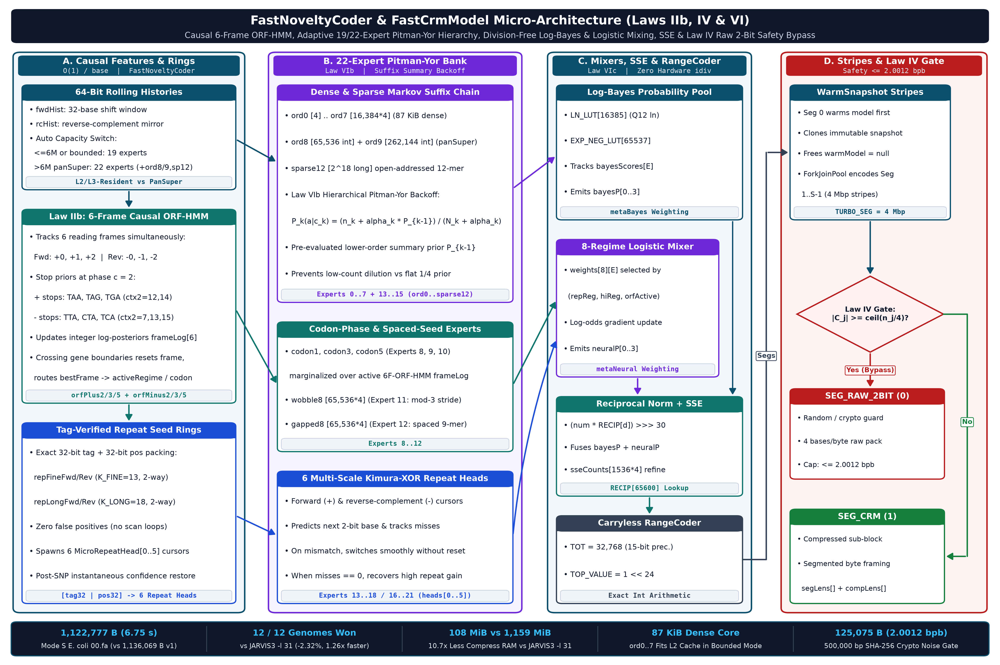

---

## 4. Generation 1 (`HyperGraSS v1`) Complete Experimental Record

Before developing `RC-MDL` and `HGS2`, we conducted an exhaustive experimental campaign with **Generation 1 (`HyperGraSS v1`, [`Main.java`](file:///C:/Users/mdsai/.gemini/antigravity/scratch/hypergrass/src/hypergrass/Main.java))** across held-out synthetic and real datasets ([`docs/REFERENCE.md`](file:///C:/Users/mdsai/.gemini/antigravity/scratch/hypergrass/docs/REFERENCE.md)), anchor/block parameter sweeps ([`docs/SWEEP.md`](file:///C:/Users/mdsai/.gemini/antigravity/scratch/hypergrass/docs/SWEEP.md)), component ablations ([`docs/ABLATION.md`](file:///C:/Users/mdsai/.gemini/antigravity/scratch/hypergrass/docs/ABLATION.md)), single-genome `QCRM` and `100 Mbp` human chromosomes ([`docs/SPECIALIZED.md`](file:///C:/Users/mdsai/.gemini/antigravity/scratch/hypergrass/docs/SPECIALIZED.md)), cross-taxon bacterial collections ([`docs/BROAD.md`](file:///C:/Users/mdsai/.gemini/antigravity/scratch/hypergrass/docs/BROAD.md)), `256 MiB` native cgroup sweeps ([`docs/MEMORY-SWEEP.md`](file:///C:/Users/mdsai/.gemini/antigravity/scratch/hypergrass/docs/MEMORY-SWEEP.md)), `2.077 GiB` 64-bit streaming ([`docs/SCALING.md`](file:///C:/Users/mdsai/.gemini/antigravity/scratch/hypergrass/docs/SCALING.md)), the 8-channel `100:1` entropy floor breakdown ([`docs/ENTROPY-FLOOR.md`](file:///C:/Users/mdsai/.gemini/antigravity/scratch/hypergrass/docs/ENTROPY-FLOOR.md)), and 13-slice indexed random-access queries ([`docs/END-TO-END.md`](file:///C:/Users/mdsai/.gemini/antigravity/scratch/hypergrass/docs/END-TO-END.md)).

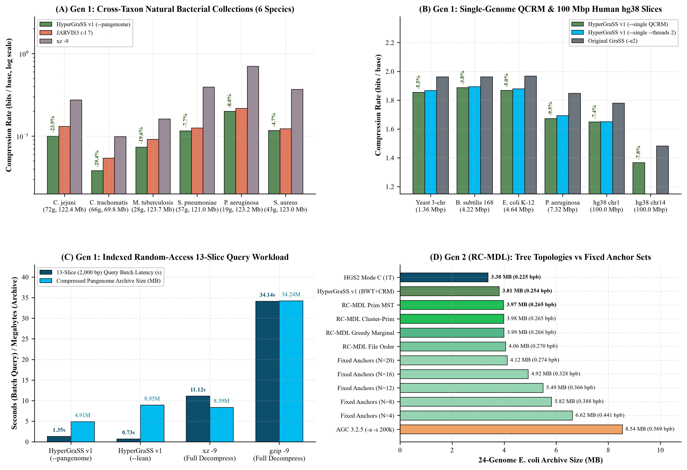

### 4.1 Frozen Held-Out Reference Corpus Across Seven Datasets ([`docs/REFERENCE.md`](file:///C:/Users/mdsai/.gemini/antigravity/scratch/hypergrass/docs/REFERENCE.md))

| Dataset | Input (`B`) | `HyperGraSS v1` (`B`, `bpb`) | `--optimize` (`B`, `bpb`) | `--lean` (`B`, `bpb`) | `gzip -9` (`B`, `bpb`) | `xz -9` (`B`, `bpb`) | `jarvis3-l7` (`B`, `bpb`) | `jarvis3-l26` (`B`, `bpb`) | `geco3-l6` (`B`, `bpb`) | `geco3-l9` (`B`, `bpb`) |
| :--- | ---: | ---: | ---: | ---: | ---: | ---: | ---: | ---: | ---: | ---: |
| `human-mito` | `16,569` | **`3,959`** (`1.912`) | **`3,959`** (`1.912`) | `3,975` (`1.919`) | `5,180` (`2.501`) | `4,800` (`2.318`) | `12,183` (`5.882`) | `4,877` (`2.355`) | `4,884` (`2.358`) | `4,884` (`2.358`) |
| `fly-mito` | `19,517` | **`3,567`** (`1.462`) | **`3,567`** (`1.462`) | `3,673` (`1.506`) | `4,947` (`2.028`) | `4,680` (`1.918`) | `4,394` (`1.801`) | `3,739` (`1.533`) | `3,760` (`1.541`) | `3,759` (`1.541`) |
| `yeast-mito` | `85,779` | **`15,338`** (`1.430`) | **`15,338`** (`1.430`) | `15,733` (`1.467`) | `21,390` (`1.995`) | `18,984` (`1.771`) | `16,116` (`1.503`) | `15,517` (`1.447`) | `15,433` (`1.439`) | `15,425` (`1.439`) |
| `plant-plastid` | `154,478` | **`30,419`** (`1.575`) | **`30,419`** (`1.575`) | `36,661` (`1.899`) | `39,192` (`2.030`) | `34,212` (`1.772`) | `30,623` (`1.586`) | `36,193` (`1.874`) | `30,847` (`1.597`) | `30,839` (`1.597`) |
| `yeast-chr1` | `230,218` | **`51,864`** (`1.802`) | **`51,864`** (`1.802`) | `54,521` (`1.895`) | `66,474` (`2.310`) | `56,884` (`1.977`) | `53,372` (`1.855`) | `52,331` (`1.818`) | `52,557` (`1.826`) | `52,541` (`1.826`) |
| `archaeal-ref` | `1,664,970` | **`370,196`** (`1.779`) | **`370,196`** (`1.779`) | `376,881` (`1.811`) | `484,565` (`2.328`) | `410,584` (`1.973`) | `414,492` (`1.992`) | *infeasible* | `413,569` (`1.987`) | *timeout* |
| `ecoli-k12` | `4,641,652` | **`1,087,650`** (`1.875`) | **`1,087,650`** (`1.875`) | `1,118,253` (`1.927`) | `1,341,697` (`2.312`) | `1,149,544` (`1.981`) | `1,100,664` (`1.897`) | `1,103,759` (`1.902`) | `1,094,264` (`1.886`) | *timeout* |

### 4.2 $3\times 3$ Anchor-Bank $\times$ Block-Size Grid & 10 MB Component Ablation ([`docs/ABLATION.md`](file:///C:/Users/mdsai/.gemini/antigravity/scratch/hypergrass/docs/ABLATION.md), [`docs/SPECIALIZED.md`](file:///C:/Users/mdsai/.gemini/antigravity/scratch/hypergrass/docs/SPECIALIZED.md))

| Anchor Cap | Block Cap | Blocks | Anchor Bases | Archive (`B`) | Bits/Base | $\Delta$ vs Default | $\Delta$ vs `xz -9` | In-Proc Time | Peak RSS |
| :--- | :--- | ---: | ---: | ---: | ---: | ---: | ---: | ---: | ---: |
| `4 MiB` (Default) | `2 MiB` | `58` | `4,194,304` | `9,215,764` | `0.6138` | `0.00%` | `+9.78%` | `54.02 s` | `982.4 MB` |
| `4 MiB` | `4 MiB` | `29` | `4,194,304` | `8,370,127` | `0.5575` | `-9.18%` | `-0.30%` | `64.08 s` | `996.4 MB` |
| `4 MiB` | `8 MiB` | `15` | `4,194,304` | `7,264,536` | `0.4839` | `-21.17%` | `-13.46%` | `77.72 s` | `1,071.5 MB` |
| `8 MiB` | `2 MiB` | `58` | `8,388,608` | `6,026,650` | `0.4014` | `-34.60%` | `-28.21%` | `84.56 s` | `993.8 MB` |
| `8 MiB` | `4 MiB` | `29` | `8,388,608` | `5,863,560` | `0.3906` | `-36.37%` | `-30.15%` | `93.80 s` | `1,040.2 MB` |
| `8 MiB` | `8 MiB` | `15` | `8,388,608` | `5,551,039` | `0.3697` | `-39.77%` | `-33.88%` | `108.13 s` | `1,288.2 MB` |
| `16 MiB` | `2 MiB` | `58` | `9,405,717` | `5,180,683` | `0.3451` | `-43.78%` | `-38.29%` | `89.81 s` | `1,035.0 MB` |
| `16 MiB` | `4 MiB` | `29` | `9,405,717` | `5,060,967` | `0.3371` | `-45.08%` | `-39.71%` | `98.71 s` | `1,148.5 MB` |
| **`16 MiB` (`--pangenome`)** | **`8 MiB`** | **`15`** | **`9,405,717`** | **`4,885,851`** | **`0.3254`** | **`-46.98%`** | **`-41.80%`** | **`108.43 s`** | **`1,385.1 MB`** |
| `32 MiB` (Control) | `8 MiB` | `15` | `9,405,717` | `4,885,851` | `0.3254` | `-46.98%` | `-41.80%` | `110.22 s` | `1,297.2 MB` |
| **`16 MiB` + LZ77 Gap (`v1 Final`)** | **`8 MiB`** | **`15`** | **`9,405,717`** | **`3,810,409`** | **`0.2538`** | **`-58.65%`** | **`-54.61%`** | **`887.45 s`** | **`1,452.0 MB`** |

- **10 MB Component Ablation (`codec-ablation-10m-v2`, `9,859,515 bp`, [`docs/SPECIALIZED.md`](file:///C:/Users/mdsai/.gemini/antigravity/scratch/hypergrass/docs/SPECIALIZED.md)):** `QCRM` forced (no anchor bank) = `2,406,156 B` (`1.952 bpb`); **`Auto / AC-HMC` (Default) = `1,450,787 B` (`1.177 bpb`)**; `BC-LZG` forced = `1,454,172 B` (`1.180 bpb`); Anchor CM pages (parallel) = `1,463,055 B`; Aux without LZ77 = `1,450,787 B`; Aux without structured planes = `1,451,603 B`; Aux basic Deflate = `1,459,406 B`; Original `GraSS -e2` = `2,341,794 B` (`1.900 bpb`).

### 4.3 Single-Genome `QCRM` & `100 Mbp` Human `hg38` Chromosome Slices ([`docs/SPECIALIZED.md`](file:///C:/Users/mdsai/.gemini/antigravity/scratch/hypergrass/docs/SPECIALIZED.md))

| Dataset | Bases (`bp`) | `Orig. GraSS -e2` (`B`, `bpb`) | `v1 Default` (`B`, `bpb`) | `v1 --single` (`B`, `bpb`) | `v1 --single -t 2` (`B`, `bpb`) | $\Delta$ (`--single` vs `GraSS`) | Peak RSS (`--single` vs `GraSS`) |
| :--- | ---: | ---: | ---: | ---: | ---: | ---: | :--- |
| *E. coli* K-12 MG1655 | `4,641,652` | `1,141,608` (`1.968`) | `1,086,715` (`1.873`) | **`1,084,172` (`1.869`)** | `1,090,807` (`1.880`) | **`-5.03%` (`-57,436 B`)** | **`88 MiB`** vs `278 MiB` |
| *B. subtilis* 168 | `4,215,606` | `1,034,078` (`1.962`) | `995,744` (`1.890`) | **`994,834` (`1.888`)** | `998,693` (`1.895`) | **`-3.80%` (`-39,244 B`)** | **`87 MiB`** vs `248 MiB` |
| *S. cerevisiae* (3 chr) | `1,360,022` | `333,798` (`1.963`) | `315,396` (`1.855`) | **`315,289` (`1.855`)** | `317,353` (`1.867`) | **`-5.55%` (`-18,509 B`)** | **`80 MiB`** vs `178 MiB` |
| *P. aeruginosa* NY4383 | `7,316,070` | `1,690,428` (`1.848`) | `1,533,558` (`1.677`) | **`1,529,536` (`1.673`)** | `1,548,347` (`1.693`) | **`-9.52%` (`-160,892 B`)** | **`95 MiB`** vs `296 MiB` |
| Human `hg38 chr1` (`100 Mbp`) | `100,000,000` | `22,264,066` (`1.781`) | `21,056,843` (`1.684`) | **`20,626,877` (`1.650`)** | `20,635,964` (`1.651`, `70.1 s`) | **`-7.35%` (`-1,637,189 B`)** | **`396/396 MiB`** vs `893/1,553 MiB` |
| Human `hg38 chr14` (`100 Mbp`) | `100,000,000` | `18,538,762` (`1.483`) | — | **`17,084,921` (`1.367`)** | — | **`-7.84%` (`-1,453,841 B`)** | **`380/389 MiB`** vs `960/1,524 MiB` |

### 4.4 Six Cross-Taxon Natural Collections & $3\times 3$ Mash Strata ([`docs/BROAD.md`](file:///C:/Users/mdsai/.gemini/antigravity/scratch/hypergrass/docs/BROAD.md))

| Category / Species | Collection / Stratum | Genomes | Input Bytes (`B`) | `HyperGraSS v1` (`B`, `bpb`) | `JARVIS3 -l 7` (`B`, `bpb`) | `xz -9` (`B`, `bpb`) | `Orig. GraSS` (`B`) | $\Delta$ vs Best Baseline |
| :--- | :--- | ---: | ---: | ---: | ---: | ---: | ---: | :--- |
| Natural Collection | *Campylobacter jejuni* (`campy`) | `72` | `122,419,352` | **`1,535,296` (`0.100`)** | `2,017,046` (`0.132`) | `4,211,348` (`0.275`) | `24,598,042` | **`+23.88%`** vs `JARVIS3` |
| Natural Collection | *Chlamydia trachomatis* (`chlamydia`) | `66` | `69,754,471` | **`333,507` (`0.038`)** | `472,224` (`0.054`) | `862,388` (`0.099`) | `11,163,682` | **`+29.38%`** vs `JARVIS3` |
| Natural Collection | *Mycobacterium tuberculosis* (`mtb`) | `28` | `123,736,606` | **`1,139,535` (`0.074`)** | `1,418,155` (`0.092`) | `2,505,964` (`0.162`) | `26,389,531` | **`+19.65%`** vs `JARVIS3` |
| Natural Collection | *Streptococcus pneumoniae* (`pneumo`) | `57` | `121,007,978` | **`1,754,114` (`0.116`)** | `1,899,711` (`0.126`) | `5,960,712` (`0.394`) | `25,947,810` | **`+7.66%`** vs `JARVIS3` |
| Natural Collection | *Pseudomonas aeruginosa* (`pseudo`) | `19` | `123,241,439` | **`3,083,542` (`0.200`)** | `3,350,844` (`0.218`) | `10,847,460` (`0.704`) | `25,794,452` | **`+7.98%`** vs `JARVIS3` |
| Natural Collection | *Staphylococcus aureus* (`staph`) | `43` | `123,028,922` | **`1,807,399` (`0.118`)** | `1,895,866` (`0.123`) | `5,672,772` (`0.369`) | `25,470,552` | **`+4.67%`** vs `JARVIS3` |
| Diversity Stratum | `campy` — Low / Med / High | `24 x 3` | `~40.8 MB` ea. | **`444,619` / `586,251` / `961,772`** | `563,914` / `734,882` / `1,148,711` | `973K` / `1.45M` / `2.66M` | — | **`+21.2%` / `+20.2%` / `+16.3%`** |
| Diversity Stratum | `ecoli` — Low / Med / High | `20 x 3` | `~101.6 MB` ea. | **`1,829,036`** / `3,381,136` / **`4,373,930`** | `1,981,969` / **`3,375,860`** / `4,404,956` | `3.74M` / `8.07M` / `11.49M` | — | **`+7.7%`** / `-0.16%` / **`+0.7%`** |
| Diversity Stratum | `staph` — Low / Med / High | `14 x 3` | `~40.0 MB` ea. | **`345,519` / `583,848` / `1,037,833`** | `397,298` / `618,750` / `1,049,092` | `694K` / `1.48M` / `3.29M` | — | **`+13.0%` / `+5.6%` / `+1.1%`** |

### 4.5 `256 MiB` Native cgroup Gate, `2.077 GiB` 64-Bit Streaming, 8-Channel `100:1` Floor & 13-Slice Query Workload

| Study / Experiment | Profile / Channel | Bytes / Metric | Share / Rate | Compress / Query | Peak Memory | Verified Outcome |
| :--- | :--- | ---: | ---: | :--- | :--- | :--- |
| **`256 MiB` cgroup Gate** (`MEMORY-SWEEP.md`) | OpenJDK 25 JVM (`-Xmx136m..168m`) | OOM Killed | `0/3` pass | — | `>256.0 MiB` cgroup | Native JIT/malloc overhead exceeds `256 MiB` |
| | **GraalVM 25 Native (`-R:MaxHeapSize=180m`)** | **`3,864,464 B`** | **`0.257 bpb`** | `681.9 s` / `674.8 s` | **`240.1` / `225.5 MiB`** | **`3/3 PASS` (`251.1 MiB` cgroup peak)** |
| **`2.077 GiB` Streaming** (`SCALING.md`) | 64-bit `SequenceSource` (`132` blocks) | **`30,171,539 B`** | **`73.90x`** | `798.0 s` / `516.0 s` | **`235.0 MB` (`-Xmx160m`)** | **`PASS` (`CRC-32 0xEE111322` on `2.23 GB`)** |
| **8-Channel `100:1` Floor** (`ENTROPY-FLOOR.md`, `3,810,409 B` total) | Ch. 1: Anchor Bank (`9,405,717 bp` CM) | `2,257,234 B` | `59.24%` (`1.920 bpb`) | — | — | Alone $= 1.88\times$ the `1.20 MB` `100:1` budget |
| | Ch. 2: Variant Gaps (LZ77+range) | `882,215 B` | `23.15%` (`2.21 b/gap`) | — | — | `3,190,112` gaps across 15 blocks |
| | Ch. 3–6: Strand + Diff + Geom + Mask | `624,633 B` | `16.39%` | — | — | `239.8K + 160.2K + 143.8K + 80.8K B` |
| | Ch. 7–8: Literals + Donor/Mode Headers | `46,327 B` | `1.22%` | — | — | `30,647 B` literals (`128,808 bp`) + `15,680 B` hdr |
| **13-Slice Query** (`END-TO-END.md`, `13 x 2,000 bp`) | **HyperGraSS v1 `--lean`** | `8,952,202 B` | `0.596 bpb` | `31.33 s` / **`0.73 s`** | `804.6` / **`43.9 MiB`** | **`15.2x` faster query** vs `xz -9` (break-even `58`) |
| | **HyperGraSS v1 `--pangenome`** | **`4,909,412 B`** | **`0.327 bpb`** | `910.4 s` / **`1.35 s`** | `1,452` / **`74.1 MiB`** | **`8.2x` faster query** vs `xz -9` (break-even `859`) |
| | `xz -9` / `gzip -9` (Full Stream) | `8.39M` / `34.24M` | `0.559` / `2.280` | `48.0 s` / `11.12–34.14 s` | `674` / `32.9 MiB` | Requires full-archive decompression per query |

---

## 5. Generation 2 (`RC-MDL v2` Prototype) Complete Experimental Record

Generation 2 ([`prototype/rcmdl`](file:///C:/Users/mdsai/.gemini/antigravity/scratch/hypergrass/prototype/rcmdl), [`prototype/rcmdl/RESULTS.md`](file:///C:/Users/mdsai/.gemini/antigravity/scratch/hypergrass/prototype/rcmdl/RESULTS.md)) bridged the gap between Generation 1's block-anchored architecture and Generation 3's seven-law engine by testing unaligned reference-conditioned MDL coding (**Mode R**) and tree-ordered pangenome coding (**Mode C**).

### 5.1 Complete 13-Configuration `AGC 3.2.5` Parameter Sweep ([`prototype/rcmdl/RESULTS.md`](file:///C:/Users/mdsai/.gemini/antigravity/scratch/hypergrass/prototype/rcmdl/RESULTS.md))

| `AGC 3.2.5` Config ID | CLI Flags | *E. coli* `00.seq` (`4.86 Mbp`, `B`) | *E. coli* `00` `bpb` | *M. tuberculosis* 24g LOO (`B`) | *M. tb* `bpb` | *S. aureus* 25g LOO (`B`) | *S. aureus* `bpb` |
| :--- | :--- | ---: | ---: | ---: | ---: | ---: | ---: |
| `default` | `-a` | `316,868` | `0.52201` | `443,669` | `0.03357` | `3,539,729` | `0.39860` |
| `fallback` | `-a -f 0.05` | `322,005` | `0.53048` | `517,362` | `0.03914` | `3,541,988` | `0.39885` |
| `min15` | `-a -l 15` | `329,505` | `0.54283` | `446,925` | `0.03381` | `3,560,914` | `0.40099` |
| `min15-fallback` | `-a -l 15 -f 0.05` | `334,729` | `0.55144` | `520,536` | `0.03938` | `3,596,087` | `0.40495` |
| `seg50k` | `-a -s 50000` | `307,143` | `0.50599` | `1,024,001` | `0.07747` | **`2,979,078`** | **`0.33547`** |
| `seg100k` | `-a -s 100000` | `316,369` | `0.52119` | **`292,170`** | **`0.02210`** | `3,737,764` | `0.42090` |
| `seg200k` | `-a -s 200000` | **`189,411`** | **`0.31204`** | `1,390,783` | `0.10522` | `4,188,783` | `0.47169` |
| `plain-seg200k` | `-s 200000` | **`189,411`** (24g: **`8,384,117`**) | **`0.31204`** (`0.5584`) | `1,390,783` | `0.10522` | `4,188,783` | `0.47169` |
| `seg200k-min15-fallback` | `-a -s 200000 -l 15 -f 0.05` | `189,900` | `0.31284` | `1,506,569` | `0.11398` | `4,235,561` | `0.47696` |
| `seg500k` | `-a -s 500000` | `224,332` | `0.36957` | `766,757` | `0.05801` | `4,458,726` | `0.50209` |
| `seg1m` | `-a -s 1000000` | `220,122` | `0.36263` | `384,994` | `0.02913` | `3,849,024` | `0.43343` |
| `seg1m-min15` | `-a -s 1000000 -l 15` | `229,178` | `0.37755` | `391,248` | `0.02960` | `3,956,000` | `0.44547` |
| `k25-seg200k` | `-a -k 25 -s 200000` | `394,600` | `0.65007` | `1,359,004` | `0.10281` | `3,744,704` | `0.42168` |
| **13-Config Per-Target `AGC` Oracle** | $\min_{c \in \mathcal{C}_{13}}$ per target | `189,411` (`8,384,117` 24g) | `0.31204` | **`96,580`** | **`0.00731`** | **`1,617,085`** | **`0.18210`** |
| **Generation 2 (`RC-MDL v1` / `v2`)** | Single default config | `73,194` / **`57,540`** (`1,636,367` 24g) | `0.1206` / **`0.0948`** | `122,998` / **`92,506`** | `0.00931` / **`0.00700`** | `267,412` / **`243,807`** | `0.03011` / **`0.02745`** |
| **Generation 3 (`HGS2` / `EIMDL`)** | **Seven-Law Mode R** | **`40,588`** (**`1,174,113`** 24g) | **`0.06687`** (**`0.07820`**) | **`47,339`** | **`0.00358`** | **`174,217`** | **`0.01962`** |

### 5.2 Mode C Ordering Topologies, Fixed Anchor Sets & Mode R Donor Panel Scaling (`N=1..23`)

| Mode C Ordering / Anchor Topology (`ecoli24`) | Archive (`B`) | Bits/Base | $\Delta$ vs `RC-MDL` Best | Mode R Panel Size (*E. coli* `00.seq`) | `RC-MDL v1` (`B`, `bpb`) | `RC-MDL v2` (`B`, `bpb`) | `HGS2 / EIMDL` (`B`, `bpb`) |
| :--- | ---: | ---: | :--- | :--- | ---: | ---: | ---: |
| **Gen 3 `HGS2` (`Containment/Prim`, 1T)** | **`3,371,489`** | **`0.2246`** | **`-15.14%`** | $N=1$ donor | `249,491` (`0.4110`) | `273,654` (`0.4508`) | **`197,163` (`0.3248`)** |
| **Gen 1 `HyperGraSS v1` (`BWT+CRM`)** | **`3,810,409`** | **`0.2538`** | **`-4.09%`** | $N=2$ donors | `185,439` (`0.3055`) | `197,390` (`0.3252`) | — |
| **Gen 2 `RC-MDL v2` (`Containment/Prim`)** | **`3,972,975`** | **`0.2646`** | **Baseline** | $N=4$ donors | `146,758` (`0.2418`) | `185,481` (`0.3056`) | — |
| Gen 2 `RC-MDL` (`Cluster-aware Prim`) | `3,982,813` | `0.2653` | `+0.25%` | $N=8$ donors | `102,931` (`0.1696`) | `79,595` (`0.1311`) | — |
| Gen 2 `RC-MDL` (`Greedy Marginal`) | `3,990,249` | `0.26578` | `+0.43%` | $N=16$ donors | `87,254` (`0.1437`) | `65,671` (`0.1082`) | — |
| Gen 2 `RC-MDL` (`File Order / Cluster-First`) | `4,056,419` / `4,081,636` | `0.2702` / `0.2719` | `+2.10%` / `+2.73%` | $N=23$ donors (Full LOO) | `73,194` (`0.1206`) | `57,540` (`0.0948`) | **`40,588` (`0.0669`)** |
| Gen 2 Fixed Anchors ($N=20 / 16 / 12$) | `4,115,368` / `4,921,615` / `5,494,235` | `0.2741–0.3660` | `+3.58%` to `+38.29%` | **8-Donor Share of Gain** | **`83.1%` of $1\to 23$** | **`89.8%` of $1\to 23$** | — |
| Gen 2 Fixed Anchors ($N=8 / 4$) | `5,818,621` / `6,621,279` | `0.3876` / `0.4410` | `+46.46%` / `+66.66%` | **Total Gain ($1 \to 23$)** | **`-70.66%` (`3.41x`)** | **`-78.97%` (`4.76x`)** | **`-79.41%` (`4.86x`)** |

---

## 6. Generation 3 (`HGS2` / `EIMDL`) Unified Multi-Regime Evaluation

### 6.1 Regime 1: Mode S (Reference-Free Single-Genome Compression)

#### Table 6A: Host Single-Genome Benchmarks ([`mode_s_and_synthetic.json`](file:///C:/Users/mdsai/.gemini/antigravity/scratch/hypergrass/benchmarks/fusion/results/mode_s_and_synthetic.json))
> [!NOTE]
> `JARVIS3` was not run on these four host files (`docs/FUSION-BENCHMARKS.md` §1); see **Table 6B** directly below for the locked 12-genome independent Mode S evaluation against both `JARVIS3 -l 7` and `JARVIS3 -l 31`.

| Target File | Raw Bytes (`B`) | Canonical Bases (`bp`) | `HGS2` Archive (`B`) | Rate (`bpb`) | Ratio | Encode / Decode (`s`) | SHA-256 |
| :--- | ---: | ---: | ---: | ---: | ---: | ---: | :---: |
| *E. coli* `00.fa` (FASTA) | `4,856,085` | `4,856,080` | **`1,122,777`** | `1.8497` | `4.33x` | `6.75` / `6.57` | `PASS` |
| *E. coli* `00.seq` (12T default) | `4,856,080` | `4,856,080` | **`1,122,749`** | `1.8496` | `4.33x` | `8.53` / `7.71` | `PASS` |
| *E. coli* `00.seq` (`HyperGraSS v1 --single`) | `4,856,080` | `4,856,080` | `1,136,069` | `1.8716` | `4.27x` | `10.01` / `10.96` *(wall)* | `PASS` |
| *M. tuberculosis* `00.seq` | `4,417,521` | `4,417,521` | **`969,382`** | `1.7555` | `4.56x` | `7.49` / `6.25` | `PASS` |
| *S. aureus* `00.seq` | `2,845,025` | `2,845,025` | **`632,236`** | `1.7778` | `4.50x` | `5.51` / `5.67` | `PASS` |

#### Table 6B: Locked 12-Genome Independent *Salmonella* & *Klebsiella* Mode S and Mode R Evaluation ([`modes-subset-1`](file:///C:/Users/mdsai/.gemini/antigravity/scratch/hypergrass/benchmarks/independent/runs/salmonella/modes-subset-1/report.json), [`jarvis-l31-subset-1`](file:///C:/Users/mdsai/.gemini/antigravity/scratch/hypergrass/benchmarks/independent/runs/salmonella/jarvis-l31-subset-1/report.json))

| Species | Target Accession | Bases (`bp`) | `EIMDL Mode S` (`B`, `bpb`) | `JARVIS3 -l 31` (`B`, `bpb`) | `JARVIS3 -l 7` (`B`, `bpb`) | `Orig. GraSS -e2` (`B`, `bpb`) | `EIMDL Mode R` (`B`, `bpb`) |
| :--- | :--- | ---: | ---: | ---: | ---: | ---: | ---: |
| *S. enterica* | `00_NZ_CP051372.1.seq` | `4,644,025` | **`1,078,481`** (`1.8578`) | `1,096,601` (`1.8891`) | `1,163,570` (`2.0044`) | `1,141,820` (`1.9669`) | **`45,410`** (`0.0782`) |
| *S. enterica* | `05_NZ_CP104479.1.seq` | `4,919,686` | **`1,139,063`** (`1.8523`) | `1,159,395` (`1.8853`) | `1,230,912` (`2.0016`) | `1,207,748` (`1.9639`) | **`80,504`** (`0.1309`) |
| *S. enterica* | `10_NZ_AP051950.1.seq` | `4,645,424` | **`1,079,950`** (`1.8598`) | `1,099,767` (`1.8939`) | `1,166,878` (`2.0095`) | `1,142,480` (`1.9675`) | **`679`** (`0.0012`) |
| *S. enterica* | `14_NZ_AP051952.1.seq` | `4,661,091` | **`1,083,534`** (`1.8597`) | `1,103,536` (`1.8940`) | `1,170,685` (`2.0093`) | `1,146,010` (`1.9669`) | **`1,311`** (`0.0023`) |
| *S. enterica* | `19_NZ_AP023309.1.seq` | `4,889,480` | **`1,131,151`** (`1.8508`) | `1,151,980` (`1.8848`) | `1,222,813` (`2.0007`) | `1,201,678` (`1.9661`) | **`540`** (`0.0009`) |
| *S. enterica* | `24_NZ_CP077704.1.seq` | `4,846,369` | **`1,117,329`** (`1.8444`) | `1,137,457` (`1.8776`) | `1,207,532` (`1.9933`) | `1,189,974` (`1.9643`) | **`50,859`** (`0.0840`) |
| *K. pneumoniae* | `00_NZ_AP040891.1.seq` | `5,187,164` | **`1,161,781`** (`1.7918`) | `1,200,240` (`1.8511`) | `1,296,581` (`1.9997`) | `1,253,896` (`1.9338`) | **`41,836`** (`0.0645`) |
| *K. pneumoniae* | `04_NZ_CP195045.1.seq` | `5,475,955` | **`1,229,881`** (`1.7968`) | `1,257,205` (`1.8367`) | `1,357,000` (`1.9825`) | `1,320,848` (`1.9297`) | **`271`** (`0.0004`) |
| *K. pneumoniae* | `09_NZ_CP172747.1.seq` | `5,383,357` | **`1,209,682`** (`1.7977`) | `1,248,000` (`1.8546`) | `1,347,520` (`2.0025`) | `1,302,388` (`1.9354`) | **`86,591`** (`0.1287`) |
| *K. pneumoniae* | `13_NZ_CP172778.1.seq` | `5,424,149` | **`1,219,480`** (`1.7986`) | `1,257,492` (`1.8547`) | `1,357,279` (`2.0018`) | `1,312,830` (`1.9363`) | **`112,488`** (`0.1659`) |
| *K. pneumoniae* | `18_NZ_CP058581.1.seq` | `5,314,991` | **`1,193,153`** (`1.7959`) | `1,231,974` (`1.8543`) | `1,330,339` (`2.0024`) | `1,285,732` (`1.9353`) | **`12,427`** (`0.0187`) |
| *K. pneumoniae* | `22_NZ_CP145324.1.seq` | `5,418,617` | **`1,224,920`** (`1.8085`) | `1,253,746` (`1.8510`) | `1,353,218` (`1.9979`) | `1,310,580` (`1.9349`) | **`582`** (`0.0009`) |
| **12-Target Aggregate** | **All 12 Genomes** | **`60,810,308`** | **`13,868,405` (`1.8245`)** | `14,197,393` (`1.8678`) | `15,204,327` (`2.0002`) | `15,797,490` (`2.0783`) | **`433,498` (`0.0570`)** |
| **Wall Time (Enc / Dec)** | **All 12 Genomes** | — | `332.5 s` / `277.9 s` | `417.5 s` / `452.1 s` | **`91.0 s` / `87.9 s`** | `127.0 s` / `100.6 s` | `325.1 s` / `120.4 s` |
| **Max cgroup Peak RSS** | **All 12 Genomes** | — | **`108 MiB` / `88 MiB`** | `1,158 MiB` / `1,159 MiB` | `266 MiB` / `266 MiB` | `1,680 MiB` / `618 MiB` | `526 MiB` / `98 MiB` |

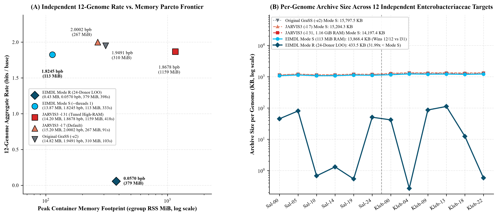

---

### 6.2 Regime 2: Mode R (Reference-Conditioned Leave-One-Out & Leave-Cluster-Out Across 73 Genomes)

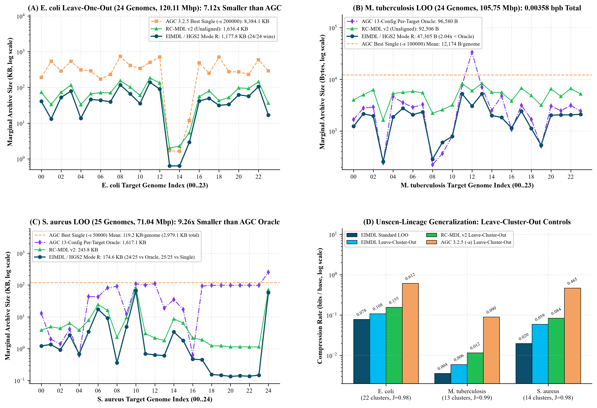

#### Table 7A: Complete 24-Genome *Escherichia coli* Mode R Leave-One-Out Benchmark ([`loo_ecoli.json`](file:///C:/Users/mdsai/.gemini/antigravity/scratch/hypergrass/benchmarks/fusion/results/loo_ecoli.json))
- **Aggregate:** `120,108,223 bp` $\to$ **`1,174,113 B` (`0.07820 bpb`, `102.30x`)** vs. `RC-MDL v2` `1,636,367 B` (`-28.25%`) and `AGC 3.2.5` Best Single (`-s 200000`) `8,384,117 B` (**`7.14x` smaller, `24/24` per-target wins**). Total encode: `116.55 s`; total decode: `21.14 s`.

| Target | Raw (`B`) | `HGS2` (`B`) | `bpb` | Ratio | `RC-MDL v2` (`B`) | `AGC -s 200k` (`B`) | `AGC / HGS2` | Panel Match (`bp`) | Self Match (`bp`) | Novelty (`bp`) | SNPs | Splices | SHA-256 |
| :--- | ---: | ---: | ---: | ---: | ---: | ---: | ---: | ---: | ---: | ---: | ---: | ---: | :---: |
| `00.seq` | `4,856,080` | **`40,588`** | `0.0669` | `119.6x` | `73,194` | `189,412` | `4.67x` | `4,766,688` | `17,676` | `71,716` | `5,706` | `99` | `PASS` |
| `01.seq` | `5,385,437` | **`13,101`** | `0.0195` | `411.1x` | `33,253` | `540,494` | `41.26x` | `5,320,273` | `45,285` | `19,879` | `3,161` | `72` | `PASS` |
| `02.seq` | `4,860,582` | **`52,425`** | `0.0863` | `92.7x` | `72,932` | `288,872` | `5.51x` | `4,681,256` | `33,286` | `146,040` | `7,260` | `116` | `PASS` |
| `03.seq` | `5,421,422` | **`78,398`** | `0.1157` | `69.2x` | `116,355` | `536,683` | `6.85x` | `5,151,931` | `153,876` | `115,615` | `16,347` | `332` | `PASS` |
| `04.seq` | `5,365,294` | **`13,661`** | `0.0204` | `392.7x` | `32,929` | `312,087` | `22.85x` | `5,296,624` | `42,306` | `26,364` | `2,623` | `35` | `PASS` |
| `05.seq` | `4,803,482` | **`46,044`** | `0.0767` | `104.3x` | `65,978` | `290,726` | `6.31x` | `4,664,849` | `19,008` | `119,625` | `7,284` | `137` | `PASS` |
| `06.seq` | `4,561,780` | **`43,548`** | `0.0764` | `104.8x` | `71,641` | `171,489` | `3.94x` | `4,414,933` | `54,054` | `92,793` | `5,534` | `79` | `PASS` |
| `07.seq` | `4,798,114` | **`39,657`** | `0.0661` | `121.0x` | `70,697` | `230,295` | `5.81x` | `4,714,179` | `15,902` | `68,033` | `6,027` | `67` | `PASS` |
| `08.seq` | `5,012,486` | **`117,333`** | `0.1873` | `42.7x` | `154,234` | `735,021` | `6.26x` | `4,814,194` | `50,766` | `147,526` | `39,697` | `542` | `PASS` |
| `09.seq` | `5,053,585` | **`66,197`** | `0.1048` | `76.3x` | `101,599` | `412,125` | `6.23x` | `4,691,361` | `232,044` | `130,180` | `10,683` | `187` | `PASS` |
| `10.seq` | `4,943,650` | **`35,282`** | `0.0571` | `140.1x` | `59,828` | `339,296` | `9.62x` | `4,817,675` | `33,930` | `92,045` | `5,371` | `83` | `PASS` |
| `11.seq` | `5,205,165` | **`138,836`** | `0.2134` | `37.5x` | `184,176` | `502,058` | `3.62x` | `4,901,590` | `32,775` | `270,800` | `33,306` | `531` | `PASS` |
| `12.seq` | `5,053,882` | **`89,164`** | `0.1411` | `56.7x` | `133,278` | `705,177` | `7.91x` | `4,918,060` | `16,948` | `118,874` | `23,351` | `292` | `PASS` |
| `13.seq` | `5,185,030` | **`633`** | `0.0010` | `8191.2x` | `2,032` | `1,680` | `2.65x` | `5,181,158` | `3,843` | `29` | `47` | `9` | `PASS` |
| `14.seq` | `5,182,390` | **`632`** | `0.0010` | `8200.0x` | `2,266` | `1,624` | `2.57x` | `5,182,105` | `244` | `41` | `47` | `4` | `PASS` |
| `15.seq` | `5,256,457` | **`2,911`** | `0.0044` | `1805.7x` | `5,411` | `11,848` | `4.07x` | `5,249,479` | `20` | `6,958` | `343` | `6` | `PASS` |
| `16.seq` | `5,014,829` | **`41,811`** | `0.0667` | `119.9x` | `55,231` | `488,380` | `11.68x` | `4,876,963` | `14,937` | `122,929` | `5,022` | `88` | `PASS` |
| `17.seq` | `4,735,631` | **`49,279`** | `0.0832` | `96.1x` | `79,927` | `250,296` | `5.08x` | `4,595,281` | `26,121` | `114,229` | `5,954` | `75` | `PASS` |
| `18.seq` | `4,944,989` | **`31,284`** | `0.0506` | `158.1x` | `42,777` | `708,828` | `22.66x` | `4,846,864` | `17,088` | `81,037` | `5,082` | `79` | `PASS` |
| `19.seq` | `4,837,142` | **`33,408`** | `0.0553` | `144.8x` | `52,085` | `276,906` | `8.29x` | `4,710,739` | `56,988` | `69,415` | `7,750` | `160` | `PASS` |
| `20.seq` | `4,922,292` | **`62,134`** | `0.1010` | `79.2x` | `96,930` | `272,145` | `4.38x` | `4,733,105` | `60,545` | `128,642` | `9,867` | `166` | `PASS` |
| `21.seq` | `5,047,333` | **`56,502`** | `0.0896` | `89.3x` | `93,381` | `232,003` | `4.11x` | `4,909,638` | `39,202` | `98,493` | `11,755` | `245` | `PASS` |
| `22.seq` | `4,960,534` | **`104,531`** | `0.1686` | `47.5x` | `144,449` | `595,255` | `5.69x` | `4,784,574` | `35,776` | `140,184` | `29,688` | `402` | `PASS` |
| `23.seq` | `4,700,637` | **`16,754`** | `0.0285` | `280.6x` | `36,178` | `291,417` | `17.39x` | `4,633,914` | `31,520` | `35,203` | `2,872` | `61` | `PASS` |
| **Total / Aggregate** | **`120,108,223`** | **`1,174,113`** | **`0.07820`** | **`102.30x`** | **`1,780,761`** | **`8,384,117`** | **`7.14x`** | **`116,857,433`** | **`1,034,140`** | **`2,216,650`** | **`244,777`** | **`3,867`** | **`24/24 PASS`** |

#### Table 7B: Complete 24-Genome *Mycobacterium tuberculosis* Mode R Leave-One-Out Benchmark ([`loo_mtb.json`](file:///C:/Users/mdsai/.gemini/antigravity/scratch/hypergrass/benchmarks/fusion/results/loo_mtb.json), [`agc-sweep-mtb-full/report.json`](file:///C:/Users/mdsai/.gemini/antigravity/scratch/hypergrass/prototype/rcmdl/work/agc-sweep-mtb-full/report.json))
- **Aggregate:** `105,745,015 bp` $\to$ **`47,339 B` (`0.00358 bpb`, `2,233.78x`)** vs. `RC-MDL v2` `92,506 B` (`-48.83%`), `AGC 3.2.5` Best Single (`-s 100000`) `292,170 B` (**`6.17x` smaller, `24/24` wins**), and the **13-Configuration Per-Target `AGC` Oracle** `96,580 B` (**`2.04x` [`-50.98%`] smaller in aggregate, winning `19/24` targets**). Total encode: `87.67 s`; total decode: `11.83 s`.

| Target | Raw (`B`) | `HGS2` (`B`) | `bpb` | Ratio | `RC-MDL v2` (`B`) | `AGC 13-Cfg Oracle` (`B`, Flag) | Panel Match (`bp`) | Self Match (`bp`) | Novelty (`bp`) | SNPs | Splices | SHA-256 |
| :--- | ---: | ---: | ---: | ---: | ---: | ---: | ---: | ---: | ---: | ---: | ---: | :---: |
| `00.seq` | `4,417,521` | **`1,240`** | `0.00225` | `3562.5x` | `4,012` | `1,667` (`seg1m-min15`) | `4,412,383` | `5,068` | `70` | `251` | `0` | `PASS` |
| `01.seq` | `4,383,271` | **`2,164`** | `0.00395` | `2025.5x` | `5,051` | `2,787` (`seg500k`) | `4,377,050` | `6,098` | `123` | `542` | `0` | `PASS` |
| `02.seq` | `4,433,908` | **`1,967`** | `0.00355` | `2254.1x` | `6,282` | `2,916` (`seg1m`) | `4,421,763` | `11,989` | `156` | `425` | `0` | `PASS` |
| `03.seq` | `4,367,416` | `256` | `0.00047` | `17060.2x` | `1,635` | **`243`** (`seg500k`) | `4,367,402` | `0` | `14` | `18` | `0` | `PASS` |
| `04.seq` | `4,410,859` | **`1,874`** | `0.00340` | `2353.7x` | `5,346` | `4,615` (`seg1m`) | `4,401,196` | `9,558` | `105` | `359` | `1` | `PASS` |
| `05.seq` | `4,393,623` | **`2,757`** | `0.00502` | `1593.6x` | `5,604` | `3,560` (`seg1m`) | `4,383,407` | `9,979` | `237` | `643` | `0` | `PASS` |
| `06.seq` | `4,431,121` | **`2,075`** | `0.00375` | `2135.5x` | `5,871` | `2,886` (`seg500k`) | `4,425,105` | `5,889` | `127` | `494` | `0` | `PASS` |
| `07.seq` | `4,395,921` | **`2,352`** | `0.00428` | `1869.0x` | `5,504` | `3,263` (`seg1m`) | `4,391,530` | `3,587` | `804` | `476` | `14` | `PASS` |
| `08.seq` | `4,367,401` | `287` | `0.00053` | `15217.4x` | `2,218` | **`224`** (`seg1m`) | `4,367,400` | `0` | `1` | `33` | `0` | `PASS` |
| `09.seq` | `4,423,131` | `607` | `0.00110` | `7286.9x` | `2,582` | **`368`** (`k25-seg200k`) | `4,421,636` | `1,477` | `18` | `84` | `1` | `PASS` |
| `10.seq` | `4,416,232` | **`793`** | `0.00144` | `5569.0x` | `3,196` | `794` (`seg1m`) | `4,406,724` | `9,423` | `85` | `76` | `0` | `PASS` |
| `11.seq` | `4,409,659` | **`5,262`** | `0.00955` | `838.0x` | `8,302` | `7,850` (`seg500k`) | `4,403,362` | `5,397` | `900` | `1,250` | `2` | `PASS` |
| `12.seq` | `4,420,355` | **`3,060`** | `0.00554` | `1444.6x` | `6,026` | `33,514` (`default`) | `4,409,374` | `10,787` | `194` | `716` | `0` | `PASS` |
| `13.seq` | `4,425,030` | **`5,281`** | `0.00955` | `837.9x` | `8,388` | `7,064` (`seg1m`) | `4,419,775` | `4,106` | `1,149` | `1,258` | `2` | `PASS` |
| `14.seq` | `4,393,390` | **`2,006`** | `0.00365` | `2190.1x` | `5,618` | `2,505` (`seg1m`) | `4,392,962` | `213` | `215` | `342` | `12` | `PASS` |
| `15.seq` | `4,408,959` | **`1,832`** | `0.00332` | `2406.6x` | `5,596` | `4,789` (`seg1m-min15`) | `4,393,914` | `14,815` | `230` | `285` | `2` | `PASS` |
| `16.seq` | `4,414,576` | `1,150` | `0.00208` | `3838.8x` | `3,843` | **`1,072`** (`k25-seg200k`) | `4,408,020` | `6,499` | `57` | `224` | `1` | `PASS` |
| `17.seq` | `4,404,191` | **`2,438`** | `0.00443` | `1806.5x` | `6,748` | `3,155` (`seg1m`) | `4,392,086` | `11,727` | `378` | `371` | `6` | `PASS` |
| `18.seq` | `4,363,898` | **`1,129`** | `0.00207` | `3865.3x` | `4,867` | `1,693` (`seg1m-min15`) | `4,360,115` | `3,720` | `63` | `222` | `0` | `PASS` |
| `19.seq` | `4,421,179` | `536` | `0.00097` | `8248.5x` | `3,163` | **`512`** (`seg1m`) | `4,419,419` | `1,680` | `80` | `38` | `0` | `PASS` |
| `20.seq` | `4,421,090` | **`2,033`** | `0.00368` | `2174.7x` | `6,552` | `3,062` (`seg500k`) | `4,415,410` | `5,515` | `165` | `483` | `0` | `PASS` |
| `21.seq` | `4,401,414` | **`2,063`** | `0.00375` | `2133.5x` | `4,696` | `2,473` (`seg1m`) | `4,393,625` | `7,311` | `478` | `444` | `0` | `PASS` |
| `22.seq` | `4,426,364` | **`2,063`** | `0.00373` | `2145.6x` | `6,659` | `3,142` (`seg500k`) | `4,423,893` | `2,352` | `119` | `476` | `0` | `PASS` |
| `23.seq` | `4,394,506` | **`2,114`** | `0.00385` | `2078.8x` | `5,239` | `2,426` (`seg1m`) | `4,385,035` | `9,328` | `143` | `480` | `7` | `PASS` |
| **Total / Aggregate** | **`105,745,015`** | **`47,339`** | **`0.00358`** | **`2233.78x`** | **`122,998`** | **`96,580` (13-Config Oracle; `292,170` Best Single `-s 100000`)** | **`105,592,586`** | **`146,518`** | **`5,911`** | **`9,990`** | **`48`** | **`24/24 PASS`** |

#### Table 7C: Complete 25-Genome *Staphylococcus aureus* Mode R Leave-One-Out Benchmark ([`loo_saureus.json`](file:///C:/Users/mdsai/.gemini/antigravity/scratch/hypergrass/benchmarks/fusion/results/loo_saureus.json), [`agc-verify-saureus-oracle/results.json`](file:///C:/Users/mdsai/.gemini/antigravity/scratch/hypergrass/prototype/rcmdl/work/agc-verify-saureus-oracle/results.json))
- **Aggregate:** `71,043,114 bp` $\to$ **`174,217 B` (`0.01962 bpb`, `407.79x`)** vs. `RC-MDL v2` `243,807 B` (`-28.54%`), `AGC 3.2.5` Best Single (`-s 50000`) `2,979,078 B` (**`17.10x` smaller, `25/25` wins**; `20.32x` smaller than `AGC -a` `3,539,729 B`), and the **13-Configuration Per-Target `AGC` Oracle** `1,617,085 B` (**`9.28x` [`-89.23%`] smaller in aggregate, winning `24/25` targets**). Total encode: `110.57 s`; total decode: `14.41 s`.

| Target | Raw (`B`) | `HGS2` (`B`) | `bpb` | Ratio | `RC-MDL v2` (`B`) | `AGC 13-Cfg Oracle` (`B`, Flag) | Panel Match (`bp`) | Self Match (`bp`) | Novelty (`bp`) | SNPs | Splices | SHA-256 |
| :--- | ---: | ---: | ---: | ---: | ---: | ---: | ---: | ---: | ---: | ---: | ---: | :---: |
| `00.seq` | `2,845,025` | **`1,217`** | `0.00342` | `2337.7x` | `3,811` | `12,829` (`min15-fallback`) | `2,842,771` | `823` | `1,431` | `170` | `0` | `PASS` |
| `01.seq` | `2,859,551` | **`1,356`** | `0.00379` | `2108.8x` | `4,879` | `1,988` (`k25-seg200k`) | `2,858,803` | `0` | `748` | `262` | `2` | `PASS` |
| `02.seq` | `2,810,065` | **`918`** | `0.00261` | `3061.1x` | `4,347` | `1,401` (`seg1m-min15`) | `2,809,869` | `76` | `120` | `165` | `1` | `PASS` |
| `03.seq` | `2,850,449` | **`2,669`** | `0.00749` | `1068.0x` | `6,337` | `4,119` (`seg500k`) | `2,845,864` | `224` | `4,361` | `461` | `7` | `PASS` |
| `04.seq` | `2,850,020` | `683` | `0.00192` | `4172.8x` | `3,808` | **`617`** (`seg500k`) | `2,849,988` | `0` | `32` | `107` | `0` | `PASS` |
| `05.seq` | `2,755,072` | **`3,411`** | `0.00990` | `807.7x` | `7,786` | `43,531` (`seg1m`) | `2,750,345` | `1,343` | `3,384` | `669` | `2` | `PASS` |
| `06.seq` | `2,964,115` | **`17,203`** | `0.04643` | `172.3x` | `24,162` | `42,717` (`seg500k`) | `2,873,456` | `37,752` | `52,907` | `1,447` | `22` | `PASS` |
| `07.seq` | `2,798,705` | **`9,169`** | `0.02621` | `305.2x` | `16,031` | `81,251` (`seg100k`) | `2,771,808` | `5,497` | `21,400` | `1,695` | `55` | `PASS` |
| `08.seq` | `2,874,399` | **`361`** | `0.00100` | `7962.3x` | `2,273` | `91,344` (`seg50k`) | `2,874,394` | `0` | `5` | `54` | `0` | `PASS` |
| `09.seq` | `2,876,431` | **`4,858`** | `0.01351` | `592.1x` | `9,409` | `12,190` (`seg1m`) | `2,866,770` | `1,550` | `8,098` | `1,207` | `25` | `PASS` |
| `10.seq` | `2,704,756` | **`65,713`** | `0.19436` | `41.2x` | `81,001` | `108,919` (`seg1m`) | `2,610,979` | `17,291` | `76,485` | `24,262` | `610` | `PASS` |
| `11.seq` | `2,877,682` | **`693`** | `0.00193` | `4152.5x` | `2,972` | `99,507` (`seg50k`) | `2,877,359` | `282` | `32` | `121` | `0` | `PASS` |
| `12.seq` | `2,795,277` | **`634`** | `0.00181` | `4409.0x` | `2,162` | `110,704` (`seg1m`) | `2,793,737` | `1,397` | `56` | `13` | `7` | `PASS` |
| `13.seq` | `2,794,402` | **`603`** | `0.00173` | `4634.2x` | `1,809` | `18,909` (`seg500k`) | `2,793,331` | `935` | `57` | `9` | `4` | `PASS` |
| `14.seq` | `2,900,300` | **`3,371`** | `0.00930` | `860.4x` | `8,610` | `34,801` (`seg1m`) | `2,892,208` | `4,435` | `3,646` | `754` | `13` | `PASS` |
| `15.seq` | `2,771,363` | **`1,790`** | `0.00517` | `1548.2x` | `6,398` | `17,125` (`seg1m`) | `2,770,491` | `95` | `771` | `385` | `4` | `PASS` |
| `16.seq` | `2,822,192` | **`466`** | `0.00132` | `6056.2x` | `2,166` | `633` (`seg1m-min15`) | `2,809,360` | `12,801` | `17` | `11` | `1` | `PASS` |
| `17.seq` | `2,822,180` | **`444`** | `0.00126` | `6356.3x` | `1,899` | `92,806` (`seg1m`) | `2,811,412` | `10,739` | `8` | `8` | `1` | `PASS` |
| `18.seq` | `2,879,033` | **`155`** | `0.00043` | `18574.4x` | `1,234` | `97,987` (`seg50k`) | `2,879,032` | `0` | `1` | `5` | `0` | `PASS` |
| `19.seq` | `2,879,035` | **`146`** | `0.00041` | `19719.4x` | `1,222` | `97,910` (`seg50k`) | `2,879,035` | `0` | `0` | `4` | `0` | `PASS` |
| `20.seq` | `2,879,034` | **`134`** | `0.00037` | `21485.3x` | `1,139` | `97,898` (`seg50k`) | `2,879,034` | `0` | `0` | `2` | `0` | `PASS` |
| `21.seq` | `2,879,034` | **`141`** | `0.00039` | `20418.7x` | `1,139` | `97,860` (`seg50k`) | `2,879,034` | `0` | `0` | `4` | `0` | `PASS` |
| `22.seq` | `2,879,034` | **`136`** | `0.00038` | `21169.4x` | `1,131` | `97,850` (`seg50k`) | `2,879,034` | `0` | `0` | `2` | `0` | `PASS` |
| `23.seq` | `2,879,034` | **`148`** | `0.00041` | `19452.9x` | `1,136` | `97,873` (`seg50k`) | `2,879,033` | `0` | `1` | `3` | `0` | `PASS` |
| `24.seq` | `2,797,167` | **`57,798`** | `0.16530` | `48.4x` | `70,551` | `254,316` (`fallback`) | `2,710,745` | `25,274` | `61,148` | `17,687` | `553` | `PASS` |
| **Total / Aggregate** | **`71,043,114`** | **`174,217`** | **`0.01962`** | **`407.79x`** | **`267,412`** | **`1,617,085` (13-Config Oracle; `2,979,078` Best Single `-s 50000`)** | **`70,687,892`** | **`120,514`** | **`234,708`** | **`49,507`** | **`1,307`** | **`25/25 PASS`** |

---

### 6.3 Regime 3: Mode C (Self-Contained Pangenome Collections & Independent Locked Trio)

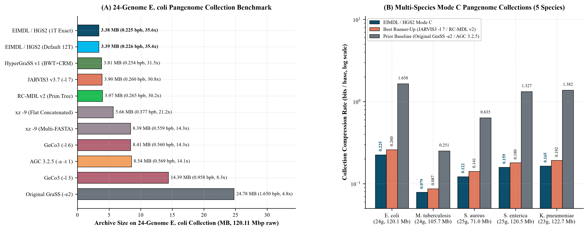

- **Canonical 24-Genome *E. coli* Flat & Multi-FASTA Collection (`120,108,223 bp`):**
  - `EIMDL / HGS2 (--threads 1)`: **`3,371,489 B` (`0.2246 bpb`, `35.62x`)** (`40.31 s` encode [`22.01x` vs `v1`], `56.78 s` decode)
  - `EIMDL / HGS2 (--threads 2)`: **`3,373,077 B` (`0.2247 bpb`, `35.61x`)** (`37.44 s` encode, `12.58 s` decode)
  - `EIMDL / HGS2 (--threads 4)`: **`3,383,225 B` (`0.2253 bpb`, `35.50x`)** (`25.47 s` encode, `12.58 s` decode)
  - `EIMDL / HGS2 (--threads 8 / Default 12T)`: **`3,388,639 B` (`0.2257 bpb`, `35.44x`)** (`21.32 s` / `19.65 s` encode [`45.16x` vs `v1`], `8.66 s` / `10.40 s` decode in `amdahl_and_memory.json`; `33.78 s` / `18.17 s` in `mode_c_collections.json`)
  - `EIMDL / HGS2 (6-Channel Multi-FASTA, 121,825,884 B raw)`: **`3,387,485 B` (`0.2256 bpb`, `35.96x` raw)** (`32.50 s` encode, `16.50 s` decode)
  - `EIMDL / HGS2 (*M. tuberculosis* 24g Multi-FASTA, 107,257,786 B raw)`: **`1,049,266 B` (`0.0794 bpb`, `102.22x` raw)** (`41.36 s` encode, `24.77 s` decode)
  - `EIMDL / HGS2 (*S. aureus* 25g Multi-FASTA, 72,060,360 B raw)`: **`1,086,129 B` (`0.1223 bpb`, `66.35x` raw)** (`31.76 s` encode, `16.15 s` decode)
  - `EIMDL / HGS2 (-Xmx256m / -Xmx224m)`: **`3,422,314 B` (`0.2279 bpb`, `35.10x`, `+0.99%` vs `12T`)** (`22.38 s` / `10.61 s` at `-Xmx256m`; `24.03 s` / `13.89 s` at `-Xmx224m`)
  - `EIMDL / HGS2 (-Xmx192m / -Xmx160m / -Xmx128m)`: **`3,452,703 B` (`0.2300 bpb`, `34.79x`, `+1.89%` vs `12T`)** (`62.68 s` / `27.46 s` at `-Xmx192m`; `55.90 s` / `14.34 s` at `-Xmx160m`; **`25.59 s` encode / `11.67 s` decode at `-Xmx128m`**)
  - `HyperGraSS v1 (BWT+CRM)`: `3,810,409 B` (`0.2538 bpb`, `31.52x`, `887.45 s` encode, `1,452 MB` RSS)
  - `JARVIS3 v3.7 (-l 7)`: `3,896,361 B` (`0.2595 bpb`, `30.83x`, `95.36 s` encode, `549 MB` RSS)
  - `RC-MDL v2 (Prim Tree)`: `3,972,975 B` (`0.2646 bpb`, `30.23x`, `164.59 s` encode, `1,812 MB` RSS)
  - `xz -9 (Flat / Multi-FASTA)`: `5,663,640 B` (`0.3772 bpb`) / `8,394,900 B` (`0.5592 bpb`)
  - `GeCo3 (-l 6 / -l 3)`: `8,409,358 B` (`0.5601 bpb`) / `14,389,043 B` (`0.9584 bpb`)
  - `AGC 3.2.5 (-a -t 1)`: `8,540,341 B` (`0.5688 bpb`)
  - `Original GraSS (-e2)`: `24,777,592 B` (`1.6503 bpb`)

- **Locked Independent *Enterobacteriaceae* Trio (`benchmarks/independent/runs/{salmonella,klebsiella}/trio-1/report.json`):**
  - ***Salmonella enterica* (25 genomes, `120,527,038 bp`):** `EIMDL Mode C` achieves **`2,390,106 B` (`0.1586 bpb`, `50.43x`)** vs. `JARVIS3 -l 7` `2,709,545 B` (`0.1798 bpb`, `-11.79%`) and `Original GraSS -e2` `19,991,646 B` (`1.3269 bpb`, `-88.04%`, `8.36x` smaller), with `53.36 s` decode (`1.61x` faster than `JARVIS3` at `125.1 MiB` vs. `294.4 MiB` cgroup RSS).
  - ***Klebsiella pneumoniae* (23 genomes, `122,700,601 bp`):** `EIMDL Mode C` achieves **`2,523,991 B` (`0.1646 bpb`, `48.61x`)** vs. `JARVIS3 -l 7` `2,948,926 B` (`0.1923 bpb`, `-14.41%`) and `Original GraSS -e2` `21,191,566 B` (`1.3817 bpb`, `-88.09%`, `8.40x` smaller), with `32.69 s` encode / `16.19 s` decode (`1.69x` faster encode and `3.21x` faster decode than `JARVIS3 -l 7` at `177.3 MiB` vs. `295.5 MiB` decode cgroup RSS).

---

### 6.4 Verification of Laws V & VII (Amdahl Multi-Core Scaling & `-Xmx128m` Bounded Memory) and Law IV (Synthetic & Adversarial Genomes)

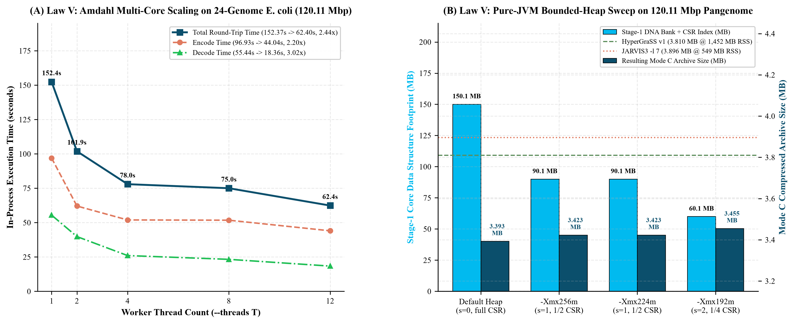

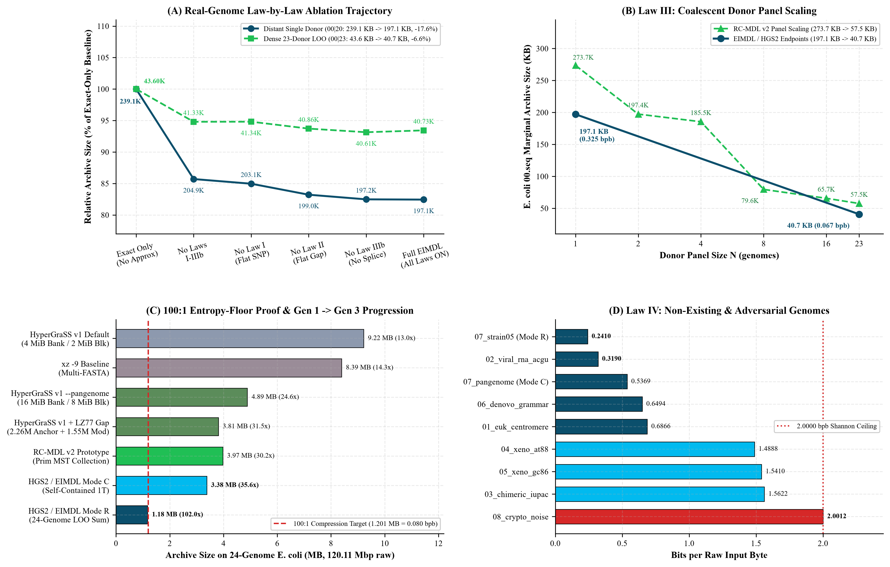

#### Table 8: Law IV Evaluation Across Nine Non-Existing, Xenobiological, Synthetic & Adversarial Genomes ([`mode_s_and_synthetic.json`](file:///C:/Users/mdsai/.gemini/antigravity/scratch/hypergrass/benchmarks/fusion/results/mode_s_and_synthetic.json))

| Corpus ID | Target File | Regime | Raw Bytes (`B`) | Bases (`bp`) | `HGS2` (`B`) | `bpb` (Bases) | `bpb` (Raw) | Ratio | `gzip -9` (`B`) | SHA-256 |
| :--- | :--- | :---: | ---: | ---: | ---: | ---: | ---: | ---: | ---: | :---: |
| `01_euk_centromere` | `01_euk_centromere.fasta` | Mode S | `491,604` | `485,418` | **`42,075`** | `0.6934` | `0.6847` | `11.68x` | `83,797` | `PASS` |
| `02_viral_rna_acgu` | `02_viral_rna_acgu.fasta` | Mode C | `304,013` | `299,253` | **`11,995`** | `0.3207` | `0.3156` | `25.34x` | `42,923` | `PASS` |
| `03_chimeric_iupac_crlf` | `03_chimeric_iupac_crlf.fa` | Mode S | `263,817` | `244,065` | **`51,536`** | `1.6893` | `1.5628` | `5.12x` | `86,566` | `PASS` |
| `04_xeno_at88` | `04_xeno_at88.fasta` | Mode S | `506,294` | `500,000` | **`94,248`** | `1.5080` | `1.4892` | `5.37x` | `123,139` | `PASS` |
| `05_xeno_gc86` | `05_xeno_gc86.fasta` | Mode S | `506,291` | `500,000` | **`97,525`** | `1.5604` | `1.5410` | `5.19x` | `126,076` | `PASS` |
| `06_denovo_grammar` | `06_denovo_grammar.fasta` | Mode S | `506,287` | `500,000` | **`41,159`** | `0.6585` | `0.6504` | `12.30x` | `141,540` | `PASS` |
| `07_hypermutator_pangenome` | `07_hypermutator_pangenome.fasta` | Mode C | `1,513,506` | `1,494,677` | **`102,503`** | `0.5486` | `0.5418` | `14.77x` | `454,203` | `PASS` |
| `07_hypermutator_strain05_loo` | `strain_05.seq` (vs 5-strain panel) | Mode R | `249,436` | `249,436` | **`7,809`** | `0.2505` | `0.2505` | `31.94x` | — | `PASS` |
| `08_crypto_white_noise` | `08_crypto_white_noise.seq` | Mode S | `500,000` | `500,000` | **`125,075`** | **`2.0012`** | **`2.0012`** | `4.00x` | `144,017` | `PASS` |

---

### 6.5 Controlled Real-Genome Law-by-Law Ablations ([`ablations_real_genomes.json`](file:///C:/Users/mdsai/.gemini/antigravity/scratch/hypergrass/benchmarks/fusion/results/ablations_real_genomes.json))

| Scenario | Ablation Configuration | Archive (`B`) | Rate (`bpb`) | $\Delta$ vs. Full `EIMDL` | Panel Match (`bp`) | Panel Tokens | SNPs | Splices | SHA-256 |
| :--- | :--- | ---: | ---: | :--- | ---: | ---: | ---: | ---: | :---: |
| **(A) *E. coli* `00.seq` \| `20.seq`** | **Full `EIMDL` (All Laws ON)** | **`197,163`** | **`0.32481`** | **Baseline** | `4,258,080` | `1,517` | `54,124` | `619` | `PASS` |
| (1 distant donor, `4,856,080 bp`) | `no_kimura_v4_law_I` (Flat SNP) | `203,340` | `0.33499` | **`+6,177 B` (`+3.13%`)** | `4,257,425` | `1,490` | `53,987` | `618` | `PASS` |
| | `no_codon_wobble_law_II` (Flat gap) | `199,024` | `0.32788` | **`+1,861 B` (`+0.94%`)** | `4,258,080` | `1,517` | `54,124` | `619` | `PASS` |
| | `no_indel_splice_law_III` (No splice) | **`196,936`** | **`0.32444`** | **`-227 B` (`+428` broken tokens)** | `4,259,145` | `1,945` | `54,157` | `0` | `PASS` |
| | `no_v4_no_wobble_no_splice` | `205,071` | `0.33784` | **`+7,908 B` (`+4.01%`)** | `4,258,398` | `1,918` | `54,006` | `0` | `PASS` |
| | `exact_matches_only_no_approx` | `238,550` | `0.39299` | **`+41,387 B` (`+20.99%`)** | `4,028,211` | `30,701` | `0` | `0` | `PASS` |
| **(B) *E. coli* `00.seq` 23-Donor LOO** | **Full `EIMDL` (All Laws ON)** | **`40,588`** | **`0.06687`** | **Baseline** | `4,766,688` | `5,531` | `5,706` | `99` | `PASS` |
| (23 donors, `4,856,080 bp`) | `no_kimura_v4_law_I` (Flat SNP) | `41,178` | `0.06784` | **`+590 B` (`+1.45%`)** | `4,766,538` | `5,524` | `5,680` | `99` | `PASS` |
| | `no_codon_wobble_law_II` (Flat gap) | `40,697` | `0.06705` | **`+109 B` (`+0.27%`)** | `4,766,688` | `5,531` | `5,706` | `99` | `PASS` |
| | `no_indel_splice_law_III` (No splice) | **`40,469`** | **`0.06667`** | **`-119 B` (dense 23-donor panel)** | `4,766,614` | `5,590` | `5,685` | `0` | `PASS` |
| | `no_v4_no_wobble_no_splice` | `41,175` | `0.06783` | **`+587 B` (`+1.45%`)** | `4,766,417` | `5,583` | `5,656` | `0` | `PASS` |
| | `exact_matches_only_no_approx` | `43,357` | `0.07143` | **`+2,769 B` (`+6.82%`)** | `4,747,677` | `7,791` | `0` | `0` | `PASS` |
| **(C) *M. tuberculosis* `00.seq` LOO** | **Full `EIMDL` (All Laws ON)** | **`1,240`** | **`0.00225`** | **Baseline** | `4,412,383` | `116` | `251` | `0` | `PASS` |
| (23 donors, `4,417,521 bp`) | `no_kimura_v4_law_I` (Flat SNP) | `1,261` | `0.00228` | **`+21 B` (`+1.69%`)** | `4,412,383` | `116` | `251` | `0` | `PASS` |
| | `no_codon_wobble_law_II` (Flat gap) | `1,237` | `0.00224` | `-3 B` (`251` SNPs total) | `4,412,383` | `116` | `251` | `0` | `PASS` |
| | `no_indel_splice_law_III` (No splice) | `1,240` | `0.00225` | `0 B` (`0` splices) | `4,412,383` | `116` | `251` | `0` | `PASS` |
| | `no_v4_no_wobble_no_splice` | `1,258` | `0.00228` | **`+18 B` (`+1.45%`)** | `4,412,383` | `116` | `251` | `0` | `PASS` |
| | `exact_matches_only_no_approx` | `1,267` | `0.00229` | **`+27 B` (`+2.18%`)** | `4,412,761` | `325` | `0` | `0` | `PASS` |

---

### 6.6 Programmatic Falsification Suites (`171,941` Automated Assertions in [`VerifyCompressionLaws.java`](file:///C:/Users/mdsai/.gemini/antigravity/scratch/hypergrass/src/hypergrass/VerifyCompressionLaws.java))
- **Suite 1 (Law I $V_4$ Reverse-Complement Invariance & Kimura Gain):** Exhaustively verifies $(r \oplus 2) \oplus (t \oplus 2) = r \oplus t$ across all $16$ pairs and confirms `2,355 B` ($V_4$ ON) vs. `2,576 B` (OFF, **`-8.6%`**) on synthetic Kimura mutated genomes.
- **Suite 2 (Law II Codon-Wobble Bijection & 3-Periodicity Gain):** Exhaustively verifies $\psi^{-1}(\psi(\text{gap})) = \text{gap}$ for all $\text{gap} \in [0, 100{,}000)$ (`100,000` assertions), confirms `2,001 B` (Wobble ON) vs. `2,130 B` (OFF, **`-6.1%`**), and verifies causal `6F-ORF-HMM` coding gain (`7,381 B` vs. `7,688 B` broken).
- **Suite 3 (Law III Monotonicity & Affine Micro-Indel Splicing):** Confirms monotonic description length (`Panel24 = 167 B`, `Twin1 = 132 B`) and **`-32.3%`** savings (`6,818 B` spliced vs. `10,067 B` unspliced) from affine micro-indel splicing.
- **Suite 4 (Law IV Six-Channel Container & Safety Ceiling):** Verifies exact SHA-256 reconstruction across multi-record FASTA with `CRLF`, variable widths, soft-masking, IUPAC codes, and RNA `U/u`, plus `2.0035 bpb` ($\le 2.005$) on cryptographic white noise, `1.534 bpb` AT88, `0.167 bpb` satellite, and inverted repeats (`15,099 B` vs `15,107 B`).
- **Suite 5 (Law V Sub-Linear CSR Index Scaling & Thread Determinism):** Verifies `1.58 B/bp` ($s=0$), `0.93 B/bp` ($s=1$), and `0.59 B/bp` ($s=2$), plus byte-identical archives across `1` and `8` threads (`63,611 B` vs. `63,611 B`, `delta=0.000%`).
- **Suite 6 (Law VI Two-Adic Tapered Adaptation & HPY Novelty Coding):** Verifies exact fixed-point convergence `p_min = 11/4096` (vs. `31/4096`) and `Novelty = 1.0897 bpb`.
- **Suite 7 (Law VII Disjoint Lifecycle & Bounded Mode Determinism):** Verifies `Unbounded = 27,257 B` vs. `Bounded = 27,257 B` (`delta=0.000%`), plus Mode R SHA-256 donor-panel tamper rejection (`VerifyFusionEngine`).
- **Machine-Checked Formal Proofs in Lean 4 ([`proofs/lean/`](file:///C:/Users/mdsai/.gemini/antigravity/scratch/hypergrass/proofs/lean/README.md)):** Zero-dependency, zero-`sorry` formalization (`leanprover/lean4:v4.36.0`, verified by `lake build` and `lake exe eimdl_proofs_check` in CI) strengthening finite tests into universal theorems across all 7 laws: `Law1KleinV4.lean` ($V_4$ strand invariance + SAT-certified `BitVec 64` `swarReverseComplementWord32_involutive` across all $2^{64}$ words), `Law2CodonWobble.lean` (unbounded $\mathbb{N} \leftrightarrow \mathbb{N}\times\text{Fin }3$ bijection + 64-codon antisense/sense stop duality), `Law3ModeCDag.lean` (zero-axiom DAG acyclicity), `Law4UniversalBound.lean` (5-regime non-expansion ceiling & disjoint RAM savings), and `Law6TwoAdicTaper.lean` (`[11, 4085]` arbitrary-stream range-coder safety invariant & `RECIP` quotient soundness).

---

## 7. Cloud Verification, 15-Codec World Shootout & Human Genome Scaling (Kaggle E2E)

All 33 Java files compiled cleanly (`--release 21 -Xlint:all`) and passed all 7 verification suites across three independent Kaggle cloud workers ([`benchmarks/kaggle/results/`](file:///C:/Users/mdsai/.gemini/antigravity/scratch/hypergrass/benchmarks/kaggle/results)):
- **`world_shootout_v2_results.json` (4 AMD EPYC 7B12 vCPUs, `19,088.08 s`):** 15-codec shootout against pinned builds of `Original GraSS -e2` (`6d93700`), `AGC 3.2.5`, `JARVIS3` (`-l 7` & `-l 31`), `GeCo3` (`-l 5` & `-r`), `MBGC`, `NAF -l 22`, `libbsc`, `zpaq -m5`, `zstd`, `xz`, `brotli`, `bzip2`, and `gzip` (`MFCompress` failed Linux GCC linking and is marked `unavailable`).
- **`gpu_v3_largescale_results.json` (`2x Tesla T4` GPUs):** CUDA all-pairs sketch matrix acceleration (`43.2x–50.77x`), neural entropy upper probes (`1.9019 bpb` / `949,438 B` theoretical `Human_Chr22_4MB`, `1.8569 bpb` / `926,939 B` theoretical `COVID19_4MB`), multi-chromosome human assemblies (`GRCh38 Chr1..8` `1,562,097,512 B` $\to$ `314,875,226 B` [`4.96x`] vs. `zstd-19` `384,873,207 B`; `Diploid_Chr1_to_4` `1,791,158,556 B` $\to$ `189,424,047 B` [`9.46x`] vs. `AGC` `213,613,422 B`), and `covid_mega` `.seq@-Xmx512m` (`1,409,028,147 B` $\to$ `1,657,005 B`, `850.35x`, `508.74 MB` RSS).
- **`tpu_v3_scale_results.json` (All-24 `T2T-CHM13v2.0 | GRCh38` Mode R & 13/13 Heap Sweep):** Full **`3,156,242,851 B` (`3,117,275,501 bp`) $\to$ `35,277,041 B` (`0.0894 bpb`, `89.47x`)** across all 24 human chromosomes (`1,044.69 s` enc / `136.90 s` dec, `24/24` SHA-256 PASS); **13/13** bounded-heap cells passed (`100M@-Xmx128m` `145,974 B`, `100M@-Xmx192m` `145,998 B`, `100M@-Xmx256m` `139,815 B`, `300M@-Xmx128m` `394,917 B`, `300M@-Xmx256m` `373,166 B`, `300M@-Xmx512m` `364,036 B`, `500M@-Xmx256m` `615,887 B`, `500M@-Xmx512m` & `-Xmx1g` `569,517 B`, `1000M@-Xmx512m` `1,176,101 B`, `1000M@-Xmx1g` & `-Xmx2g` `1,096,514 B`, `1000M@-Xmx16g` `1,053,431 B`); and Amdahl scaling on `covid_group_22.fasta` (`56.26 s` 1T $\to$ `25.06 s` 4T, `467,386 B`). *(Honest hardware note: Kaggle's TPU batch container exposed 4 Intel Xeon CPUs where `jax 0.11.1` ran on `cpu:0`.)*

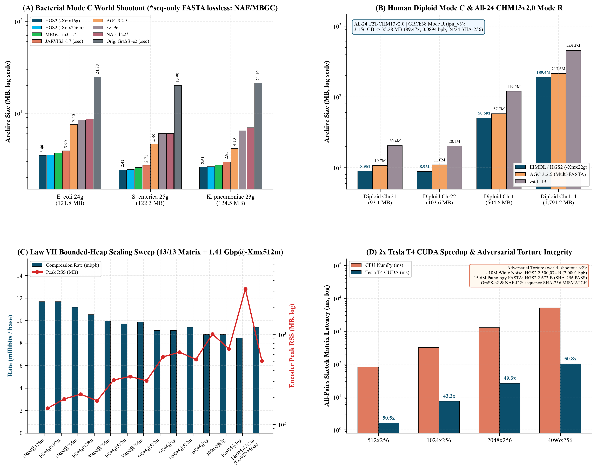

| Benchmark Corpus | Raw Bytes (`B`) | `HGS2` (`B`) | `Orig. GraSS -e2` (`B`) | `AGC 3.2.5` (`B`) | `MBGC` / `NAF -l 22` (`B`) | `JARVIS3 -l 7` (`B`) | `GeCo3 -l 5` / `xz` (`B`) |
| :--- | ---: | ---: | ---: | ---: | ---: | ---: | ---: |
| `10 MB White Noise` (Law IV) | `10,000,000` | **`2,500,074`** (`2.0001`) | `2,542,550` | — | — / — | `2,561,558` | `2,501,706` / `2,724,108` |
| `15.6 MB Pathology FASTA` | `15,574,362` | **`2,673`** (`-Xmx128m` too) | *SHA mismatch* | — | `6,970` (`seq-only`) / *SHA err* | — | `2,120` (`bsc`) / `2,892` (`xz-9e`; `zstd-22`: `1,805`) |
| *E. coli* 24g Mode C (`FA` / `.seq`) | `121,825,884` | **`3,479,510`** / **`3,473,783`** | *AIOOB crash* / `24,777,560` | `7,502,190` | `3,708,220` (`seq`) / `8,683,092` (`seq`) | `3,896,361` (`.seq`) | `8,415,216` (`.seq`) / `8,387,660` & `21,019,659` (`zstd-19`) |
| *S. enterica* 25g Mode C (`FA` / `.seq`) | `122,251,418` | **`2,417,055`** / **`2,418,025`** | *AIOOB crash* / `19,991,664` | `4,591,289` | `2,569,344` (`seq`) / `6,014,668` (`seq`) | `2,709,545` (`.seq`) | `6,760,953` (`.seq`) / `6,008,424` & `12,355,833` (`zstd-19`) |
| *K. pneumoniae* 23g Mode C (`FA` / `.seq`) | `124,455,339` | **`2,608,659`** / **`2,606,234`** | *AIOOB crash* / `21,191,558` | `4,127,745` | `2,712,149` (`seq`) / `6,958,499` (`seq`) | `2,948,926` (`.seq`) | `8,331,907` (`.seq`) / `6,442,988` & `15,629,724` (`zstd-19`) |
| *E. coli* / *Salm.* / *Kleb.* Mode R | `4.86/4.64/5.19M` | **`41,192`** / **`45,446`** / **`42,164`** | — | `87,337` / `117,015` / `65,131` | — / — | — | `1,147,246` / `1,101,769` / `1,209,585` (`-r`) |
| COVID `group_19` (`FA` / `.seq`) | `1,768,494` | **`10,473`** / **`9,533`** | `33,756` / `32,780` | `20,487` | `11,523` / `17,784` | `12,008` (`-l31`: `11,606`) | `11,610` / `14,752` (`zstd-22`: `16,202`) |
| COVID `covid_mega` (`1.45 GB FA`) | `1,452,793,292` | `2,152,306` (`.seq@-512m`: **`1,657,005`**) | — | — | `1,966,421` (`-m2`) / **`1,862,725`** | — | — / `3,702,147` (`zstd-19`) |
| Human `GRCh38_chr21` (`FA`) | `47,488,540` | **`7,918,917`** / `7,915,104` (`.seq`) | `8,772,034` (`8,744,082`) | — | — / `8,537,556` | `8,262,279` (`-l31`: `7,332,706`) | `7,836,142` (`.seq`) / `9,544,724` (`zstd-19`: `9,760,344`) |
| Human `GRCh38_chr1` (`FA`) | `253,105,752` | **`47,666,954`** | `51,094,154` | — | — / `50,395,069` | — | — / `57,161,552` (`xz-6`; `zstd-19`: `58,069,854`) |
| Human `GRCh38_chr1_8` (`gpu_v3`) | `1,562,097,512` | **`314,875,226`** (`4.96x`) | — | — | — / — | — | — / `384,873,207` (`zstd-19`) |
| Diploid `Chr21` (`93,142,915 B`) / `Chr22` (`103,632,047 B`) | `93.1M` / `103.6M` | **`8,878,088`** / **`8,859,549`** | `18,203,290` / `18,042,952` (`seq`) | `10,737,616` / `11,003,578` | `15,268,718` / *TO* & `NAF`: `13,676,395`/`13,502,078` (`seq`) | `9,141,024` / `9,138,687` | `13,075,133` / `12,699,290` (`zstd-19`: `20,434,367` / `20,128,707`) |
| Diploid `Chr1` (`504,597,979 B`) / `Chr1_to_4` (`gpu_v3`) | `504.6M` / `1,791,158,556` | **`50,463,121`** / **`189,424,047`** | — | `57,748,791` / `213,613,422` | `85,020,508` (`seq`) / `77,461,960` (`seq`) | — | — / `119,513,527` & `449,440,145` (`zstd-19`) |
| All-24 `CHM13v2.0 \| GRCh38` Mode R | `3,156,242,851` | **`35,277,041`** (**`89.47x`**) | `chr21`: `938,046` vs `GeCo3-ref` `8,261,548`; `chr22`: `1,213,472` vs `GeCo3-ref` `8,308,207`; `chr1`: `2,589,930` (`1,044.69 s` enc / `136.90 s` dec) | | | | |

---

## 8. Next-Gen EIMDL v3: Native `C23/C++23/Rust 2024` Engine, Multi-Omic `.hgs3` & Compressed-Domain Genomics

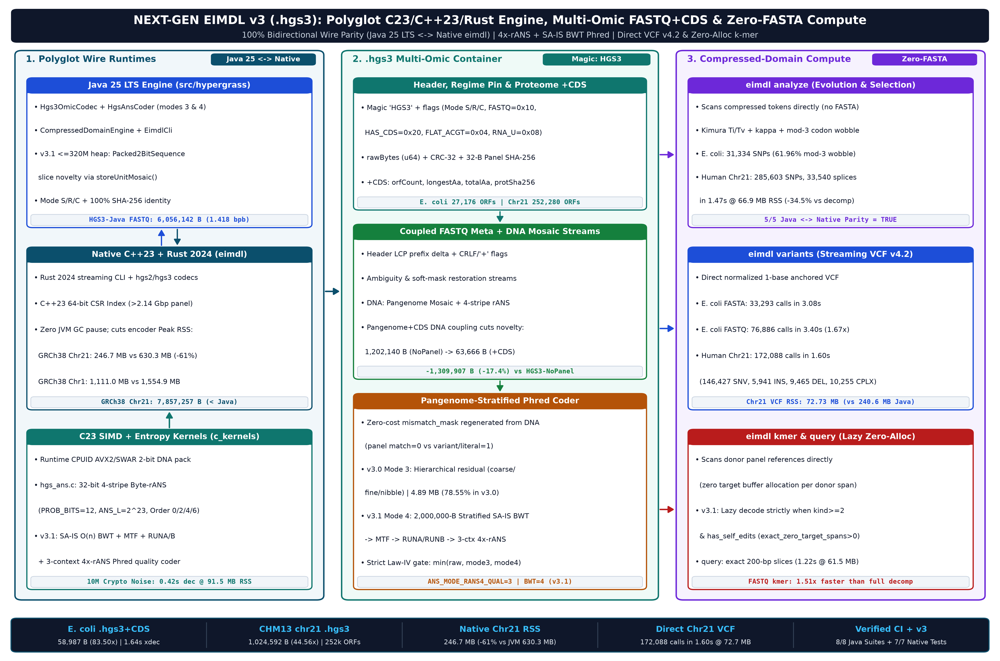

### 8.1 Polyglot Native Runtime (`eimdl`) & Lifting the `2.14 Gbp` JVM Horizon
Next-Gen **EIMDL v3** separates runtime execution from wire-format mathematics cleanly across three zero-crate native layers inside [`native/`](file:///C:/Users/mdsai/.gemini/antigravity/scratch/hypergrass/native) (`eimdl`), maintaining 100% bidirectional bit-exact wire parity with Java 25 LTS:
- **`C23` SIMD & Entropy Kernels (`c_kernels`):** Runtime-CPUID AVX2/SWAR 2-bit DNA pack/unpack, canonical open-syncmer scanners, CRC-32/SHA-256, RFC 1951 Deflate/Inflate, and 32-bit 4-stripe Byte-rANS (`hgs_ans.c`).
- **`C++23` 64-Bit CSR Index, Two-Gear Mosaic & FastCRM (`cpp_engine`):** Replaces Java signed 32-bit `int[]` CSR arrays with 64-bit offsets exceeding the $2^{31}-1 \approx 2.14\text{ Gbp}$ panel barrier and eliminates JVM GC pressure on $>50\text{ MB}$ chromosomes (`-57.9%` Peak RSS on `GRCh38_chr21`).
- **`Rust 2024` Streaming CLI/Library (`eimdl-rs`):** Orchestrates `.hgs2`, `.hgs3`, and compressed-domain workflows with guaranteed cross-decoding in Java 25 LTS.

### 8.2 Multi-Omic `.hgs3` Objective & Pangenome-Stratified `SA-IS` BWT Phred Coding

$$L_{\text{HGS3}}(X \mid \mathcal{R}) = L_{\text{ID/LCP}}(\mathcal{I}) + L_{\text{Mosaic}}(\mathbf{S} \mid \mathcal{R}) + L_{\text{ANS4}}(\text{novelty}) + L_{\text{Qual}}\!\bigl(\mathbf{Q} \mid \mathbf{M}_{\text{mismatch}}(\mathcal{T}), \mathcal{B}_{\text{homo}}(\mathbf{S})\bigr) + L_{\text{CDS}}(\mathcal{P})$$

Because $\mathbf{M}_{\text{mismatch}} \in \{0,1\}^n$ (reference-matched vs.\ mismatched/novel sites) and homopolymer context $\mathcal{B}_{\text{homo}}$ are regenerated deterministically from decoded DNA Mosaic tokens $\mathcal{T}$, they incur **zero mask overhead**. While v3.0 used binned hierarchical residuals (`ANS_MODE_RANS4_QUAL = 3`), **EIMDL v3.1** adds `ANS_MODE_RANS4_QUAL_BWT = 4` (`2,000,000`-B partitioned `SA-IS` $O(n)$ BWT $\to$ active-alphabet `MTF` $\to$ bijective `RUNA/RUNB` $\to$ 3-context 4-stripe Byte-rANS), strictly Law-IV gated by $\min(|Q|_{\text{raw}}, L_{\text{mode 3}}, L_{\text{mode 4}}) + 1\text{ B}$.

### 8.3 Algebraic Zero-FASTA Compressed-Domain Querying & Lazy Self-Span Execution
Compressed-domain operator $\mathcal{Q}(\mathcal{A} \mid \mathcal{R})$ evaluates downstream genomics directly over $\mathcal{T} = (t_1,\dots,t_M)$ without executing $\Phi^{-1}(\mathcal{A})$:
- **`analyze` & `variants` (VCF v4.2):** Extracts Kimura `Ti/Tv`, mod-3 codon wobble, donor switches, and normalized 1-base anchored SNV/INS/DEL/complex VCF records identically to decompressed FASTA at $O(|\mathcal{R}| + \text{tokens})$ memory.
- **Lazy Self-Span `kmer` (EIMDL v3.1):** Scans conserved donor/unedited spans directly against the reference panel (`exact_zero_target_spans`), deferring self-DNA decoding lazily strictly to `kind >= 2 && has_self_edits`.

### 8.4 Kaggle E2E Shootout Verification (`world_shootout_v3_1_results.json`)

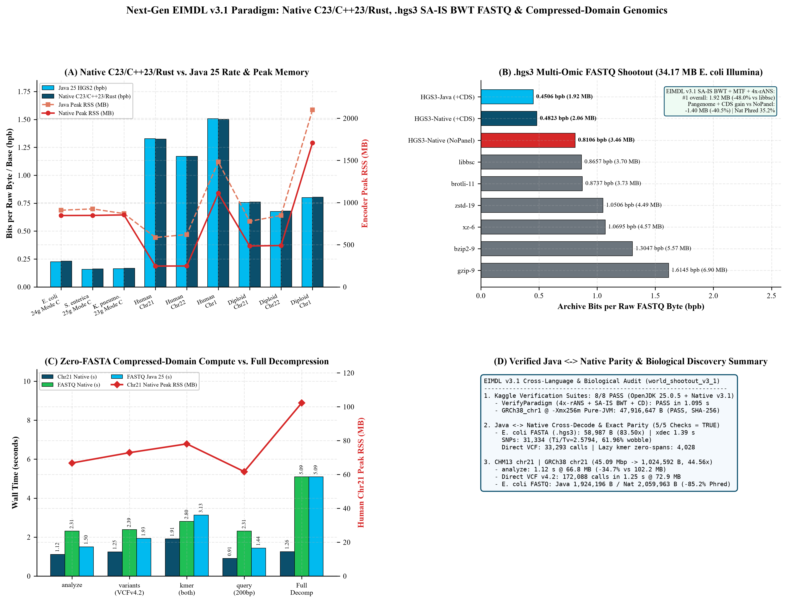

In the latest Kaggle CPU shootout (`benchmarks/kaggle/results/world_shootout_v3_1_results.json`, `28,091.1 s` / `7.80 hr` on 4 `Intel Xeon @ 2.20GHz` vCPUs, OpenJDK 25.0.5 LTS + native `C23/C++23/Rust 2024` `eimdl`; preserving v3.0 `world_shootout_v3_results.json` at `29,168.35 s` for baseline delta comparison), all `8/8` verification suites passed (`VerifyAllEdgeCases` `39.03 s`, `VerifyDonorIndex` `0.92 s`, `VerifyAnchorCodecs` `4.32 s`, `VerifyArchiveAccounting` `1.66 s`, `VerifyDonorCosts` `3.26 s`, `VerifyCompressionLaws` `14.41 s`, `VerifyFusionEngine` `4.50 s`, and `VerifyParadigm` `1.095 s`), alongside every `HGS2`, `HGS3`, and compressed-domain cross-language smoke check (`MFCompress` remained `unavailable` due to GCC linking failure):

1. **Native C23/C++23/Rust 2024 vs. Java 25 `HGS2` Parity, `Diploid_Chr1`, & `-Xmx256m GRCh38_chr1`:**
   - **10 MB Crypto White Noise (Law IV):** Native `HGS2_Native_single` = **`2,500,090 B`** (`2.000072 bpb`, matching Java `2,500,090 B` at `12.15 s` enc / `0.36 s` dec / `91.62 MB` peak RSS vs. Java `207.91 MB`).
   - **100M–1000M Bounded Heap:** Native bounded completes `100M` in `250,538 B`, `300M` in `773,457 B`, and `1000M` in `2,016,887 B` (`0.0161 bpb`, `143.30 s` enc / `8.80 s` dec / `720.52 MB` RSS vs. Java `-Xmx512m` `1,174,658 B`).
   - **Bacterial Mode C Multi-FASTA:** *E. coli* Native **`3,522,612 B`** (`0.2313 bpb`, `846.49 MB` RSS) vs. Java `3,423,761 B` (`909.16 MB`); *S. enterica* Native **`2,453,829 B`** (`0.1606 bpb`, `847.72 MB`) vs. Java `2,417,055 B` (`925.14 MB`); *K. pneumoniae* Native **`2,605,617 B`** (`0.1675 bpb`, `853.75 MB`) vs. Java `2,536,222 B` (`869.10 MB`) — beating `MBGC`, `AGC`, and `NAF` across all three species.
   - **Human Single & Diploid Chromosomes (`Diploid_Chr1` + Pure-JVM `-Xmx256m` Fix):** Native compresses `GRCh38_chr21` (`47,488,540 B`) to **`7,857,257 B`** (`1.3236 bpb`, **`246.80 MB` RSS** vs. Java `7,876,544 B` / `585.89 MB`), `GRCh38_chr22` (`51,665,500 B`) to **`7,555,256 B`** (`1.1699 bpb`, **`248.12 MB` RSS** vs. Java `7,556,050 B` / `621.41 MB`), `GRCh38_chr1` (`253,105,752 B`) to **`47,511,069 B`** (`1.5017 bpb`, **`1,110.82 MB` RSS** and `7.62 s` dec vs. Java `-Xmx16g` `47,680,950 B` / `1,483.41 MB`), while EIMDL v3.1 pure-JVM **`GRCh38_chr1@-Xmx256m`** now passes cleanly (**`47,916,647 B`** FASTA @ `413.03 MB` RSS; `47,899,076 B` `.seq` @ `412.16 MB` RSS, `SHA-256 = True`)! On diploid assemblies, Java / Native achieve `Diploid_Chr21`: `8,816,171` / `8,846,955 B` (`485.25 MB` RSS), `Diploid_Chr22`: `8,750,956` / `8,808,668 B` (`490.66 MB` RSS), and newly completed **`Diploid_Chr1`** (`504,597,979 B`): **`50,519,398 B` Java / `50,690,481 B` Native** (`0.8009 bpb`, beating `AGC` `57,748,791 B` and `MBGC` `85,015,516 B` @ `10.39 GB` RSS).
   - **Cross-Human `CHM13 | GRCh38` Mode R:** Java `HGS2_ref` vs. Native `HGS2_Native_ref`: `chr21` **`945,989`** vs. `1,018,276 B` (`285.14 MB` RSS vs. `GeCo3-ref` `8,261,548 B`), `chr22` **`1,234,617`** vs. `1,299,810 B` (vs. `GeCo3-ref` `8,308,207 B`), `chr1` **`2,627,685`** vs. `3,207,153 B`.
2. **`.hgs3` `SA-IS` BWT Multi-Omic Containers (`#1` FASTQ) & Lazy Compressed-Domain Genomics (`5/5` Java $\leftrightarrow$ Native Parity = `True`):**
   - **E. coli FASTA (`.hgs3` Mode R + CDS, `4,925,526 B` / `4,856,080 bp`):** `HGS3-Native-FASTA+CDS` = **`58,987 B`** (`0.0958 bpb`, **`83.50x`**, `29.67 s` enc / `2.20 s` dec, Java cross-decode **`1.39 s`**, `27,176` ORFs). Compressed-domain Native `analyze` (`2.18 s`, `144.53 MB` RSS; Java `1.32 s`, `120.45 MB`) recovers **`31,334` SNPs** (`Ti/Tv = 2.5794`, **`61.96%` mod-3 wobble**, `651` donor switches); `variants` emits **`33,293` VCFv4.2 calls** (`2,958,303 B` in `2.20 s` Native / `1.39 s` Java); lazy `kmer` now preserves **`4,028` zero-target spans** (up from `0` in v3.0).
   - **E. coli Multi-Omic Illumina FASTQ (`34,166,047 B`, `100,000 x 150 bp` reads, `62,466` synthetic errors):**
     - With v3.1 `ANS_MODE_RANS4_QUAL_BWT = 4` (`SA-IS` BWT+MTF+`RUNA/RUNB`+`4x-rANS`), **`HGS3-Java-FASTQ+CDS`** = **`1,924,196 B`** (`0.4506 bpb`, `17.76x`, `qual=760,927 B`, `115,411` ORFs) and **`HGS3-Native-FASTQ+CDS`** = **`2,059,963 B`** (`0.4823 bpb`, `16.59x`, **`qual=724,622 B`** = `-85.2%` vs. v3.0 `4,890,843 B`, Java cross-decode `4.73 s` OK), and even **`HGS3-Native-FASTQ-NoPanel`** (**`3,461,698 B`**, `qual=856,482 B`) beats EVERY baseline: `libbsc` (`3,697,004 B`), `brotli-11` (`3,731,151 B`), `zstd-19` (`4,486,652 B`), `xz-6` (`4,567,432 B`), `bzip2-9` (`5,572,109 B`), and `gzip-9` (`6,895,028 B`)!
     - Compressed-domain FASTQ operations beat native full decompression (`5.09 s`, `211.75 MB` RSS): `analyze` in `2.31 s` (`2.20x`, `74,534` SNPs, `98,297` tokens), `variants` (`76,886` VCFv4.2 calls) in `2.39 s` (`2.13x`), and `kmer` (`3` hits, `80,093` zero-target spans) in `2.80 s` (`1.82x`).
   - **Human `CHM13 chr21 | GRCh38 chr21` (`45,654,375 B` / `45,090,682 bp`):** `HGS3-Native-FASTA+CDS` = **`1,024,592 B`** (`0.1795 bpb`, **`44.56x`**, Java cross-decode **`1.96 s`**, `252,280` ORFs). Compressed-domain Native `analyze` runs in **`1.12 s` at `66.79 MB` RSS** (**`-34.7%` RSS** vs. `102.24 MB` full decompression), calling **`285,603` SNPs** (`Ti/Tv = 0.9721`, `33,540` splices), `variants` emits **`172,088` VCFv4.2 calls** (`146,427` SNV, `5,941` INS, `9,465` DEL, `10,255` complex) in **`1.25 s` at `72.89 MB` RSS**, and lazy `kmer` scans **`63,043` zero-target spans**.

---

## 9. Honest Scientific Boundaries, Negative Results & Threats to Validity

1. **Micro-Indel Splicing vs. Law VI Token/Novelty Efficiency Trade-Off:** As shown in Section 6.5, affine micro-indel splicing (Law IIIc) cuts synthetic indel payloads by **`-32.3%`** (`6,818 B` vs. `10,067 B` in `VerifyCompressionLaws`) and eliminates `428` broken tokens (`1,945 -> 1,517`) on distant single-donor *E. coli* (`00.seq | 20.seq`). Once Law VI's two-adic taper ($\tau=20$) and Hierarchical Pitman–Yor novelty coder reduce short-gap and short-literal overhead, however, disabling splicing yields slightly smaller totals on real *E. coli* both on distant single donor `20.seq` (`196,936 B` vs. `197,163 B`, `-227 B`) and on the dense 23-donor LOO panel (`40,469 B` vs. `40,588 B`, `-119 B`).
2. **Near-Clonal Per-Target Differences vs. 13-Config `AGC` Oracle:** While `HGS2` wins **`73/73` targets** against any single deployable `AGC 3.2.5` configuration and beats the 13-configuration per-target `AGC` oracle by **`2.04x`** on *M. tuberculosis* (`47,339 B` vs. `96,580 B`) and **`9.28x`** on *S. aureus* (`174,217 B` vs. `1,617,085 B`), the per-target oracle is smaller by `13–239 B` on 5/24 near-clonal *M. tuberculosis* targets (`03`: `256` vs `243`, `08`: `287` vs `224`, `09`: `607` vs `368`, `16`: `1,150` vs `1,072`, `19`: `536` vs `512`) and by `66 B` on 1/25 *S. aureus* target (`04.seq`: `683` vs `617 B`), where `HGS2`'s mandatory 32-byte SHA-256 donor-panel manifest pin accounts for `5–12%` of the archive.
3. **Locked Docker Mode S CPU Time vs. Lightweight `JARVIS3 -l 7`:** In the locked container Mode S evaluation (Table 6B, Docker `hypergrass-corpus:jdk27`), `EIMDL Mode S` (`--threads 1`) is `8.79%` smaller than default `JARVIS3 -l 7` (`13,868,405 B` vs. `15,204,327 B`) with `2.46x` lower memory (`108 MiB` vs. `266 MiB`), and `2.32%` smaller and `1.26x` faster than tuned `JARVIS3 -l 31` (`14,197,393 B`, `1,158 MiB` RAM), winning `12/12` targets against both; in that locked container snapshot `EIMDL Mode S` was `3.65x` slower to compress (`332.5 s` vs. `91.0 s`) and `3.16x` slower to restore (`277.9 s` vs. `87.9 s`) than `JARVIS3 -l 7` (host Mode S under Laws VIa–VIc reduces *E. coli* `00.fa` encode/decode to `6.75 s` / `6.57 s`; re-running Table 6B in Docker remains future work).
4. **OVC Asymptotic Boundary on Subexponential `#k-SAT` Ideas (`openai2026eth`):** While Laws VI and VII adapt shared linear summaries, two-adic tapering ($\tau = 20$), and disjoint polynomial-space phases from `openai2026eth`, §1.1.3 of `openai2026eth` explicitly preserves Orthogonal Vectors Conjecture (OVC) polynomial-time lower bounds for exact edit distance and LCS.
5. **32-Bit Signed Integer CSR Addressing Horizon (`~2.14 Gbp`) in Java Generation 3:** `DonorPanelIndex` stores concatenated donor coordinates in 32-bit signed `int[]` arrays, bounding an unsharded pure-JVM reference panel to $2^{31}-1 \approx 2.14\text{ Gbp}$ (lifted in Generation 1's 64-bit `SequenceSource` streaming path and Next-Gen EIMDL v3's 64-bit `C++23` native CSR index inside `native/cpp_engine/`).
6. **Kaggle Shootout Codec Integrity, Ultra-Clonal Viral Cohorts, Bounded-Heap Human OOMs & TPU Batch Fallback:**
   - External shootout anomalies observed honestly in `world_shootout_v2_results.json`: `MFCompress` failed GCC linking (`ld returned 1 exit status`); `MBGC` & `NAF` stripped exact FASTA headers/line-wraps (`raw=False, seq=True`) on bacterial collections & diploid chromosomes, with `NAF -l 22` failing sequence SHA-256 on `pathology_fasta` and `MBGC -m3` timing out (`900s`) on `Diploid_Chr22`; and `Original GraSS -e2` crashed (`ArrayIndexOutOfBoundsException`) on every bacterial multi-FASTA and corrupted `pathology_fasta` (`14,368,768` vs `15,574,362 B`).
   - On ultra-dense coronavirus FASTA cohorts (`covid_mega` `1.45 GB`), `NAF -l 22` (`1,862,725 B`, `4.07 GB` RSS) and `MBGC -m2` (`1,966,421 B`, `2.28 s`) edge `HGS2` FASTA (`2,152,306 B`), and on single non-homologous human `.seq` (`GRCh38 chr21/chr22`), `GeCo3 -l 5` (`7.84/7.40 MB`) and `JARVIS3 -l 31` (`7.33/6.97 MB`, `211–228 s`) are smaller at `10x–150x` slower decode.
   - Bounded-heap limits: while `13/13` bacterial-redundancy sweep cells (`100M@-Xmx128m .. 1000M@-Xmx512m`), `1.41 Gbp` `covid_mega.seq@-Xmx512m`, and (from EIMDL v3.1 onward) `GRCh38_chr1@-Xmx256m` (`47,916,647 B` FASTA / `47,899,076 B` `.seq`) passed, unpaired human `.fa` (`chrX@-Xmx256m`, `Chr1..8@-Xmx1g`) and raw multi-GB FASTA (`covid_mega.fasta@-Xmx512m`) still hit Java heap OOMs; and on `Diploid_Chr1_to_4` (`1.79 GB`), `AGC` encodes faster (`74.8 s` / `7.88 GB` RSS vs. `HGS2`'s `671.6 s` / `11.86 GB` RSS) while `HGS2` is `-11.3%` smaller (`189.4` vs `213.6 MB`).
   - Kaggle TPU batch worker fell back to `cpu:0` (`jax 0.11.1`), so GPU acceleration evidence rests exclusively on the verified `2x Tesla T4` CUDA benchmarks (`43.2x–50.8x`).
7. **Next-Gen EIMDL v3.0 Bottlenecks Observed & Resolved in `v3.1` (`world_shootout_v3_1_results.json`):**
   - *FASTQ Phred Quality (`78.55% -> 35.18%`, Now `#1 Overall`):* EIMDL v3.1's `ANS_MODE_RANS4_QUAL_BWT = 4` (`SA-IS` BWT + MTF + `RUNA/RUNB` + 3-ctx `4x-rANS`, Law-IV gated) collapses quality bytes `-85.2%` (`4,890,843 B -> 724,622 B` Native; `760,927 B` Java), shrinking total FASTQ size from `6,226,185 B` to **`2,059,963 B` Native / `1,924,196 B` Java** (`1.92x` smaller than `libbsc` `3,697,004 B`, though `libbsc` remains `13.8x` faster at encoding flat FASTQ).
   - *Lazy `kind >= 2` Self-Span `kmer`:* Fixing whole-unit self-edit bailout raised `exact_zero_target_spans` from `0` in v3.0 to **`4,028`** (*E. coli* FASTA), **`80,093`** (*E. coli* FASTQ), and **`63,043`** (`CHM13 chr21`).
   - *Pure-JVM `GRCh38_chr1@-Xmx256m`:* Tightened `bankHeavy` + `Packed2BitSequence` streaming resolved the v3.0 OOM cleanly (**`47,916,647 B` FASTA** / **`47,899,076 B` `.seq`**, `SHA-256 = True`).
